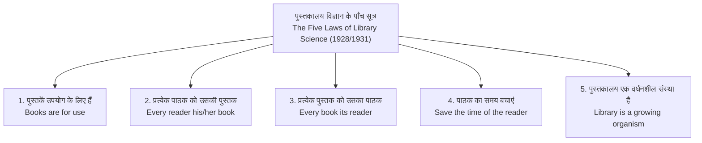

# इकाई 1 — पुस्तकालय की नींव एवं समाज (Foundations of Library Science)

## उप-इकाई 1.2: डॉ. एस.आर. रंगनाथन की जीवनी, योगदान एवं पुस्तकालय विज्ञान के पाँच सूत्र  
*(SubUnit 1.2: Biography of Dr. S.R. Ranganathan, Contributions and Five Laws of Library Science)*

> **द्विभाषी विस्तृत अध्ययन सामग्री | Bilingual In-depth Study Notes (Hindi & English)**  
> लक्ष्य: बिहार विद्यालय पुस्तकालयाध्यक्ष पात्रता परीक्षा 2026 (Bihar School Librarian Eligibility Test 2026)

---

### भाग 1: डॉ. एस.आर. रंगनाथन — संक्षिप्त जीवन परिचय एवं पृष्ठभूमि (Biography & Background)

| विवरण (Attribute) | तथ्य (Hindi) | Facts (English) |
| :--- | :--- | :--- |
| **पूरा नाम (Full Name)** | शियाली रामामृत रंगनाथन (एस.आर. रंगनाथन) | Shiyali Ramamrita Ranganathan |
| **जन्म तिथि (Date of Birth)** | 9 अगस्त 1892 (आधिकारिक दस्तावेजों में 12 अगस्त 1892) | 9 August 1892 (Officially recorded: 12 August 1892) |
| **जन्म स्थान (Birthplace)** | शियाली (सीरकाझी), तंजावुर जिला, मद्रास प्रेसीडेंसी (तमिलनाडु) | Shiyali (Sirkazhi), Thanjavur District, Tamil Nadu |
| **माता-पिता (Parents)** | पिता: रामामृत अय्यर, माता: सीतालक्ष्मी | Father: Ramamrita Ayyar, Mother: Seethalakshmi |
| **मृत्यु (Date of Demise)** | 27 सितंबर 1972 (बेंगलुरु, कर्नाटक) | 27 September 1972 (Bangalore, Karnataka) |
| **मूल शिक्षा (Education)** | गणित में एम.ए. (1916), मद्रास क्रिश्चियन कॉलेज | M.A. in Mathematics (1916), Madras Christian College |
| **आदरणीय गुरु (Beloved Mentor)** | प्रो. एडवर्ड बी. रॉस (गणित प्राध्यापक) | Prof. Edward B. Ross (Professor of Mathematics) |
| **पुस्तकालय गुरु (Library Mentor)** | डब्ल्यू.सी. बेरविक सायर्स (क्रॉयडन पब्लिक लाइब्रेरी, यूके) | W.C. Berwick Sayers (University College London / Croydon) |
| **उपाधियां (Honorary Titles)** | राव साहब (1935), पद्मश्री (1957), राष्ट्रीय शोध प्राध्यापक (1965) | Rao Sahib (1935), Padma Shri (1957), National Research Professor (1965) |

---

### भाग 2: शैक्षणिक एवं व्यावसायिक यात्रा (Professional Career Timeline)

1. **गणित प्राध्यापक (1917–1923):**
   * डॉ. रंगनाथन ने अपने करियर की शुरुआत राजकीय कॉलेज मंगलूर, कोयंबटूर और प्रेसीडेंसी कॉलेज मद्रास में गणित के प्राध्यापक (Lecturer in Mathematics) के रूप में की थी।
2. **मद्रास विश्वविद्यालय के प्रथम पुस्तकालयाध्यक्ष (1924–1944):**
   * जनवरी 1924 में वे मद्रास विश्वविद्यालय पुस्तकालय के प्रथम पूर्णकालिक पुस्तकालयाध्यक्ष नियुक्त हुए।
   * सितंबर 1924 से जुलाई 1925 तक वे पुस्तकालय विज्ञान में उच्च प्रशिक्षण हेतु यूनिवर्सिटी कॉलेज लंदन (School of Librarianship) भेजे गए, जहाँ उन्होंने **डब्ल्यू.सी. बेरविक सायर्स (W.C. Berwick Sayers)** के सानिध्य में अध्ययन किया।
3. **मद्रास पुस्तकालय संघ (MALA - Madras Library Association, 1928):**
   * 31 जनवरी 1928 को डॉ. रंगनाथन और के.वी. कृष्णस्वामी अय्यर ने MALA की स्थापना की। इसी संघ ने रंगनाथन की बहुचर्चित पुस्तकों का प्रकाशन किया।
4. **बनारस हिंदू विश्वविद्यालय (BHU, 1945–1947):**
   * पंडित मदन मोहन मालवीय और डॉ. सर्वपल्ली राधाकृष्णन के निमंत्रण पर वे BHU के लाइब्रेरियन और पुस्तकालय विज्ञान के प्रोफेसर रहे।
5. **दिल्ली विश्वविद्यालय (Delhi University, 1947–1955):**
   * तत्कालीन कुलपति **सर मॉरिस ग्वायर (Sir Maurice Gwyer)** के आमंत्रण पर दिल्ली विश्वविद्यालय में पुस्तकालय विज्ञान विभाग की स्थापना की।
   * **ऐतिहासिक मील का पत्थर:** दिल्ली विश्वविद्यालय में 1948 में डिप्लोमा, 1949 में देश का पहला मास्टर डिग्री कोर्स (**M.Lib.Sc.**) और 1951 में **Ph.D. कार्यक्रम** शुरू किया।
   * **भारत एवं राष्ट्रमंडल (Commonwealth) की प्रथम Ph.D.:** वर्ष **1957** में डॉ. रंगनाथन के मार्गदर्शन में **डॉ. डी.बी. कृष्ण राव (Dr. D.B. Krishna Rao)** को भारत में पुस्तकालय विज्ञान की पहली डॉक्टरेट उपाधि प्रदान की गई (शोध विषय: *"Facet Analysis and Depth Classification of Agriculture"*).
6. **DRTC, बेंगलुरु (Documentation Research and Training Centre, 1962):**
   * जनवरी **1962** में डॉ. रंगनाथन ने प्रख्यात सांख्यिकीविद् प्रो. पी.सी. महालनोबिस के सहयोग से भारतीय सांख्यिकी संस्थान (ISI) के तत्वावधान में बेंगलुरु में **DRTC** की स्थापना की। वे जीवनपर्यंत इसके मानद निदेशक रहे।
7. **राष्ट्रीय शोध प्राध्यापक (National Research Professor, 1965):**
   * भारत सरकार ने वर्ष 1965 में डॉ. रंगनाथन को पुस्तकालय विज्ञान में भारत का प्रथम (और एकमात्र) 'राष्ट्रीय शोध प्राध्यापक' नियुक्त किया।
8. **राष्ट्रीय पुस्तकालयाध्यक्ष दिवस (National Librarian's Day):**
   * उनके आधिकारिक जन्मदिवस **12 अगस्त** को संपूर्ण भारत में प्रतिवर्ष 'राष्ट्रीय पुस्तकालयाध्यक्ष दिवस' के रूप में श्रद्धापूर्वक मनाया जाता है।

---

### भाग 3: डॉ. रंगनाथन की कालजयी कृतियां (Major Published Treatises)

| वर्ष (Year) | पुस्तक का नाम (Book Title) | मुख्य विशेषता (Key Significance) |
| :---: | :--- | :--- |
| **1931** | **The Five Laws of Library Science** | पुस्तकालय विज्ञान के आधारभूत पाँच सूत्रों का प्रथम बार पुस्तक रूप में प्रकाशन (प्रस्तावना: Sir P.S. Sivaswami Ayyar, भूमिका: W.C. Berwick Sayers)। |
| **1933** | **Colon Classification (CC)** | पक्षात्मक वर्गीकरण पद्धति (Analytico-Synthetic Classification) का 1st Edition; इसमें PMEST और फेसेट एनालिसिस का सिद्धांत आया। |
| **1934** | **Classified Catalogue Code (CCC)** | भारत का प्रथम पूर्ण वैज्ञानिक सूचीकरण कोड (1st ed.; 5वां संस्करण 1964 में ए. नीलमघन के सहयोग से)। |
| **1937** | **Prolegomena to Library Classification** | पुस्तकालय वर्गीकरण के दार्शनिक सिद्धांतों और कैनन्स (Canons) का महाग्रंथ (2nd ed. 1957, 3rd ed. 1967)। |
| **1938** | **Theory of Library Catalogue** | सूचीकरण के कैनन्स (Canons of Cataloguing) का प्रतिपादन। |
| **1940** | **Reference Service and Bibliography** | के.एम. शिवारामन के सहयोग से संदर्भ सेवा पर लिखित मौलिक ग्रंथ। |
| **1951** | **Library Development Plan** | भारत में पुस्तकालय तंत्र के विकास हेतु 30-वर्षीय राष्ट्रीय रूपरेखा। |
| **1953** | **Dictionary Catalogue Code** | शब्दकोशीय सूची हेतु मानक नियमों का संकलन। |
| **1961** | **Reference Service** | संदर्भ सेवा का स्वतंत्र एवं व्यावहारिक सिद्धांत (Ready vs. Long Range Reference Service)। |
| **1973** | **Documentation: Genesis and Development** | मरणोपरांत प्रकाशित प्रलेखन एवं सूचना विज्ञान पर शोध ग्रंथ। |
| **1992** | **A Librarian Looks Back** | डॉ. रंगनाथन की आत्मकथा (पी.एन. कौला द्वारा संपादित एवं प्रकाशित)। |

---

### भाग 4: पुस्तकालय विज्ञान के पाँच सूत्र — गहन एवं व्यावहारिक विश्लेषण  
*(The Five Laws of Library Science: In-depth & Practical Analysis)*

डॉ. रंगनाथन ने इन पाँच सूत्रों का सर्वप्रथम प्रतिपादन **1928** में मीनाक्षी कॉलेज, अन्नामलाईनगर में किया था। 1931 में मद्रास लाइब्रेरी एसोसिएशन द्वारा इसे पुस्तक रूप में प्रकाशित किया गया।

---

#### 1. प्रथम सूत्र: पुस्तकें उपयोग के लिए हैं (Books Are For Use)
* **मूल दर्शन (Philosophical Shift):**  
  मध्यकाल में पुस्तकें "सुरक्षा एवं परिरक्षण" (Preservation and Chaining) के लिए थीं। प्रथम सूत्र ने इसे क्रांति में बदलते हुए कहा कि पुस्तकें तिजोरी में बंद रखने के लिए नहीं बल्कि **अधिकतम उपयोग (Maximum Utilization)** के लिए हैं।
* **निहितार्थ एवं अनुप्रयोग (Implications & Applications):**
  1. **पुस्तकालय की स्थिति (Library Location):** पुस्तकालय नगर या संस्थान के केंद्र में स्थित होना चाहिए, ताकि पाठक आसानी से पहुँच सकें।
  2. **कार्य के घंटे (Library Hours):** पुस्तकालय देर शाम, सप्ताहांत और अवकाश के दिनों में भी खुला रहना चाहिए।
  3. **पुस्तकालय भवन एवं उपस्कर (Building & Ergonomic Furniture):** आरामदायक कुर्सियां, पर्याप्त प्रकाश, शुद्ध वायु तथा किताबों की अलमारियों की ऊंचाई ऐसी हो कि पाठक बिना सीढ़ी के सामान्य हाथ बढ़ाकर पुस्तकें निकाल सकें।
  4. **पुस्तक चयन नीति (Book Selection):** केवल दुर्लभता के आधार पर नहीं, बल्कि उपयोगकर्ताओं की वास्तविक मांग और उपयोगिता के आधार पर पुस्तकें खरीदी जाएं।
  5. **कर्मचारियों का व्यवहार (Staff Attitude):** पुस्तकालय कर्मचारी विनम्र, सेवाभावी और मार्गदर्शक होने चाहिए, न कि पुस्तकों के कठोर चौकीदार।
  6. **मुक्त प्रवेश प्रणाली (Open Access System):** पाठकों को सीधे अलमारियों तक जाने की छूट मिले।

---

#### 2. द्वितीय सूत्र: प्रत्येक पाठक को उसकी पुस्तक (Every Reader His/Her Book)
* **मूल दर्शन (Democratization of Knowledge):**  
  यह सूत्र **"सभी के लिए पुस्तकें" (Books for All)** का सिद्धांत देता है। यह उपयोगकर्ता (Reader) के दृष्टिकोण पर केंद्रित है। समाज के प्रत्येक वर्ग—चाहे वह अमीर हो या गरीब, सामान्य हो या दिव्यांग, साक्षर हो या नवसाक्षर—को उसकी रुचि और बौद्धिक स्तर की पुस्तक मिलनी चाहिए।
* **चार प्रमुख हितधारकों के वैधानिक दायित्व (Obligations of Four Stakeholders):**
  1. **राज्य का दायित्व (Obligations of the State):**  
     * सार्वजनिक पुस्तकालय कानून (Library Legislation) पारित करना।
     * पुस्तकालय उपकर (Cess) या वित्तीय अनुदान द्वारा निरंतर वित्तपोषण की व्यवस्था करना।
     * पुस्तकालयों का एक राज्यव्यापी एवं राष्ट्रव्यापी नेटवर्क स्थापित करना।
  2. **पुस्तकालय प्राधिकार का दायित्व (Obligations of Library Authority):**  
     * स्थानीय समुदाय की आवश्यकताओं के अनुरूप पुस्तकों का चयन करना।
     * योग्य एवं सेवाभावी पेशेवर कर्मचारियों की नियुक्ति करना।
  3. **पुस्तकालय कर्मचारियों का दायित्व (Obligations of Library Staff):**  
     * पाठकों की रुचि को समझना और व्यक्तिगत संदर्भ सेवा (Reference Service) प्रदान करना।
  4. **पाठकों का दायित्व (Obligations of Readers):**  
     * पुस्तकों को नुकसान न पहुंचाना, समय पर लौटाना और पुस्तकालय नियमों का अनुपालन करना।
* **विशिष्ट समूहों की सेवा (Serving Marginalized Groups):**  
  दृष्टिबाधितों हेतु ब्रेल साहित्य, कैदियों हेतु जेल पुस्तकालय, मरीजों हेतु अस्पताल पुस्तकालय, और नवसाक्षरों हेतु सरल चित्रमय साहित्य उपलब्ध कराना द्वितीय सूत्र की प्रत्यक्ष मांग है।

---

#### 3. तृतीय सूत्र: प्रत्येक पुस्तक को उसका पाठक (Every Book Its Reader)
* **मूल दर्शन (Book's Perspective):**  
  द्वितीय सूत्र पाठक का पक्ष लेता है, जबकि तृतीय सूत्र **पुस्तक (The Book)** का पक्ष लेता है। इसका उद्देश्य है कि पुस्तकालय में खरीदी गई कोई भी पुस्तक अलमारी में धूल न फांकती रहे; प्रत्येक पुस्तक को उसका उपयुक्त पाठक मिलना ही चाहिए।
* **निहितार्थ एवं अनुप्रयोग (Implications & Practical Measures):**
  1. **मुक्त प्रवेश प्रणाली (Open Access System):** यह तृतीय सूत्र का सबसे शक्तिशाली साधन है। खुली अलमारियों के सामने पाठक अचानक उन पुस्तकों से भी रू-ब-रू हो जाता है जिनकी उसने कल्पना भी नहीं की थी (**Serendipitous Discovery**)।
  2. **वर्गीकृत शेल्फ व्यवस्था (Classified Shelf Arrangement):** पुस्तकों को विषयवार तार्किक क्रम में सजाना, ताकि एक विषय की सभी पुस्तकें एक साथ मिलें।
  3. **विश्लेषणात्मक सूची प्रविष्टियां (Analytical Entries & Cross References):** किसी समग्र पुस्तक में छुपे हुए अध्यायों और विशिष्ट निबंधों के लिए क्रॉस-रेफरेंस इंडेक्स प्रविष्टियां (CR档案) तैयार करना।
  4. **नवीन आगमन प्रदर्शन (Display of New Arrivals):** नव-अधिग्रहीत पुस्तकों को प्रवेश द्वार या शोकेस में प्रदर्शित करना।
  5. **पुस्तकालय विस्तार सेवाएं (Library Extension Services):** पुस्तक प्रदर्शनियां, पुस्तक वार्ता (Book Talks), वाचन मंडल, और सार्वजनिक व्याख्यान आयोजित करना ताकि सुप्त पुस्तकों की ओर पाठकों का ध्यान आकर्षित हो।

---

#### 4. चतुर्थ सूत्र: पाठक का समय बचाएं (Save the Time of the Reader)
* **मूल दर्शन (Efficiency & Reader Satisfaction):**  
  पाठक का समय अमूल्य है। पुस्तकालय की प्रत्येक प्रशासनिक और तकनीकी प्रक्रिया ऐसी होनी चाहिए कि पाठक को न्यूनतम समय में वांछित सूचना प्राप्त हो सके।
* **निहितार्थ एवं पद्धतियां (Implications & Techniques):**
  1. **त्वरित परिसंचरण पद्धतियां (Efficient Circulation Methods):**  
     * पारंपरिक रजिस्टर प्रणाली (Ledger System) के स्थान पर कार्ड-आधारित पद्धतियां लागू करना।
     * **ब्राउन प्रणाली (Browne System, 1895)** और **नेवार्क प्रणाली (Newark System, 1900)** जैसी दो-कार्ड पद्धतियों का उपयोग, जिससे पुस्तक निर्गम-वापसी सेकंडों में हो सके।
  2. **मुक्त प्रवेश (Open Access):** बंद प्रणाली (Closed Access) में पाठक पर्ची लिखकर घंटों इंतजार करता था; मुक्त प्रवेश समय बचाता है।
  3. **केंद्रीकृत एवं पूर्व-प्रसूति सूचीकरण (Centralized & Pre-natal Cataloguing):** पुस्तक प्रकाशन के समय ही सूचीकरण कर लेना ताकि अधिग्रहण के बाद प्रसंस्करण में महीनों का विलंब न हो।
  4. **संदर्भ सेवा (Reference Service):** कुशल संदर्भ पुस्तकालयाध्यक्ष पाठक का मार्गदर्शन कर घंटों की खोज को मिनटों में बदल देता है।
  5. **मार्गदर्शन पट्टिकाएं (Signboards and Shelf Guides):** प्रवेश द्वार पर नक्शा, प्रत्येक कतार पर विषय पट्टिका (Bay Guide) और शेल्फ गाइड लगाना।
  6. **पुस्तकालय स्वचालन (Library Automation & OPAC):** बारकोड, RFID और ऑनलाइन कैटलॉग द्वारा त्वरित खोज।
* **सहायक सूत्र (Ranganathan's Corollary):** *"Save the time of the staff"* — कर्मचारियों के समय की बचत के लिए रंगनाथन ने 'तीन-कार्ड प्रणाली' (Three-Card System for periodicals) का आविष्कार किया।

---

#### 5. पंचम सूत्र: पुस्तकालय एक वर्धनशील संस्था है (The Library Is a Growing Organism)
* **मूल दर्शन (Biological Analogy):**  
  पुस्तकालय एक जीवित जीव (Living Organism) के समान है। एक जीवित जीव कभी स्थिर नहीं रहता; वह या तो बढ़ता है या फिर उसका ह्रास होता है।
* **दो प्रकार की वृद्धि (Two Types of Biological Growth):**
  1. **बालक वृद्धि (Child Growth):** प्रारंभिक अवस्था में पुस्तकालय का आकार, अलमारियां, पाठक, कर्मचारी और भवन का भौतिक विस्तार बहुत तीव्र गति से बढ़ता है (Growth in Bulk & Volume)।
  2. **प्रौढ़ वृद्धि (Adult Growth):** परिपक्व होने पर भौतिक स्थान असीमित नहीं बढ़ सकता; तब पुरानी और मृत कोशिकाओं का स्थान नई कोशिकाएं लेती हैं। यह आंतरिक, गुणात्मक और संरचनात्मक विकास है (Replacement of parts & qualitative enrichment)।
* **अति-महत्वपूर्ण निहितार्थ (Critical Implications):**
  1. **पुस्तक निरसन / छंटाई (Weeding Out of Obsolete Books):**  
     * जिस प्रकार मानव शरीर से मृत कोशिकाएं बाहर निकलती हैं, उसी प्रकार पुस्तकालय के स्वास्थ्य के लिए जीर्ण-शीर्ण, अप्रासंगिक और अप्रचलित पुस्तकों को संग्रह से हटाना (Weeding) पंचम सूत्र की अनिवार्य मांग है।
  2. **लचीली वर्गीकरण एवं सूचीकरण पद्धति (Flexible Classification & Cataloguing):**  
     * नए विषयों के समावेश के लिए वर्गीकरण में दशमलव (DDC) या कोलन (CC) जैसी ओपन-एंडेड अंकन प्रणाली का होना।
     * **कार्ड कैटलॉग (Card Catalogue) एवं OPAC:** मुद्रित पुस्तक रूपी कैटलॉग स्थिर होता है और पंचम सूत्र के विरुद्ध है; जबकि 5"×3" इंच के मानक कार्ड और डिजिटल डेटाबेस में नए रिकॉर्ड असीमित जोड़े जा सकते हैं।
  3. **भविष्योन्मुखी भवन निर्माण (Modular Building Architecture):**  
     * पुस्तकालय भवन का निर्माण ऐसा होना चाहिए कि भविष्य में 20–30 वर्षों तक संग्रह और पाठकों की वृद्धि के अनुसार दीवारों और तलों का विस्तार किया जा सके।

---

### भाग 5: अन्य विचारकों द्वारा पाँच सूत्रों के आधुनिक विस्तार (Modern Adaptations)

#### 1. माइकल गोरमैन के पाँच नए सूत्र (Michael Gorman's Five New Laws of Librarianship, 1998):
1. पुस्तकालय मानवता की सेवा करते हैं। (*Libraries serve humanity.*)
2. ज्ञान संप्रेषण के सभी रूपों का सम्मान करें। (*Respect all forms by which knowledge is communicated.*)
3. सेवा संवर्धन हेतु प्रौद्योगिकी का बुद्धिमत्तापूर्ण उपयोग करें। (*Use technology intelligently to enhance service.*)
4. ज्ञान तक स्वतंत्र पहुंच की रक्षा करें। (*Protect free access to knowledge.*)
5. अतीत का सम्मान करें और भविष्य का निर्माण करें। (*Honor the past and create the future.*)

#### 2. अलीरेज़ा नोरूजी के वेब के पाँच सूत्र (Alireza Noruzi's Five Laws of the Web, 2004):
1. वेब संसाधन उपयोग के लिए हैं। (*Web resources are for use.*)
2. प्रत्येक प्रयोक्ता को उसका वेब संसाधन मिले। (*Every user his/her web resource.*)
3. प्रत्येक वेब संसाधन को उसका प्रयोक्ता मिले। (*Every web resource its user.*)
4. प्रयोक्ता का समय बचाएं। (*Save the time of the user.*)
5. वेब एक वर्धनशील संस्था/तंत्र है। (*The Web is a growing organism.*)

---

### भाग 6: परीक्षा के लिए मास्टर तुलनात्मक सारणी (Master Comparative Matrix)

| सूत्र (Law) | केंद्रीय आदर्श वाक्य (Motto) | दृष्टिकोण (Focus Point) | सबसे प्रमुख व्यावहारिक अनुप्रयोग (Key Practical Applications) |
| :--- | :--- | :--- | :--- |
| **प्रथम सूत्र (First Law)** | उपयोगिता (Utility) | पुस्तक का उपयोग | उपयुक्त स्थान, सुविधाजनक समय, सुलभ फर्नीचर, विनम्र कर्मचारी |
| **द्वितीय सूत्र (Second Law)** | सार्वभौमिकता (Democratization) | पाठक का अधिकार (Reader) | पुस्तकालय कानून (Legislation), उपकर (Cess), ब्रेल/जेल पुस्तकालय |
| **तृतीय सूत्र (Third Law)** | दृश्यता एवं प्रसार (Visibility) | पुस्तक का पाठक (Book) | मुक्त प्रवेश (Open Access), वर्गीकृत शेल्फ, पुस्तक प्रदर्शनी, विस्तार सेवा |
| **चतुर्थ सूत्र (Fourth Law)** | दक्षता एवं गति (Efficiency) | पाठक का समय (Time) | ब्राउन/नेवार्क चार्जिंग, OPAC, संदर्भ सेवा, शेल्फ गाइड |
| **पंचम सूत्र (Fifth Law)** | विकास एवं नवीनीकरण (Evolution) | संस्था का स्वरूप (Organism) | पुस्तक निरसन (Weeding Out), कार्ड कैटलॉग, भविष्योन्मुखी मॉड्यूलर भवन |

---

### भाग 7: Exam POV उच्च-प्राथमिकता वन-लाइनर्स (15 High-Yield Facts)

1. **पाँच सूत्रों का प्रथम प्रतिपादन कब और कहाँ हुआ?** — वर्ष **1928** में, मीनाक्षी कॉलेज, अन्नामलाईनगर में।
2. **The Five Laws of Library Science पुस्तक कब प्रकाशित हुई?** — वर्ष **1931** में, मद्रास लाइब्रेरी एसोसिएशन (MALA) द्वारा।
3. **इस पुस्तक की प्रस्तावना (Foreword) और भूमिका (Introduction) किसने लिखी?** — प्रस्तावना: **सर पी.एस. शिवस्वामी अय्यर**; भूमिका: **डब्ल्यू.सी. बेरविक सायर्स**।
4. **राष्ट्रीय पुस्तकालयाध्यक्ष दिवस (National Librarian's Day) कब मनाया जाता है?** — प्रतिवर्ष **12 अगस्त** को।
5. **भारत में पुस्तकालय विज्ञान की प्रथम Ph.D. उपाधि किसे और कब मिली?** — **डॉ. डी.बी. कृष्ण राव** को **1957** में (दिल्ली विश्वविद्यालय, निर्देशक: डॉ. रंगनाथन)।
6. **DRTC (बेंगलुरु) की स्थापना किस वर्ष हुई?** — जनवरी **1962** में (प्रो. पी.सी. महालनोबिस के सहयोग से)।
7. **डॉ. रंगनाथन को भारत सरकार द्वारा पद्मश्री किस वर्ष प्रदान किया गया?** — वर्ष **1957** में।
8. **डॉ. रंगनाथन को राष्ट्रीय शोध प्राध्यापक (National Research Professor) कब नियुक्त किया गया?** — वर्ष **1965** में।
9. **पुस्तकालय कानून (Library Legislation) और उपकर (Cess) की मांग किस सूत्र से संबंधित है?** — **द्वितीय सूत्र (Second Law)** से।
10. **मुक्त प्रवेश प्रणाली (Open Access System) को सबसे अधिक समर्थन कौन-से सूत्र देते हैं?** — **तृतीय सूत्र** (मुख्यतः) एवं **प्रथम व चतुर्थ सूत्र**।
11. **ब्राउन और नेवार्क जैसी त्वरित चार्जिंग पद्धतियां किस सूत्र की संतुष्टि करती हैं?** — **चतुर्थ सूत्र (Save the time of the reader)**।
12. **पुस्तकों की छंटाई / निरसन (Weeding Out) किस सूत्र का अनिवार्य परिणाम है?** — **पंचम सूत्र (Library is a growing organism)**।
13. **बालक वृद्धि और प्रौढ़ वृद्धि (Child Growth vs. Adult Growth) की अवधारणा किस सूत्र में है?** — **पंचम सूत्र** में।
14. **पुस्तकें तिजोरी में बंद रखने के बजाय 'उपयोग' के लिए हैं, यह किसका आह्वान है?** — **प्रथम सूत्र** का।
15. **माइकल गोरमैन ने पुस्तकालय विज्ञान के नए पाँच नियम किस वर्ष प्रतिपादित किए?** — वर्ष **1998** में (*Our Singular Strengths* में)।
