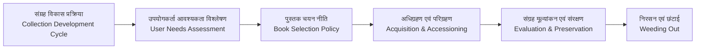
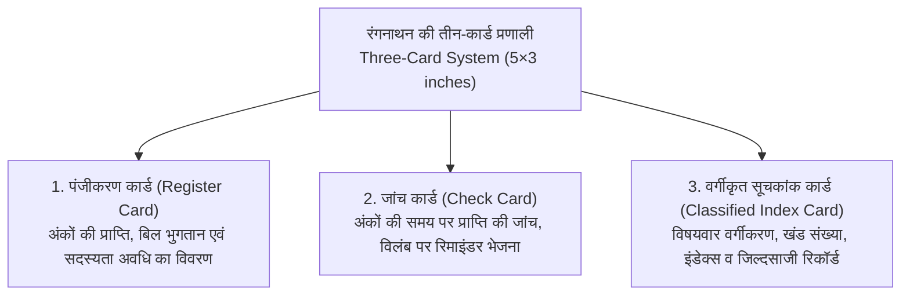

# इकाई 2 — पुस्तकालय प्रबंधन एवं संगठन (Library Management)

## उप-इकाई 2.1: संग्रह विकास एवं अधिग्रहण प्रक्रिया  
*(SubUnit 2.1: Collection Development and Acquisition Process)*

> **द्विभाषी विस्तृत अध्ययन सामग्री | Bilingual In-depth Study Notes (Hindi & English)**  
> लक्ष्य: बिहार विद्यालय पुस्तकालयाध्यक्ष पात्रता परीक्षा 2026 (Bihar School Librarian Eligibility Test 2026)

---

### भाग 1: संग्रह विकास — अवधारणा एवं सिद्धांत (Collection Development: Concepts & Theories)

**संग्रह विकास (Collection Development):**  
यह एक व्यापक एवं निरंतर चलने वाली प्रक्रिया है जिसमें उपयोगकर्ताओं की वर्तमान व भावी सूचना आवश्यकताओं का आकलन, पुस्तक चयन नीति का निर्माण, अधिग्रहण, मूल्यांकन, संरक्षण एवं अप्रचलित सामग्री का निरसन (Weeding) शामिल है।  
*Collection Development is a dynamic and systematic process of building and maintaining a library's collection through user needs assessment, selection policy formulation, acquisition, evaluation, preservation, and weeding.*

---

### भाग 2: पुस्तक चयन के प्रमुख सिद्धांत (Classic Theories of Book Selection)

पुस्तकालय विज्ञान के विभिन्न विचारकों ने पुस्तक चयन के संदर्भ में निम्नलिखित मार्गदर्शक सिद्धांत प्रतिपादित किए हैं:

#### 1. मेल्विल डेवी का सिद्धांत (Melvil Dewey's Principle, 1876):
* **आदर्श वाक्य (Motto):**  
  *"The best reading for the largest number at the least cost."*  
  *(न्यूनतम लागत पर, अधिकतम पाठकों के लिए, सर्वोत्तम पाठन सामग्री उपलब्ध कराना।)*
* **विश्लेषण:** यह सिद्धांत तीन तत्वों पर बल देता है:
  1. **सर्वोत्तम सामग्री (The Best Reading):** सामग्री की गुणवत्ता और प्रामाणिकता।
  2. **अधिकतम संख्या (The Largest Number):** जन-साधारण की व्यापक आवश्यकताओं की पूर्ति।
  3. **न्यूनतम लागत (The Least Cost):** वित्तीय संसाधनों का अधिकतम किफायती और विवेकपूर्ण उपयोग।

#### 2. सी.के. ड्रूरी का सिद्धांत (Francis Drury's Principle, 1930):
* अपनी पुस्तक *"Book Selection"* (1930) में ड्रूरी ने सुप्रसिद्ध सिद्धांत दिया:  
  *"To provide the right book to the right reader at the right time."*  
  *(उचित पाठक को, उचित समय पर, उचित पुस्तक प्रदान करना।)*
* **विश्लेषण:** इसमें 'उचित पाठक' (Right Reader) और 'उचित पुस्तक' (Right Book) के बीच सटीक सामंजस्य स्थापित करने पर बल दिया गया है।

#### 3. एल.आर. मैककोल्विन का मांग एवं पूर्ति सिद्धांत (L.R. McColvin's Theory of Book Selection, 1925):
* पुस्तक: *"The Theory of Book Selection for Public Libraries"* (1925)।
* **मूल अवधारणा:** मैककोल्विन ने अर्थशास्त्र के 'मांग एवं पूर्ति' (Demand and Supply) के नियम को पुस्तक चयन में लागू किया:
  * पुस्तकें अपने आप में साध्य नहीं हैं; वे केवल मांग को संतुष्ट करने का माध्यम हैं।
  * पुस्तकालय को केवल उन पुस्तकों का चयन करना चाहिए जिनकी पाठकों द्वारा **व्यक्त मांग (Expressed Demand)** हो अथवा जिनकी **संभावित मांग (Potential Demand)** उत्पन्न की जा सके।
  * उन्होंने मांग को दो आयामों में विभाजित किया: **मांग की मात्रा (Volume of Demand)** और **मांग का मूल्य/गुणवत्ता (Value of Demand)**।

#### 4. डॉ. एस.आर. रंगनाथन का पुस्तक चयन सिद्धांत (Ranganathan's Theory, 1952):
* अपनी कृति *"Library Book Selection"* (1952) में रंगनाथन ने पुस्तक चयन को **पाँच सूत्रों (Five Laws of Library Science)** पर आधारित किया:
  * **प्रथम सूत्र (Books are for use):** केवल मांग और उपयोगिता वाली पुस्तकें चुनी जाएं; अनुपयोगी व मृत संग्रह से बचा जाए।
  * **द्वितीय सूत्र (Every reader his/her book):** प्रत्येक वर्ग (छात्र, शिक्षक, शोधार्थी, सामान्य नागरिक, विशिष्ट पाठक) की आवश्यकताओं का प्रतिनिधित्व संग्रह में हो।
  * **तृतीय सूत्र (Every book its reader):** केवल वही पुस्तकें खरीदी जाएं जिनके संभावित पाठक पुस्तकालय में मौजूद हों।

#### 5. हेलेन हेन्स का सिद्धांत (Helen E. Haines, 1935):
* पुस्तक: *"Living with Books: The Art of Book Selection"* (1935)।
* हेन्स ने पुस्तक चयन को केवल एक यांत्रिक प्रक्रिया न मानकर एक **'कला' (Art)** माना, जिसमें पुस्तक के आंतरिक साहित्यिक व ज्ञानवर्धक मूल्य का मूल्यांकन अनिवार्य है।

---

### भाग 3: अधिग्रहण प्रक्रिया एवं चरण (The Acquisition Process: Step-by-Step)

अधिग्रहण अनुभाग (Acquisition Section) पुस्तकालय के लिए सामग्री क्रय करने, उपहार में प्राप्त करने या विनिमय द्वारा जोड़ने का कार्य करता है:

1. **चयन एवं सिफारिश (Selection & Recommendation):**  
   शिक्षकों, पाठकों और विषय विशेषज्ञों से मांग-पत्र प्राप्त करना तथा राष्ट्रीय ग्रंथसूचियों (INB, BNB), प्रकाशक कैटलॉग, और पुस्तक समीक्षाओं (*Times Literary Supplement*, *Book Review Digest*) से चयन करना।
2. **डुप्लीकेशन जांच (Pre-order Searching / Checking Duplication):**  
   यह सुनिश्चित करना कि सुझाई गई पुस्तक पुस्तकालय में पहले से उपलब्ध तो नहीं है अथवा पूर्व से ऑर्डर में तो नहीं है (कैटलॉग और ऑन-ऑर्डर फाइल से मिलान)।
3. **आदेश देना (Ordering):**  
   स्वीकृत पुस्तक विक्रेताओं/प्रकाशकों को क्रय आदेश (Purchase Order) भेजना, जिसमें छूट दर (Discount) और आपूर्ति समय-सीमा का उल्लेख होता है।
4. **प्राप्ति एवं भौतिक सत्यापन (Accessioning & Verification):**  
   प्राप्त पार्सल खोलना, चालान (Invoice/Bill) का आदेश से मिलान करना, पुस्तक के पन्नों, जिल्द व मुद्रण की त्रुटियों की भौतिक जांच करना।

---

### भाग 4: परिग्रहण पंजिका (The Accession Register)

परिग्रहण पंजिका पुस्तकालय का **स्थायी कानूनी एवं वित्तीय अभिलेख (Permanent Legal & Financial Record)** है। पुस्तकालय में जोड़ी गई प्रत्येक पुस्तक को इसमें एक अद्वितीय क्रमिक संख्या दी जाती है, जिसे **परिग्रहण संख्या (Accession Number)** कहते हैं।

* **मानक स्तंभ (Standard 14 Columns of Accession Register):**  
  भारतीय मानक ब्यूरो (BIS / ISI) और मानक पुस्तकालय पद्धति के अनुसार परिग्रहण पंजिका में सामान्यतः 14 स्तंभ होते हैं:
  1. **तिथि (Date of accessioning)**
  2. **परिग्रहण संख्या (Accession Number - क्रमिक संख्या)**
  3. **लेखक (Author's Name)**
  4. **आख्या / शीर्षक (Title of the Book)**
  5. **संस्करण (Edition)**
  6. **प्रकाशन स्थान एवं प्रकाशक (Place & Publisher)**
  7. **प्रकाशन वर्ष (Year of Publication)**
  8. **पृष्ठ संख्या (Pages / Collation)**
  9. **आकार (Size)**
  10. **जिल्द का स्वरूप (Binding Type - Hardbound / Paperback)**
  11. **स्रोत / विक्रेता (Source / Vendor)**
  12. **मूल्य एवं बिल विवरण (Cost & Bill No. / Date)**
  13. **वर्गांक एवं ग्रंथांक (Call No. = Class No. + Book No.)**
  14. **रिमार्क्स / वापसी (Withdrawal / Weeding Remarks)**

---

### भाग 5: पत्र-पत्रिकाओं का अधिग्रहण: रंगनाथन की तीन-कार्ड प्रणाली  
*(Periodicals Acquisition: Ranganathan's Three-Card System)*

सामयिक पत्र-पत्रिकाओं (Journals/Periodicals) का प्रबंधन निरंतर और जटिल होता है। इसके लिए डॉ. एस.आर. रंगनाथन ने **तीन-कार्ड प्रणाली (Three-Card System)** का आविष्कार किया, जिसमें 5"×3" इंच के तीन प्रकार के कार्ड उपयोग किए जाते हैं:

1. **पंजीकरण कार्ड (Register Card):**  
   पत्रिका का शीर्षक, प्रकाशक, विक्रेता, अग्रिम भुगतान की राशि, वॉल्यूम, अंक संख्या और प्राप्ति की तारीख दर्ज की जाती है।
2. **जांच कार्ड (Check Card):**  
   इस कार्ड पर साप्ताहिक/मासिक खानों में जांच की जाती है कि कौन-सा अंक प्राप्त नहीं हुआ है, ताकि विक्रेता को त्वरित **स्मरण-पत्र (Reminder)** भेजा जा सके।
3. **वर्गीकृत सूचकांक कार्ड (Classified Index Card):**  
   यह पत्रिका के वर्गांक (Class Number) के अनुसार व्यवस्थित रहता है और पाठकों को बताता है कि पुस्तकालय में अमुक पत्रिका के कौन-से खंड उपलब्ध हैं तथा कौन-से जिल्दसाजी (Binding) में भेजे गए हैं।

---

### भाग 6: परीक्षा हेतु द्विभाषी तुलनात्मक सारणी (Bilingual Comparison Matrix)

| विचारक / सिद्धांत | मूल प्रतिपादन (Core Philosophy) | पुस्तक / वर्ष (Work & Year) |
| :--- | :--- | :--- |
| **मेल्विल डेवी (Melvil Dewey)** | न्यूनतम लागत पर अधिकतम के लिए सर्वोत्तम पाठन | ALA सम्मेलन, 1876 |
| **एफ.के. ड्रूरी (F.K. Drury)** | उचित पाठक को, उचित पुस्तक, उचित समय पर | *Book Selection*, 1930 |
| **एल.आर. मैककोल्विन (L.R. McColvin)** | मांग एवं पूर्ति का सिद्धांत (मांग का मूल्य व मात्रा) | *Theory of Book Selection*, 1925 |
| **डॉ. एस.आर. रंगनाथन** | पाँच सूत्रों पर आधारित चयन (उपयोगिता एवं पाठक आवश्यकता) | *Library Book Selection*, 1952 |
| **हेलेन हेन्स (Helen Haines)** | पुस्तक चयन एक बौद्धिक कला है (*Living with Books*) | *Living with Books*, 1935 |

---

### भाग 7: Exam POV उच्च-प्राथमिकता वन-लाइनर्स (15 High-Yield Facts)

1. **"The best reading for the largest number at the least cost" किसका सिद्धांत है?** — **मेल्विल डेवी (1876)**।
2. **"To provide the right book to the right reader at the right time" सिद्धांत किसने दिया?** — **एफ.के. ड्रूरी (1930)**।
3. **पुस्तक चयन में 'मांग एवं पूर्ति का सिद्धांत' (Demand and Supply Theory) किसने प्रतिपादित किया?** — **एल.आर. मैककोल्विन (1925)**।
4. **'Library Book Selection' (1952) पुस्तक के लेखक कौन हैं?** — **डॉ. एस.आर. रंगनाथन**।
5. **'Living with Books' (1935) प्रसिद्ध कृति किसकी है?** — **हेलेन ई. हेन्स (Helen E. Haines)**।
6. **पुस्तकालय का स्थायी कानूनी एवं वित्तीय दस्तावेज कौन-सा होता है?** — **परिग्रहण पंजिका (Accession Register)**।
7. **मानक परिग्रहण पंजिका में सामान्यतः कितने कॉलम (स्तंभ) होते हैं?** — **14 कॉलम**।
8. **परिग्रहण संख्या (Accession Number) क्या होती है?** — पुस्तकालय में प्रत्येक पुस्तक को दी जाने वाली **अद्वितीय क्रमिक संख्या (Unique Serial Number)**।
9. **पत्र-पत्रिकाओं के प्रबंधन हेतु 'तीन-कार्ड प्रणाली' (Three-Card System) का आविष्कार किसने किया?** — **डॉ. एस.आर. रंगनाथन** ने।
10. **तीन-कार्ड प्रणाली में कार्डों का मानक आकार क्या होता है?** — **5" × 3" इंच (12.5 × 7.5 सेमी)**।
11. **तीन-कार्ड प्रणाली में कौन-से तीन कार्ड शामिल होते हैं?** — **Register Card, Check Card, और Classified Index Card**।
12. **पत्रिकाओं के न प्राप्त हुए अंकों के लिए रिमाइंडर भेजने हेतु किस कार्ड का उपयोग होता है?** — **जांच कार्ड (Check Card)** का।
13. **पुस्तक क्रय से पूर्व 'डुप्लीकेशन चेकिंग' किस उद्देश्य से की जाती है?** — अनावश्यक दोहराव से बचने और बजट बचाने हेतु।
14. **Call Number (क्रमांक) किन दो संख्याओं का योग होता है?** — **Class Number (वर्गांक) + Book Number (ग्रंथांक)**।
15. **संग्रह विकास में 'उपयोगकर्ता आवश्यकता विश्लेषण' (User Needs Assessment) का स्थान कहाँ है?** — यह पूरी प्रक्रिया का **प्रथम एवं आधारभूत चरण** है।
