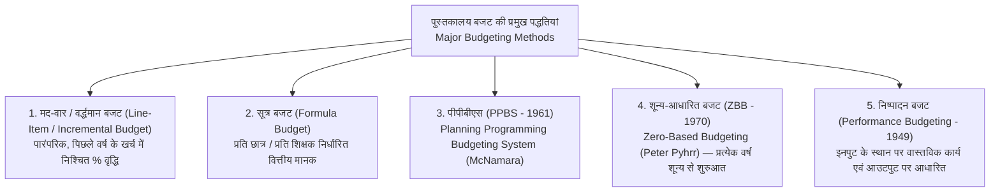
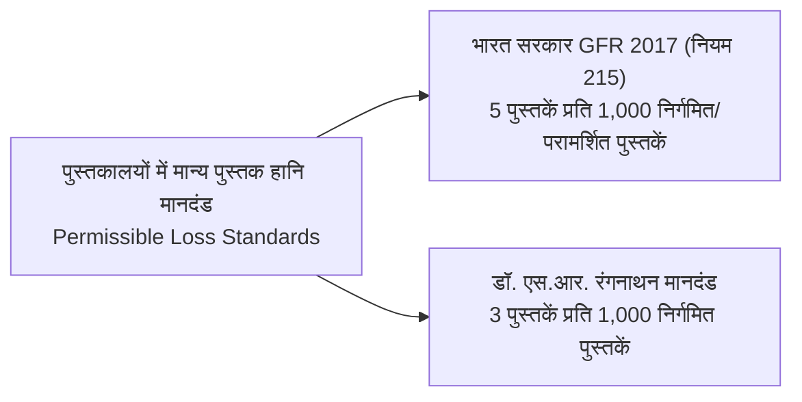

# इकाई 2 — पुस्तकालय प्रबंधन एवं संगठन (Library Management)

## उप-इकाई 2.3: पुस्तकालय बजट, वित्तीय प्रबंधन, भंडार सत्यापन एवं पुस्तक निरसन  
*(SubUnit 2.3: Library Budgeting, Financial Management, Stock Verification and Weeding Out)*

> **द्विभाषी विस्तृत अध्ययन सामग्री | Bilingual In-depth Study Notes (Hindi & English)**  
> लक्ष्य: बिहार विद्यालय पुस्तकालयाध्यक्ष पात्रता परीक्षा 2026 (Bihar School Librarian Eligibility Test 2026)

---

### भाग 1: पुस्तकालय वित्तीय प्रबंधन एवं बजट (Financial Management & Budgeting)

**पुस्तकालय बजट (Library Budget):**  
बजट किसी निश्चित भावी समयावधि (सामान्यतः एक वित्तीय वर्ष) के लिए पुस्तकालय की अनुमानित आय (Revenue) और प्रस्तावित व्यय (Expenditure) का पूर्व-नियोजित वित्तीय विवरण होता है।  
*A library budget is a financial plan outlining estimated revenues and proposed expenditures for a specific forthcoming period (typically one fiscal year).*

#### पुस्तकालय वित्त के स्रोत (Sources of Finance):
1. **सरकारी अनुदान (Government Grants):** आवर्ती अनुदान (Recurring / Maintenance Grants) और अनावर्ती अनुदान (Non-recurring / Capital Grants for building & furniture)।
2. **पुस्तकालय उपकर (Library Cess):** संपत्ति कर, वाहन कर आदि पर लगाया गया अधिभार (अधिनियम वाले राज्यों में)।
3. **मूल संस्थागत बजट (Parent Body Budget):** विश्वविद्यालय, महाविद्यालय या अनुसंधान संस्थान द्वारा आवंटित बजट।
4. **विशिष्ट अनुदान (Endowments & RRRLF):** आरआरआरएलएफ से प्राप्त मैचिंग/नॉन-मैचिंग ग्रांट्स एवं परोपकारी न्यास।
5. **आंतरिक आय:** विलंब शुल्क (Fines), जेरोक्स/डिजिटल सेवा शुल्क, सदस्यता शुल्क, और रद्दी सामग्री/अवांछित प्रतियों की नीलामी से प्राप्त आय।

---

### भाग 2: प्रमुख बजट निर्माण पद्धतियां (Major Budgeting Techniques)

#### 1. मद-वार / वर्द्धमान बजट (Line-Item / Incremental Budget):
* **प्रकृति:** सबसे पुरानी और सर्वाधिक प्रचलित पारंपरिक पद्धति।
* **कार्यप्रणाली:** पिछले वित्तीय वर्ष के वास्तविक व्यय को आधार माना जाता है और आगामी वर्ष के लिए मुद्रास्फीति व विस्तार को देखते हुए प्रत्येक मद (वेतन, पुस्तकें, पत्रिकाएं, जिल्दसाजी, उपस्कर) में 5% से 10% की वृद्धि जोड़ दी जाती है।
* **दोष:** यह व्यय की उपयोगिता या कार्यक्रमों के प्रदर्शन का मूल्यांकन नहीं करती; इसमें अप्रचलित खर्च भी निरंतर जारी रहते हैं।

#### 2. शून्य-आधारित बजट (ZBB - Zero-Based Budgeting):
* **आविष्कारक (Inventor):** **पीटर ए. पायर (Peter A. Pyhrr)** द्वारा **1970** में टेक्सास इंस्ट्रूमेंट्स (USA) में विकसित।
* **लोकप्रियता:** अमेरिकी राष्ट्रपति **जिमी कार्टर (Jimmy Carter)** ने 1977 में इसे अमेरिकी संघीय बजट में लागू किया।
* **मूल सिद्धांत:**  
  * प्रत्येक नए वित्तीय वर्ष की शुरुआत **"शून्य" (Ground Zero)** से होती है।
  * पिछले वर्ष के बजट को स्वतः स्वीकार नहीं किया जाता; प्रत्येक विभाग को अपनी प्रत्येक गतिविधि और प्रस्तावित व्यय का नए सिरे से औचित्य (Justification) सिद्ध करना होता है।
* **निर्णय पैकेज (Decision Packages):** प्रत्येक कार्यक्रम हेतु लागत-लाभ विश्लेषण (Cost-Benefit Analysis) के आधार पर निर्णय पैकेज बनाए जाते हैं और प्राथमिकताओं के आधार पर रैंक दिए जाते हैं।
* **लाभ:** अनुपयोगी एवं मृत कार्यक्रमों को समाप्त कर वित्तीय संसाधनों का अधिकतम विवेकपूर्ण उपयोग सुनिश्चित होता है।

#### 3. पीपीबीएस (PPBS - Planning Programming Budgeting System):
* **विकास:** अमेरिकी रक्षा विभाग में **रॉबर्ट मैकनामारा (Robert McNamara)** द्वारा **1961** में रैंड कॉर्पोरेशन (Rand Corporation) के सहयोग से विकसित।
* **विशेषता:** यह दीर्घकालिक नियोजन (Planning), कार्यक्रमों की रूपरेखा (Programming) और बजटीय आवंटन (Budgeting) को एक एकीकृत वैज्ञानिक प्रणाली में जोड़ता है।

---

### भाग 3: वित्तीय मानक एवं आयोगों की सिफारिशें (Financial Norms & Commission Standards)

1. **कोठारी आयोग (1964–66):**  
   विश्वविद्यालय के कुल शैक्षणिक बजट का **6.5% से 10%** हिस्सा पुस्तकालय विकास पर खर्च करने की सिफारिश।
2. **राधाकृष्णन आयोग (1948–49):**  
   प्रति छात्र **₹40** पुस्तकालय अनुदान की संस्तुति।
3. **रंगनाथन यूजीसी पुस्तकालय समिति (1957):**  
   प्रति विद्यार्थी **₹15** तथा प्रति शिक्षक/शोधार्थी **₹200** वार्षिक पुस्तकालय अनुदान का फॉर्मूला।

---

### भाग 4: भंडार सत्यापन (Stock Verification / Physical Inventory)

**परिभाषा / Definition:**  
पुस्तकालय के संपूर्ण संग्रह का भौतिक रूप से निरीक्षण और सत्यापन करना, ताकि खोई हुई, कटी-फटी, गलत स्थान पर रखी (Misplaced) पुस्तकों का पता लगाया जा सके तथा अभिलेखों को अद्यतन किया जा सके।  
*Stock Verification is the systematic physical audit and checking of a library's total holdings to detect missing, damaged, or misplaced books and update official inventories.*

#### भंडार सत्यापन की प्रमुख विधियां (Methods of Stock Verification):
1. **परिग्रहण पंजिका द्वारा (By Accession Register):**  
   शेल्फ की प्रत्येक पुस्तक का परिग्रहण पंजिका से सीधा मिलान। (यह अत्यंत धीमी है और भारी पंजिकाएं बार-बार स्टैक में ले जाने से फट जाती हैं)।
2. **शेल्फ सूची कार्ड द्वारा (By Shelf List Cards):**  
   **सर्वाधिक वैज्ञानिक, मानक एवं सुविधाजनक विधि**। शेल्फ लिस्ट कार्ड्स उसी क्रम में लगे होते हैं जिस क्रम में पुस्तकें अलमारी में सजी होती हैं (Classified Order)।
3. **संख्यात्मक गणना द्वारा (By Numerical Counting):**  
   केवल पुस्तकों की कुल संख्या गिनी जाती है; इससे खोई हुई विशिष्ट पुस्तकों के शीर्षक का पता नहीं चलता।
4. **पृथक परिग्रहण संख्या पर्चियों द्वारा (By Separate Number Slips):**  
   स्टॉक में मौजूद पुस्तकों की परिग्रहण संख्याएं पर्चियों पर नोट करके बाद में मिलान किया जाता है।
5. **बारकोड / आरएफआईडी स्कैनर द्वारा (By Barcode & RFID Scanners):**  
   **आधुनिकतम एवं त्वरित विधि**। हैंडहेल्ड आरएफआईडी रीडर को शेल्फ पर घुमाते ही सेकंडों में सैकड़ों पुस्तकों का डेटा स्कैन होकर गायब पुस्तकों की स्वतः सूची तैयार हो जाती है।

---

### भाग 5: मान्य पुस्तक हानि मानदंड (Permissible Book Loss Norms: GFR & LIS Standards)

खुली पहुंच प्रणाली (Open Access System) में भारी उपयोग के कारण कुछ पुस्तकों की हानि स्वाभाविक एवं अपरिहार्य मानी जाती है।

> [!IMPORTANT]
> **भारत सरकार सामान्य वित्तीय नियम (GFR 2017, Rule 215):**  
> * पुस्तकालय में प्रतिवर्ष जारी (Issued) अथवा परामर्शित (Consulted) की गई प्रत्येक **1,000 पुस्तकों पर 5 पुस्तकों की हानि (Loss of 5 volumes per 1,000 volumes)** को उचित और स्वीकार्य माना जाएगा, बशर्ते यह हानि कर्मचारियों की बेईमानी या घोर लापरवाही के कारण न हुई हो।  
> * *नोट: दुर्लभ, ऐतिहासिक एवं पांडुलिपि संग्रह में किसी भी एक पुस्तक की हानि पर उच्च-स्तरीय जांच अनिवार्य है।*

---

### भाग 6: पुस्तक निरसन / छंटाई (Weeding Out of Library Materials)

**परिभाषा:**  
पुस्तकालय के सीमित स्थान को उपयोगी बनाए रखने के लिए अनुपयोगी, जीर्ण-शीर्ण, अप्रासंगिक और पुराने संस्करणों को स्थायी रूप से संग्रह से हटाना **पुस्तक निरसन (Weeding Out)** कहलाता है।

#### दार्शनिक आधार:
* **पुस्तकालय विज्ञान का पंचम सूत्र (Fifth Law: Library is a Growing Organism):**  
  जिस प्रकार किसी जीवित जीव में नई कोशिकाओं के विकास हेतु मृत कोशिकाओं का निष्कासन अनिवार्य है, उसी प्रकार पुस्तकालय के स्वास्थ्य के लिए पुस्तक निरसन जैविक रूप से अनिवार्य है।

#### क्रीव विधि एवं मस्टी मानदंड (The CREW Method & MUSTIE Criteria):
टेक्सास स्टेट लाइब्रेरी द्वारा विकसित **CREW विधि** (Continuous Re-evaluation, Evaluation and Weeding) के अंतर्गत पुस्तकों की छंटाई हेतु **MUSTIE सूत्र** दिया गया है:

* **M = Misleading (भ्रामक):** तथ्यात्मक रूप से पुरानी, अशुद्ध और भ्रामक जानकारी वाली पुस्तकें।
* **U = Ugly (जीर्ण-शीर्ण):** अत्यधिक फटी हुई, जर्जर और मरम्मत से परे सामग्री।
* **S = Superseded (प्रतिस्थापित):** जिसके नए, संशोधित और बेहतर संस्करण पुस्तकालय में आ चुके हों।
* **T = Trivial (अनावश्यक):** सामयिक महत्त्व का घटिया या सतही साहित्य जिसकी उपयोगिता समाप्त हो चुकी हो।
* **I = Irrelevant (अप्रासंगिक):** संस्था के नए पाठ्यक्रम या शोध प्राथमिकताओं के सर्वथा बाहर की सामग्री।
* **E = Elsewhere Available (अन्यत्र सुलभ):** जो पुस्तकें अंतर-पुस्तकालय ऋण (ILL) या इंटरनेट/डिजिटल रिपॉजिटरी में सुलभ हों।

---

### भाग 7: परीक्षा हेतु द्विभाषी तुलनात्मक सारणी (Bilingual Master Matrix)

| अवधारणा / पद्धति | प्रतिपादक / संस्था | वर्ष / नियम | मूल विशेषता |
| :--- | :--- | :---: | :--- |
| **शून्य-आधारित बजट (ZBB)** | पीटर ए. पायर (Peter Pyhrr) | **1970** | प्रत्येक वर्ष शून्य से शुरुआत; डिसीजन पैकेज |
| **पीपीबीएस (PPBS)** | रॉबर्ट मैकनामारा (US DoD) | **1961** | योजना + कार्यक्रम + बजट का समन्वय |
| **मान्य हानि मानदंड (GFR)** | भारत सरकार (Ministry of Finance) | **GFR 2017 (Rule 215)** | **5 पुस्तकें प्रति 1,000 परामर्शित/निर्गमित** |
| **रंगनाथन हानि मानदंड** | डॉ. एस.आर. रंगनाथन | - | **3 पुस्तकें प्रति 1,000 निर्गमित** |
| **मस्टी मानदंड (MUSTIE)** | CREW पद्धति | - | पुस्तक निरसन / छंटाई का वैज्ञानिक आधार |
| **सर्वश्रेष्ठ भौतिक सत्यापन विधि** | मानक पुस्तकालय विज्ञान | - | **शेल्फ सूची कार्ड (Shelf List Cards)** |

---

### भाग 8: Exam POV उच्च-प्राथमिकता वन-लाइनर्स (15 High-Yield Facts)

1. **शून्य-आधारित बजट (Zero-Based Budgeting - ZBB) का जनक कौन है?** — **पीटर ए. पायर (Peter A. Pyhrr, 1970)**।
2. **ZBB में प्रत्येक वर्ष की शुरुआत किस आधार पर होती है?** — **शून्य (Ground Zero) से**, कोई पिछला आधार नहीं माना जाता।
3. **पीपीबीएस (PPBS) का विकास 1961 में किसने किया था?** — **रॉबर्ट मैकनामारा (अमेरिकी रक्षा विभाग)** ने।
4. **कोठारी आयोग (1964–66) ने पुस्तकालय बजट हेतु कितनी प्रतिशत सिफारिश की थी?** — कुल बजट का **6.5% से 10%**।
5. **भारत सरकार के GFR 2017 (Rule 215) के अनुसार प्रतिवर्ष कितनी पुस्तक हानि स्वीकार्य है?** — **प्रति 1,000 निर्गमित/परामर्शित पुस्तकों पर 5 पुस्तकें**।
6. **डॉ. एस.आर. रंगनाथन के अनुसार कितनी पुस्तक हानि स्वीकार्य मानी गई है?** — **प्रति 1,000 निर्गमित पुस्तकों पर 3 पुस्तकें**।
7. **भंडार सत्यापन (Stock Verification) की सबसे मानक और वैज्ञानिक विधि कौन-सी है?** — **शेल्फ सूची कार्ड (Shelf List Cards) द्वारा**।
8. **शेल्फ लिस्ट (Shelf List) में कार्ड्स किस क्रम में व्यवस्थित रहते हैं?** — जिस क्रम में पुस्तकें अलमारी में रखी हैं (**Classified / Call Number क्रम में**)।
9. **पुस्तक निरसन (Weeding Out) पुस्तकालय विज्ञान के किस सूत्र से सीधे संबंधित है?** — **पंचम सूत्र (पुस्तकालय एक वर्धनशील संस्था है)**।
10. **पुस्तक छंटाई के लिए प्रयुक्त 'MUSTIE' में 'M' और 'S' का क्या अर्थ है?** — **M = Misleading (भ्रामक)** तथा **S = Superseded (प्रतिस्थापित)**।
11. **अमेरिकन संघीय बजट में ZBB को किस राष्ट्रपति ने लागू किया था?** — **जिमी कार्टर (1977)** ने।
12. **कौन-सा बजट इनपुट के बजाय वास्तविक कार्य एवं आउटपुट पर ध्यान केंद्रित करता है?** — **निष्पादन बजट (Performance Budgeting)**।
13. **पुस्तकालय भवन और फर्नीचर हेतु मिलने वाला अनुदान किस प्रकार का होता है?** — **अनावर्ती / पूंजीगत अनुदान (Non-recurring / Capital Grant)**।
14. **पुस्तकालय में पुस्तकों की भौतिक गणना को क्या कहा जाता है?** — **भंडार सत्यापन (Stock Verification)**।
15. **दुर्लभ एवं बहुमूल्य पुस्तकों के खो जाने पर GFR का क्या निर्देश है?** — **इसकी विशेष जांच (Special Investigation) अनिवार्य है**, इसे सामान्य हानि में नहीं गिना जा सकता।
