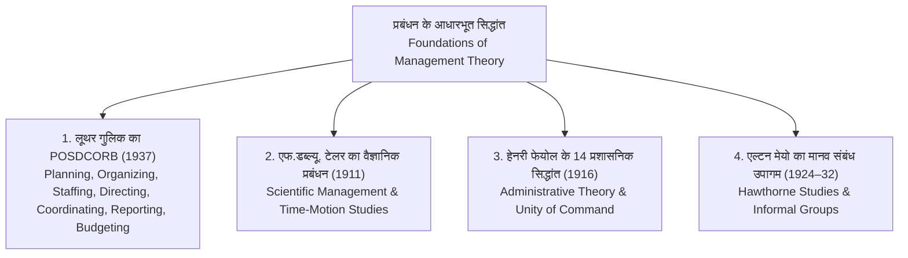
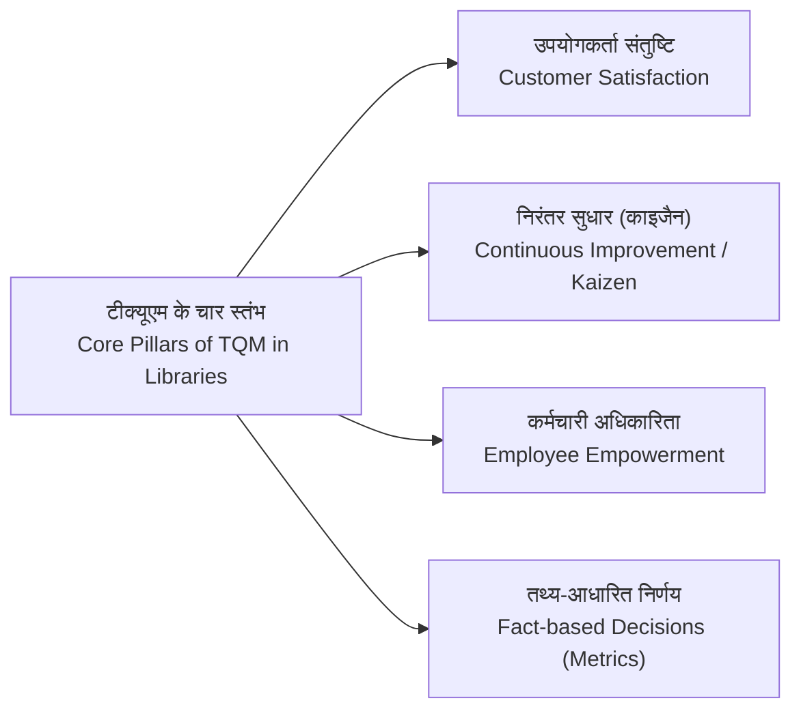

# इकाई 2 — पुस्तकालय प्रबंधन एवं संगठन (Library Management)

## उप-इकाई 2.4: मानव संसाधन प्रबंधन (HRM), रंगनाथन स्टाफ फॉर्मूला एवं संपूर्ण गुणवत्ता प्रबंधन (TQM)  
*(SubUnit 2.4: Human Resource Management, Ranganathan's Staff Formula & Total Quality Management)*

> **द्विभाषी विस्तृत अध्ययन सामग्री | Bilingual In-depth Study Notes (Hindi & English)**  
> लक्ष्य: बिहार विद्यालय पुस्तकालयाध्यक्ष पात्रता परीक्षा 2026 (Bihar School Librarian Eligibility Test 2026)

---

### भाग 1: शास्त्रीय प्रबंधन सिद्धांत (Classical Management Theories)

प्रबंधन (Management) दूसरों के माध्यम से संगठनात्मक उद्देश्यों को कुशलतापूर्वक और प्रभावी ढंग से प्राप्त करने की कला और विज्ञान है।

#### 1. लूथर गुलिक का 'POSDCORB' सूत्र (1937):
लूथर गुलिक (Luther Gulick) एवं लिंडाल उर्विक (Lyndall Urwick) ने 1937 में अपनी कृति *"Papers on the Science of Administration"* में प्रबंधन के 7 प्रमुख कार्यों का संक्षिप्तीकरण प्रस्तुत किया:

* **P = Planning (नियोजन):** भविष्य में क्या करना है, इसका पूर्व-निर्धारण।
* **O = Organizing (संगठन):** कार्यों का विभाजन और प्रशासनिक संरचना की स्थापना।
* **S = Staffing (कर्मचारी प्रबंधन):** कर्मचारियों की भर्ती, प्रशिक्षण, पदोन्नति एवं अनुकूल कार्य परिस्थितियां।
* **D = Directing (निर्देशन):** निर्णय लेना, आदेश जारी करना और नेतृत्व प्रदान करना।
* **CO = Coordinating (समन्वय):** संगठन के विभिन्न प्रभागों के बीच तालमेल स्थापित करना।
* **R = Reporting (प्रतिवेदन):** कार्यों की प्रगति की सूचना अभिलेखों व रिपोर्टों द्वारा उच्चाधिकारियों को देना।
* **B = Budgeting (बजट निर्माण):** वित्तीय योजना, लेखांकन और वित्तीय नियंत्रण।

#### 2. एफ.डब्ल्यू. टेलर का वैज्ञानिक प्रबंधन (F.W. Taylor's Scientific Management, 1911):
* **फ्रेडरिक विंसलो टेलर (F.W. Taylor)** को **'वैज्ञानिक प्रबंधन का जनक' (Father of Scientific Management)** कहा जाता है।
* पुस्तक: *"The Principles of Scientific Management"* (1911)।
* **मुख्य योगदान:** 'अंगूठा छाप नियम' (Rule of Thumb) के स्थान पर वैज्ञानिक विधियों का उपयोग; **समय एवं गति अध्ययन (Time and Motion Study)**; कार्यात्मक फोरमैनशिप (Functional Foremanship); कार्य का प्रमाणीकरण; और कार्यकुशलता के आधार पर विभेदक मजदूरी प्रणाली।

#### 3. हेनरी फेयोल के 14 सिद्धांत (Henri Fayol's 14 Principles, 1916):
* **हेनरी फेयोल (Henri Fayol)** को **'आधुनिक परिचालन प्रबंधन का जनक' (Father of Modern Operational Management)** कहा जाता है।
* पुस्तक: *"General and Industrial Management"* (1916)।
* **प्रमुख सिद्धांत:**
  1. **कार्य का विभाजन (Division of Work):** विशिष्टीकरण से दक्षता बढ़ती है।
  2. **अधिकार एवं उत्तरदायित्व (Authority & Responsibility)।**
  3. **आदेश की एकता (Unity of Command):** एक कर्मचारी को केवल एक ही उच्चाधिकारी से आदेश मिलना चाहिए।
  4. **निर्देश की एकता (Unity of Direction):** एक योजना और एक प्रमुख।
  5. **सोपान शृंखला (Scalar Chain / Gang Plank):** उच्च स्तर से निम्न स्तर तक की औपचारिक संचार रेखा; आपातकाल में समकक्षों के सीधे संवाद हेतु 'गैंग प्लैंक' का प्रावधान।
  6. **टीम भावना (Esprit de Corps):** सामूहिक एकता और सामंजस्य।

---

### भाग 2: अभिप्रेरणा के प्रमुख सिद्धांत (Theories of Motivation in LIS Management)

#### 1. मास्लो का आवश्यकता पदानुक्रम सिद्धांत (Maslow's Hierarchy of Needs, 1943):
अब्राहम मास्लो (Abraham Maslow) ने मानव आवश्यकताओं को 5 पदानुक्रमित स्तरों में विभाजित किया (पिरामिड संरचना):
1. **शारीरिक आवश्यकताएं (Physiological Needs):** भोजन, जल, विश्राम।
2. **सुरक्षा आवश्यकताएं (Safety Needs):** नौकरी की सुरक्षा, स्वास्थ्य, पेंशन।
3. **सामाजिक आवश्यकताएं (Social / Belongingness):** मित्रता, सहकर्मियों का स्नेह।
4. **सम्मान आवश्यकताएं (Esteem Needs):** पदवी, मान्यता, आत्म-सम्मान।
5. **आत्म-प्राप्ति की आवश्यकता (Self-Actualization):** अपनी क्षमताओं का सर्वोच्च प्रकटीकरण।

#### 2. हर्ज़बर्ग का द्वि-घटक सिद्धांत (Herzberg's Two-Factor / Hygiene Theory, 1959):
फ्रेडरिक हर्ज़बर्ग (Frederick Herzberg) ने दो प्रकार के घटकों की पहचान की:
* **स्वच्छता घटक (Hygiene / Extrinsic Factors):** वेतन, कंपनी नीतियां, कार्यस्थल का भौतिक वातावरण, पर्यवेक्षण संबंध।  
  *(यदि ये न हों तो असंतोष फैलता है; लेकिन इनकी उपस्थिति से कोई वास्तविक आंतरिक अभिप्रेरणा नहीं मिलती।)*
* **अभिप्रेरक घटक (Motivators / Intrinsic Factors):** कार्य में उपलब्धि, कार्य का स्वरूप, पहचान, जिम्मेदारी, और व्यावसायिक विकास।  
  *(ये सीधे कार्य संतुष्टि और उच्च निष्पादन प्रदान करते हैं।)*

#### 3. डगलस मैकग्रेगर का थ्योरी X और थ्योरी Y (Douglas McGregor's Theory X & Y, 1960):
* **थ्योरी X (पारंपरिक/निराशावादी):** कर्मचारी काम से जी चुराते हैं, महत्वाकांक्षाहीन होते हैं, अतः उनसे काम लेने हेतु कठोर नियंत्रण, निर्देशन और दंड की आवश्यकता होती है।
* **थ्योरी Y (आधुनिक/आशावादी):** कर्मचारी स्वभाव से काम को खेल की तरह आनंददायक मानते हैं, स्व-निर्देशित, रचनात्मक और उत्तरदायित्व लेने में सक्षम होते हैं।

---

### भाग 3: डॉ. एस.आर. रंगनाथन का स्टाफ फॉर्मूला (Ranganathan's Staff Formula)

डॉ. एस.आर. रंगनाथन ने विश्वविद्यालय अनुदान आयोग (UGC) पुस्तकालय समिति (1957) के अध्यक्ष के रूप में शैक्षणिक पुस्तकालयों में वैज्ञानिक कार्यभार के आधार पर **स्टाफ फॉर्मूला (Staff Formula)** प्रस्तुत किया:

| अनुभाग (Library Section) | कार्यभार मानक (Workload Standard) | आवश्यक जनशक्ति (Staff Norm) |
| :--- | :--- | :---: |
| **1. पुस्तक अर्जन अनुभाग (Book Section)** | प्रतिवर्ष जोड़े जाने वाले प्रत्येक **6,000 ग्रंथों** के लिए | **1 व्यक्ति** |
| **2. सामयिक पत्रिका अनुभाग (Periodical Section)** | प्रतिवर्ष सब्सक्राइब की जाने वाली प्रत्येक **500 पत्रिकाओं (शीर्षकों)** के लिए | **1 व्यक्ति** |
| **3. तकनीकी अनुभाग (Technical Section - वर्गीकरण व सूचीकरण)** | प्रतिवर्ष वर्गीकृत व सूचीकृत किए जाने वाले प्रत्येक **2,000 ग्रंथों** के लिए | **1 व्यक्ति** |
| **4. रखरखाव अनुभाग (Maintenance Section)** | प्रतिवर्ष जोड़े जाने वाले प्रत्येक **1,500 ग्रंथों** के लिए (शेल्फ प्रबंधन) | **1 व्यक्ति** |
| **5. परिसंचरण अनुभाग (Circulation Section)** | वर्ष के प्रत्येक दिन **50 घंटों के खुलने** तथा प्रतिदिन **100 पुस्तकों के लेन-देन** हेतु | **1 व्यक्ति** |
| **6. संदर्भ अनुभाग (Reference Section)** | वर्ष के प्रत्येक दिन **50 पाठकों के संदर्भ परामर्श** हेतु | **1 व्यक्ति** |
| **7. प्रशासनिक अनुभाग (Administrative Section)** | प्रत्येक **24 पेशेवर कर्मचारियों** के कार्य समन्वय हेतु | **1 लेखाकार/सहायक** |

---

### भाग 4: संपूर्ण गुणवत्ता प्रबंधन (TQM - Total Quality Management in Libraries)

**टीक्यूएम (TQM):**  
संगठन की सभी प्रक्रियाओं, उत्पादों और सेवाओं में निरंतर सुधार (Continuous Improvement) लाकर उपयोगकर्ताओं की अपेक्षाओं से बढ़कर संतुष्टि प्रदान करने की समग्र प्रबंधन दर्शन प्रणाली।

#### प्रमुख गुणवत्ता गुरु (Quality Pioneers):
1. **डब्ल्यू. एडवर्ड्स डेमिंग (W. Edwards Deming):**
   * **PDCA चक्र (डेमिंग चक्र):** **Plan** (योजना) $\rightarrow$ **Do** (कार्यान्वयन) $\rightarrow$ **Check** (सत्यापन) $\rightarrow$ **Act** (सुधार)।
   * डेमिंग के 14 प्रबंधन सिद्धांत।
2. **जोसेफ एम. जुरान (Joseph M. Juran):**
   * **जुरान की गुणवत्ता त्रयी (Quality Trilogy):** 1. गुणवत्ता नियोजन (Quality Planning), 2. गुणवत्ता नियंत्रण (Quality Control), 3. गुणवत्ता सुधार (Quality Improvement)।
3. **बेंचमार्किंग (Benchmarking):**  
   अपने पुस्तकालय की सेवाओं व प्रक्रियाओं की तुलना विश्व के सर्वश्रेष्ठ प्रदर्शन करने वाले पुस्तकालयों (Best Practices) से करके अपनी गुणवत्ता का उन्नयन करना।
4. **लिबक्वाल (LibQUAL+):**  
   एसोसिएशन ऑफ रिसर्च लाइब्रेरीज (ARL) द्वारा पुस्तकालय सेवा गुणवत्ता (Library Service Quality) मापने हेतु विकसित अंतरराष्ट्रीय पैमाना।

---

### भाग 5: पुस्तकालय भवन, उपस्कर एवं भारतीय मानक (Library Building, Furniture & BIS Standards)

भारतीय मानक ब्यूरो (**BIS - Bureau of Indian Standards**) द्वारा पुस्तकालयों हेतु निर्धारित प्रमुख राष्ट्रीय मानक:

1. **IS:1553-1989:** पुस्तकालय भवन के प्राथमिक वास्तुशिल्प मानक एवं सिद्धांत (*Code of Practice for Architecture and Building of Libraries*)।
2. **IS:1829 (Part I - 1978):** पुस्तकालय लकड़ी के उपस्कर एवं अलमारियां (*Wooden Furniture and Fittings*)।
3. **IS:1829 (Part II - 1993):** पुस्तकालय स्टील उपस्कर (*Steel Furniture and Shelving Racks*)।
4. **स्थान एवं प्रकाश मानक:**
   * **रीडिंग रूम प्रकाश:** 150 से 300 लक्स (Lux)।
   * **मुख्य गलियारा (Main Aisle):** 1.5 मीटर (5 फीट)।
   * **स्टैक गलियारा (Gangway between racks):** 0.75 मीटर से 1.0 मीटर।
   * **शेल्फ ऊंचाई:** सामान्यतः 2.2 मीटर (7 फीट), ताकि शीर्ष शेल्फ पर सामान्य हाथ पहुँच सके और सीढ़ी की आवश्यकता न पड़े (प्रथम सूत्र के अनुकूल)।

---

### भाग 6: परीक्षा हेतु द्विभाषी तुलनात्मक सारणी (Bilingual Master Matrix)

| सिद्धांत / अवधारणा | प्रतिपादक / वर्ष | मूल प्रतिपादन (Core Meaning) |
| :--- | :--- | :--- |
| **POSDCORB** | लूथर गुलिक एवं लिंडाल उर्विक (1937) | प्रबंधन के 7 मौलिक कार्य |
| **वैज्ञानिक प्रबंधन** | एफ.डब्ल्यू. टेलर (1911) | टाइम-मोशन स्टडी; कार्य का मानकीकरण |
| **आदेश की एकता (Unity of Command)** | हेनरी फेयोल (1916) | एक कर्मचारी को केवल एक अधिकारी से आदेश |
| **आवश्यकता पदानुक्रम** | अब्राहम मास्लो (1943) | 5-स्तरीय शारीरिक से आत्म-प्राप्ति आवश्यकता |
| **स्वच्छता एवं अभिप्रेरक घटक** | फ्रेडरिक हर्ज़बर्ग (1959) | वेतन = स्वच्छता घटक; उपलब्धि = प्रेरक |
| **रंगनाथन स्टाफ फॉर्मूला** | डॉ. एस.आर. रंगनाथन (UGC, 1957) | अर्जन: 6,000 पुस्तकें/व्यक्ति; तकनीकी: 2,000 पुस्तकें/व्यक्ति |
| **PDCA चक्र** | डब्ल्यू. एडवर्ड्स डेमिंग | Plan-Do-Check-Act गुणवत्ता चक्र |
| **पुस्तकालय भवन मानक** | BIS / ISI | **IS:1553-1989** |

---

### भाग 7: Exam POV उच्च-प्राथमिकता वन-लाइनर्स (15 High-Yield Facts)

1. **'POSDCORB' सूत्र के प्रतिपादक कौन हैं?** — **लूथर गुलिक (Luther Gulick) एवं लिंडाल उर्विक (1937)**।
2. **'वैज्ञानिक प्रबंधन का जनक' (Father of Scientific Management) किसे कहा जाता है?** — **एफ.डब्ल्यू. टेलर (F.W. Taylor)**।
3. **'आधुनिक परिचालन प्रबंधन का जनक' किसे माना जाता है?** — **हेनरी फेयोल (Henri Fayol)**।
4. **हेनरी फेयोल के प्रसिद्ध 'आदेश की एकता' (Unity of Command) का क्या अर्थ है?** — **एक कर्मचारी को एक ही अधिकारी से आदेश मिलना चाहिए**।
5. **सोपान शृंखला में आपातकालीन संप्रेषण हेतु फेयोल ने किस पुल की अवधारणा दी?** — **गैंग प्लैंक (Gang Plank)**।
6. **मास्लो के आवश्यकता पदानुक्रम में सर्वोच्च स्तर पर कौन-सी आवश्यकता है?** — **आत्म-प्राप्ति की आवश्यकता (Self-Actualization Need)**।
7. **हर्ज़बर्ग के अनुसार वेतन और कार्य दशाएं किस प्रकार के घटक हैं?** — **स्वच्छता / बाह्य घटक (Hygiene Factors)**।
8. **थ्योरी X और थ्योरी Y का प्रतिपादन किसने किया था?** — **डगलस मैकग्रेगर (Douglas McGregor, 1960)** ने।
9. **रंगनाथन के स्टाफ फॉर्मूले के अनुसार अर्जन अनुभाग में कितने ग्रंथों पर 1 व्यक्ति चाहिए?** — **वार्षिक 6,000 ग्रंथों पर**।
10. **रंगनाथन के स्टाफ फॉर्मूले के अनुसार तकनीकी अनुभाग (वर्गीकरण/सूचीकरण) में कितने ग्रंथों पर 1 व्यक्ति चाहिए?** — **वार्षिक 2,000 ग्रंथों पर**।
11. **रंगनाथन के स्टाफ फॉर्मूले के अनुसार सामयिक पत्रिका अनुभाग में कितनी पत्रिकाओं पर 1 व्यक्ति चाहिए?** — **वार्षिक 500 पत्रिकाओं (शीर्षकों) पर**।
12. **गुणवत्ता प्रबंधन में 'PDCA चक्र' के प्रवर्तक कौन हैं?** — **डब्ल्यू. एडवर्ड्स डेमिंग (W. Edwards Deming)**।
13. **पुस्तकालय सेवा गुणवत्ता मापने हेतु विश्वप्रसिद्ध पैमाना कौन-सा है?** — **लिबक्वाल (LibQUAL+)**।
14. **पुस्तकालय भवन के वास्तुशिल्प एवं डिजाइन हेतु भारतीय मानक कौन-सा है?** — **IS:1553-1989**।
15. **हॉथॉर्न प्रयोगों (Hawthorne Studies) के मुख्य अन्वेषक कौन थे?** — **एल्टन मेयो (Elton Mayo)**।
