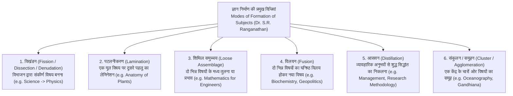
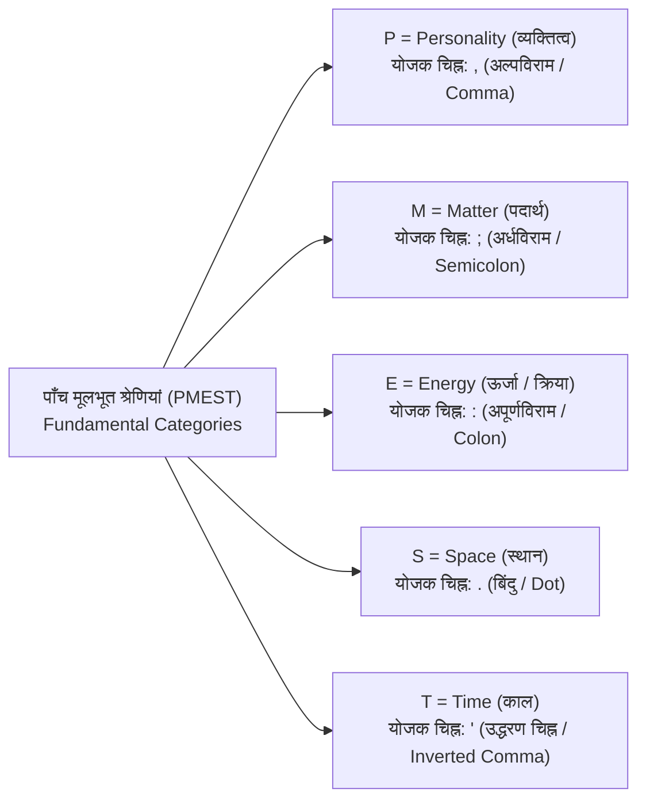

# इकाई 3 — ज्ञान संगठन: वर्गीकरण एवं सूचीकरण (Classification & Cataloguing)

## उप-इकाई 3.1: ज्ञान जगत एवं प्रमुख वर्गीकरण पद्धतियां (DDC, UDC, CC)  
*(SubUnit 3.1: Universe of Knowledge & Major Classification Schemes — DDC, UDC, CC)*

> **द्विभाषी विस्तृत अध्ययन सामग्री | Bilingual In-depth Study Notes (Hindi & English)**  
> लक्ष्य: बिहार विद्यालय पुस्तकालयाध्यक्ष पात्रता परीक्षा 2026 (Bihar School Librarian Eligibility Test 2026)

---

### भाग 1: ज्ञान जगत एवं विषय निर्माण की विधियां (Universe of Knowledge & Modes of Formation of Subjects)

**पुस्तकालय वर्गीकरण (Library Classification):**  
पुस्तकों एवं प्रलेखों को उनकी विषय-वस्तु की समानता और भिन्नता के आधार पर तार्किक क्रम में व्यवस्थित करने की कला और विज्ञान।  
*Library classification is the translation of the name of a subject into a preferred artificial language of ordinal numbers (Class Numbers) to arrange books in a helpful sequence and mechanize rediscovery.*

#### वर्गीकरण पद्धतियों के प्रमुख प्रकार (Types of Classification Schemes):
1. **शुद्ध परिगणनात्मक (Purely Enumerative):** जिसमें ज्ञान जगत के सभी पूर्व-निर्मित विषयों की तैयार सूची दी होती है (उदा. **LCC - Library of Congress Classification**, Rider's International Classification)।
2. **लगभग परिगणनात्मक (Almost Enumerative):** कुछ तालिकाओं (Tables) के साथ परिगणनात्मक (उदा. **DDC - डेवी दशमलव वर्गीकरण**)।
3. **लगभग पक्षात्मक (Almost Faceted):** पक्षात्मकता की ओर अग्रसर (उदा. **UDC - यूनिवर्सल डेसिमल वर्गीकरण**)।
4. **दृढ़ पक्षात्मक (Rigidly Faceted):** पक्षात्मक लेकिन पक्षों का क्रम कठोर (उदा. **CC के 1st से 3rd संस्करण**)।
5. **मुक्त पक्षात्मक / विश्लेषणात्मक-संश्लेषणात्मक (Analytico-Synthetic / Freely Faceted):** विषयों को मूल तत्वों (Facets) में विश्लेषित कर योजक चिह्नों से संश्लेषित करना (उदा. **CC 4th से 6th संस्करण; 7वां संस्करण Freely Faceted**)।

---

### भाग 2: डेवी दशमलव वर्गीकरण (DDC - Dewey Decimal Classification)

* **आविष्कारक (Inventor):** **मेल्विल डेवी (Melvil Dewey)** (1851–1931), एमहर्स्ट कॉलेज, मैसाचुसेट्स, USA।
* **प्रथम संस्करण (First Edition):** **1876** में अज्ञात (Anonymous) रूप से प्रकाशित (*"A Classification and Subject Index for Cataloguing and Arranging the Books and Pamphlets of a Library"*), कुल **44 पृष्ठ**।
* **अद्यतन संस्करण (Latest Edition):** **23वां संस्करण (23rd Edition, 2011)**, कुल **4 खंडों (Volumes)** में प्रकाशित (संपादक: जोन एस. मिशेल - Joan S. Mitchell)।
* **डिजिटल स्वरूप:** **WebDewey** (इंटरनेट पर निरंतर अद्यतन होने वाला संस्करण)।
* **कॉपीराइट धारक (Ownership):** 1988 से **OCLC (Online Computer Library Center)** द्वारा स्वामित्व एवं निरंतर संपादन।

#### DDC की प्रमुख संरचना (Three Summaries of DDC):
DDC शुद्ध अंकन (Pure Notation - केवल इंडो-अरेबिक अंक 0 से 9) का उपयोग करती है। 3 अंकों के बाद दशमलव (.) लगाया जाता है।

| मुख्य वर्ग (1st Summary - 10 Main Classes) | विषय क्षेत्र (Subject Area) |
| :---: | :--- |
| **000** | **कंप्यूटर विज्ञान, सूचना एवं सामान्य कार्य (Computer Science, Information & General Works)** |
| **100** | **दर्शनशास्त्र एवं मनोविज्ञान (Philosophy and Psychology)** |
| **200** | **धर्म (Religion)** |
| **300** | **सामाजिक विज्ञान (Social Sciences)** |
| **400** | **भाषा (Language / Linguistics)** |
| **500** | **विशुद्ध विज्ञान (Pure Science / Natural Sciences & Mathematics)** |
| **600** | **प्रौद्योगिकी एवं व्यावहारिक विज्ञान (Technology / Applied Sciences & Medicine)** |
| **700** | **कला एवं ललित कला (The Arts / Fine and Decorative Arts)** |
| **800** | **साहित्य एवं वाककला (Literature and Rhetoric)** |
| **900** | **इतिहास, भूगोल एवं जीवनी (History, Geography, and Biography)** |

#### DDC की सहायक तालिकाएं (Auxiliary Tables 1 to 6):
* **तालिका 1 (Table 1):** मानक उप-विभाजन (Standard Subdivisions — जैसे -01 दर्शन, -03 शब्दकोश, -05 पत्रिकाएं)।
* **तालिका 2 (Table 2):** भौगोलिक क्षेत्र, ऐतिहासिक काल, व्यक्ति (Geographic Areas, Periods, Persons)।
* **तालिका 3 (Table 3):** विशिष्ट साहित्यों के उप-विभाजन (Subdivisions for Individual Literatures)।
* **तालिका 4 (Table 4):** विशिष्ट भाषाओं के उप-विभाजन (Subdivisions for Individual Languages)।
* **तालिका 5 (Table 5):** जातीय एवं राष्ट्रीय समूह (Ethnic and National Groups)।
* **तालिका 6 (Table 6):** भाषाएं (Languages)।
*(नोट: 22वें संस्करण से Table 7 को हटा दिया गया है; 23वें संस्करण में 6 तालिकाएं हैं।)*

#### फीनिक्स अनुसूची (Phoenix Schedules in DDC):
* DDC के 16वें संस्करण (1958) से शुरू; जब किसी पुराने विषय की संपूर्ण अनुसूची को पूरी तरह नष्ट करके नए सिरे से पुनर्गठित किया जाता है (जैसे अमर पक्षी फीनिक्स अपनी राख से नया जन्म लेता है)।

---

### भाग 3: यूनिवर्सल डेसिमल वर्गीकरण (UDC - Universal Decimal Classification)

* **प्रवर्तक (Pioneers):** **पॉल ऑटलेट (Paul Otlet)** एवं **हेनरी ला फोंटेन (Henri La Fontaine)**, ब्रुसेल्स, बेल्जियम।
* **विकास का वर्ष:** **1895** में शुरू; **प्रथम संस्करण 1905** में फ्रेंच भाषा में प्रकाशित (*Manuel du Répertoire Bibliographique Universel*)।
* **आधार (Base):** DDC के 5वें संस्करण (1894) का विस्तार।
* **पद्धति का स्वरूप:** लगभग पक्षात्मक (Almost Faceted / Analytico-Synthetic)।
* **प्रबंधन:** 1895 से 1992 तक **FID** द्वारा; 1 जनवरी 1992 से **UDC कंसोर्टियम (UDCC, The Hague, Netherlands)** द्वारा।
* **अंकन (Notation):** **मिश्रित अंकन (Mixed Notation)** — अरेबिक अंकों के साथ-साथ गणितीय एवं विराम चिह्नों का व्यापक उपयोग:
  * **+ (प्लस):** संयोजन (Addition/Coordination - उदा. 54+66)
  * **/** (ऑब्लिक): विस्तार (Extension/Consecutive numbers - उदा. 592/599)
  * **:** (कोलन): संबंध (Simple Relation - उदा. 17:7)
  * **::** (डबल कोलन): अपरिवर्तनीय संबंध (Irreversible Relation)
  * **=** (बराबर): भाषा का प्रतीक (Language Auxiliary - उदा. =20 अंग्रेजी)
  * **(0...)** : प्रलेख का स्वरूप (Form of Document - उदा. (03) शब्दकोश)
  * **(...)** : स्थान (Place - उदा. (540) भारत)
  * **"..."** : समय (Time - उदा. "2026")

---

### भाग 4: कोलन वर्गीकरण (CC - Colon Classification)

* **आविष्कारक (Inventor):** **डॉ. एस.आर. रंगनाथन (Dr. S.R. Ranganathan)**।
* **प्रथम संस्करण:** **1933** (मद्रास लाइब्रेरी एसोसिएशन द्वारा प्रकाशित)।
* **संस्करणों का विकास (Chronology of Editions):**
  1. 1st ed. (1933) — कठोर पक्षात्मक (Rigidly Faceted); योजक चिह्न केवल कोलन (:) था।
  2. 2nd ed. (1939) — दशा संबंध (Phase Relation) का समावेश।
  3. 3rd ed. (1950)।
  4. 4th ed. (1952) — **PMEST** हेतु पृथक-पृथक योजक चिह्नों का प्रादुर्भाव।
  5. 5th ed. (1957)।
  6. **6th ed. (1960) एवं 6th Revised ed. (1963):** भारत में BLIS/MLIS पाठ्यक्रमों और परीक्षाओं में प्रयुक्त मानक संस्करण।
  7. 7th ed. (1987): मरणोपरांत प्रकाशित (संपादक: डॉ. एम.ए. गोपीनाथ); मुक्त पक्षात्मक (Freely Faceted)।

#### मूलभूत श्रेणियां: PMEST एवं उनके योजक चिह्न (Fundamental Categories & Connecting Symbols):
डॉ. रंगनाथन के अनुसार ज्ञान जगत का कोई भी विशिष्ट विषय पाँच मूलभूत श्रेणियों में से एक या अधिक में विश्लेषित किया जा सकता है:

> [!IMPORTANT]
> **योजक चिह्न परिवर्तन (Connecting Symbol for Time):**  
> * 6वें संस्करण (1960) तक Space और Time दोनों का योजक चिह्न **डॉट (.)** था।  
> * **6वें संशोधित संस्करण (1963)** में डॉ. रंगनाथन ने Time [T] के लिए **उद्धरण चिह्न (') Single Inverted Comma** का प्रयोग शुरू किया, ताकि Space और Time में भ्रम न रहे।

#### आवर्तन एवं स्तर (Rounds and Levels):
* **आवर्तन (Rounds):** Energy [E] किसी विषय में एक से अधिक बार आ सकती है ($2E, 3E$), और इसके बाद पुनः Personality और Matter आ सकते हैं (उदा. $[2P], [2M]$)। Space और Time केवल अंतिम आवर्तन (Final Round) में आते हैं।
* **स्तर (Levels):** एक ही आवर्तन के भीतर Personality और Matter कई स्तरों पर आ सकते हैं (उदा. $P_1, P_2, P_3$)।

#### सामान्य एकल (Common Isolates - CI):
* **पूर्ववर्ती सामान्य एकल (ACI - Anteriorising Common Isolates):** जिन्हें बिना किसी योजक चिह्न के सीधे मुख्य वर्ग से जोड़ा जाता है (उदा. $k$ शब्दकोश, $m$ पत्रिका, $v$ इतिहास)।
* **पश्चवर्ती सामान्य एकल (PCI - Posteriorising Common Isolates):** जिन्हें योजक चिह्न के साथ जोड़ा जाता है (ऊर्जा व स्थान सामान्य एकल)।

#### वर्गीकरण के त्रि-स्तरीय कार्य तल (Three Planes of Work - Ranganathan):
1. **वैचारिक धरातल (Idea Plane):** मूल विचारों, अवधारणाओं और पक्षों का विश्लेषण (सर्वोच्च एवं निर्णायक तल)।
2. **शाब्दिक धरातल (Verbal Plane):** विचारों को स्पष्ट, मानकीकृत व असंदिग्ध शब्दों में व्यक्त करना।
3. **अंकन धरातल (Notational Plane):** शब्दों को अंकों व प्रतीकों (Notation) में रूपांतरित करना।  
*(नोट: प्रोलेगोमेना में कुल **43 उपसूत्र (Canons)**, 5 मौलिक नियम, 13 पूर्वधारणाएं और 22 सिद्धांत प्रतिपादित हैं।)*

---

### भाग 5: मास्टर तुलनात्मक सारणी (Master Comparative Matrix: DDC, UDC, CC)

| विशेषता (Feature) | डेवी दशमलव वर्गीकरण (DDC) | यूनिवर्सल डेसिमल (UDC) | कोलन वर्गीकरण (CC) |
| :--- | :--- | :--- | :--- |
| **प्रणेता (Creator)** | **मेल्विल डेवी (1876)** | **पॉल ऑटलेट व ला फोंटेन (1905)** | **डॉ. एस.आर. रंगनाथन (1933)** |
| **देश (Origin)** | यूएसए (Amherst College) | बेल्जियम (Brussels) | भारत (मद्रास) |
| **पद्धति का स्वरूप** | लगभग परिगणनात्मक (Almost Enumerative) | लगभग पक्षात्मक (Almost Faceted) | विश्लेषणात्मक-संश्लेषणात्मक (Analytico-Synthetic) |
| **अंकन (Notation)** | **शुद्ध अंकन (Pure - Indo-Arabic)** | **मिश्रित अंकन (Mixed - Digits + Signs)** | **अत्यंत मिश्रित (Highly Mixed - A-Z, a-z, 0-9, Signs)** |
| **विभाजन का आधार** | दशमलव आधार (Base 10) | दशमलव आधार (Base 10) | PMEST (पाँच मूलभूत श्रेणियां) |
| **वर्तमान स्थिति / नियंत्रण** | 23वां सं. (2011), स्वामित्व: **OCLC** | संपादन: **UDC Consortium (The Hague)** | 6वां सं. (1963 rev.) सर्वाधिक प्रयुक्त |

---

### भाग 6: Exam POV उच्च-प्राथमिकता वन-लाइनर्स (15 High-Yield Facts)

1. **DDC का प्रथम संस्करण किस वर्ष और कितने पृष्ठों में प्रकाशित हुआ था?** — **1876 में, 44 पृष्ठों में**।
2. **DDC के 23वें संस्करण (2011) के प्रधान संपादक कौन थे?** — **जोन एस. मिशेल (Joan S. Mitchell)**।
3. **DDC पर वर्तमान में किसका स्वामित्व और संपादन अधिकार है?** — **OCLC (1988 से)**।
4. **DDC में मुख्य वर्ग '500' और '600' किसे दर्शाते हैं?** — **500 = विशुद्ध विज्ञान (Pure Science); 600 = प्रौद्योगिकी एवं व्यावहारिक विज्ञान (Technology)**।
5. **DDC में 'फीनिक्स अनुसूची' (Phoenix Schedule) का प्रयोग किस संस्करण से शुरू हुआ?** — **16वें संस्करण (1958)** से।
6. **UDC का प्रथम संस्करण किस वर्ष और किस भाषा में प्रकाशित हुआ था?** — **1905 में, फ्रेंच भाषा में**।
7. **वर्तमान में UDC का प्रबंधन किसके द्वारा किया जाता है?** — **UDC कंसोर्टियम (UDCC, द हेग, नीदरलैंड्स)** द्वारा।
8. **UDC में 'स्थान' (Place) और 'समय' (Time) के लिए कौन-से चिह्न प्रयुक्त होते हैं?** — स्थान हेतु **कोष्ठक (...)**, समय हेतु **उद्धरण चिह्न "..."**।
9. **कोलन क्लासिफिकेशन (CC) का प्रथम संस्करण किस वर्ष प्रकाशित हुआ था?** — वर्ष **1933** में।
10. **CC में 'PMEST' के पाँचों योजक चिह्न क्या हैं?** — **Personality = , (अल्पविराम); Matter = ; (अर्धविराम); Energy = : (कोलन); Space = . (डॉट); Time = ' (इनवर्टेड कॉमा)**।
11. **CC के 6वें संशोधित संस्करण (1963) में Time [T] का योजक चिह्न डॉट से बदलकर क्या किया गया?** — **Single Inverted Comma (')**।
12. **रंगनाथन के अनुसार वर्गीकरण कार्य के तीन धरातल कौन-से हैं?** — **वैचारिक धरातल (Idea), शाब्दिक धरातल (Verbal), अंकन धरातल (Notational Plane)**।
13. **रंगनाथन ने वर्गीकरण के कुल कितने उपसूत्र (Canons) प्रतिपादित किए हैं?** — **43 उपसूत्र (Canons of Classification)**।
14. **जैव रसायन (Biochemistry) और भू-राजनीति (Geopolitics) किस विषय निर्माण विधि के उदाहरण हैं?** — **विलयन (Fusion)** के।
15. **DDC के 23वें संस्करण में कुल कितनी सहायक तालिकाएं (Tables) हैं?** — **6 तालिकाएं (Tables 1 to 6)**।
