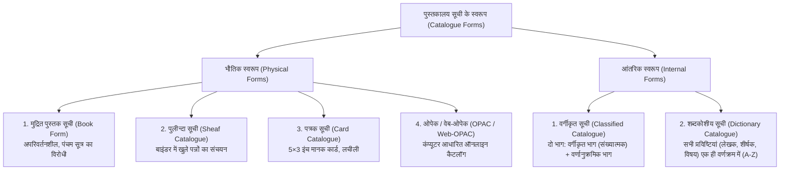
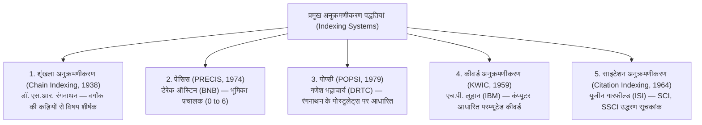

# इकाई 3 — ज्ञान संगठन: वर्गीकरण एवं सूचीकरण (Classification & Cataloguing)

## उप-इकाई 3.2: सूचीकरण, मानक संहिताएं एवं अनुक्रमणीकरण पद्धतियां  
*(SubUnit 3.2: Cataloguing Codes, Standards, OPAC and Indexing Systems — AACR-2, RDA, MARC-21, ISBD, Chain Indexing, PRECIS, POPSI)*

> **द्विभाषी विस्तृत अध्ययन सामग्री | Bilingual In-depth Study Notes (Hindi & English)**  
> लक्ष्य: बिहार विद्यालय पुस्तकालयाध्यक्ष पात्रता परीक्षा 2026 (Bihar School Librarian Eligibility Test 2026)

---

### भाग 1: पुस्तकालय सूची — अवधारणा एवं कटर के उद्देश्य (Concept & Cutter's Objectives)

**पुस्तकालय सूची (Library Catalogue):**  
पुस्तकालय में उपलब्ध संपूर्ण पाठन सामग्री का एक व्यवस्थित, वैज्ञानिक एवं अद्यतन रिकॉर्ड, जो पाठकों को सामग्री खोजने और उसका चयन करने में मार्गदर्शन करता है।  
*An organized, systematic, and up-to-date bibliographic record of the complete holdings of a library designed to guide patrons in discovering and selecting materials.*

#### सी.ए. कटर द्वारा प्रतिपादित सूची के तीन मौलिक उद्देश्य (C.A. Cutter's Objectives, 1876):
चार्ल्स एम्मी कटर (Charles Ammi Cutter) ने अपनी पुस्तक *"Rules for a Dictionary Catalog"* (1876) में सूची के निम्नलिखित तीन उद्देश्य बताए:
1. **खोजना (To Find):** किसी पुस्तक को खोजना जब उसका **लेखक (Author)**, **आख्या / शीर्षक (Title)**, अथवा **विषय (Subject)** ज्ञात हो।
2. **प्रदर्शित करना (To Show):** यह दिखाना कि पुस्तकालय में किसी लेखक विशेष की, किसी विषय विशेष की, अथवा किसी साहित्य विशेष की कौन-कौन सी पुस्तकें उपलब्ध हैं।
3. **चयन में सहायता करना (To Assist in Choice):** पुस्तक के संस्करण (Edition) अथवा उसके स्वरूप/चरित्र के आधार पर पाठक को सही पुस्तक चुनने में सहायता करना।

---

### भाग 2: सूची के भौतिक एवं आंतरिक स्वरूप (Physical and Internal Forms)

---

### भाग 3: प्रमुख सूचीकरण संहिताएं (Historical Cataloguing Codes)

| वर्ष (Year) | सूचीकरण संहिता (Cataloguing Code) | प्रणेता / संस्था (Author/Sponsor) | मुख्य विशेषता (Key Feature) |
| :---: | :--- | :--- | :--- |
| **1841** | **Panizzi's 91 Rules** | सर एंथोनी पाणिज्जी (ब्रिटिश म्यूजियम) | आधुनिक सूचीकरण संहिताओं की जननी (Mother of Codes)। |
| **1876** | **Rules for a Dictionary Catalog (RDC)** | चार्ल्स एम्मी कटर (C.A. Cutter) | शब्दकोशीय सूची के प्रथम पूर्ण नियम एवं उद्देश्य। |
| **1908** | **Anglo-American Code (AA Code)** | ALA (USA) एवं LA (UK) | प्रथम संयुक्त अंतरराष्ट्रीय संहिता। |
| **1934** | **Classified Catalogue Code (CCC)** | **डॉ. एस.आर. रंगनाथन** | **भारत की प्रथम पूर्ण वैज्ञानिक वर्गीकृत संहिता** (5वां संस्करण 1964 में)। |
| **1961** | **पेरिस सिद्धांत (Paris Principles)** | ICCP (UNESCO/IFLA, पेरिस) | अंतरराष्ट्रीय सूचीकरण सिद्धांतों पर वैश्विक सहमति। |
| **1967** | **AACR-1** | संयुक्त संचालन समिति (JSC) | पेरिस सिद्धांतों पर आधारित प्रथम संहिता। |
| **1978** | **AACR-2** | संपादक: माइकल गोरमैन व पॉल विंकलर | ISBD प्रारूप पर आधारित; 2 भाग (विवरण व शीर्षक)। |
| **2010** | **RDA (Resource Description & Access)** | JSC / अंतरराष्ट्रीय कार्यदल | AACR-2 का आधुनिक डिजिटल उत्तराधिकारी (FRBR आधारित)। |

---

### भाग 4: AACR-2 एवं रंगनाथन की CCC का तुलनात्मक ढांचा  
*(Structure of Main Entry: AACR-2 vs. CCC)*

#### 1. रंगनाथन की वर्गीकृत सूची संहिता (CCC) की मुख्य प्रविष्टि के 6 अनुच्छेद:
1. **अग्र अनुच्छेद (Leading Section):** इसमें पुस्तक का **कॉल नंबर (Call Number)** पेंसिल से लिखा जाता है।
2. **शीर्षक अनुच्छेद (Heading Section):** लेखक अथवा सह-लेखक का नाम।
3. **आख्या अनुच्छेद (Title Section):** पुस्तक का शीर्षक, संस्करण और सहकर्मी (अनुवादक, संपादक)।
4. **टिप्पणी अनुच्छेद (Note Section):** ग्रंथमाला (Series) विवरण।
5. **परिग्रहण संख्या (Accession Number):** मुख्य कार्ड के सबसे नीचे बाएं कोने में।
6. **ट्रेसिंग (Tracing):** मुख्य कार्ड के पीछे (Reverse Side) बनाई जाती है, जो बताती है कि इस मुख्य प्रविष्टि हेतु कौन-कौन सी अतिरिक्त प्रविष्टियां (Added Entries) तैयार की गई हैं।

#### 2. एएसीआर-2 (AACR-2):
* **दो मुख्य भाग:**  
  * **भाग 1 (Description):** ISBD मानकों पर आधारित 13 अध्याय (सामान्य नियम, पुस्तकें, कार्टोग्राफिक, पांडुलिपियां, इलेक्ट्रॉनिक संसाधन आदि)।
  * **भाग 2 (Headings, Uniform Titles, References):** अध्याय 21 से 26 तक।
* **तीन का नियम (Rule of Three in AACR-2):**  
  यदि किसी पुस्तक के **3 तक लेखक** हैं, तो मुख्य प्रविष्टि प्रथम लेखक के नाम से बनेगी और शेष 2 लेखकों की सहायक प्रविष्टियां (Added Entries) बनेंगी। यदि **3 से अधिक लेखक** (उदा. 4 या अधिक) हैं, तो मुख्य प्रविष्टि **शीर्षक (Title)** के अंतर्गत बनेगी और केवल प्रथम लेखक का नाम लिखकर उसके आगे **[...et al.]** लिख दिया जाता है।

---

### भाग 5: आरडीए एवं एफआरबीआर (RDA & FRBR Model)

* **RDA (Resource Description and Access, 2010):**  
  यह डिजिटल युग में सभी प्रकार के पारंपरिक एवं ई-संसाधनों (Webpages, E-books, Streaming Media) के सूचीकरण हेतु विकसित नवीनतम मानक है।
* **FRBR मॉडल (Functional Requirements for Bibliographic Records, 1998 - IFLA):**  
  आरडीए पूरी तरह एफआरबीआर के **WEMI मॉडल** पर आधारित है:
  1. **Work (कृति):** अमूर्त बौद्धिक या कलात्मक सृजन (उदा. शेक्सपियर का *Hamlet*)।
  2. **Expression (अभिव्यक्ति):** कृति का भाषाई या बौद्धिक रूप (उदा. अंग्रेजी पाठ या हिंदी अनुवाद)।
  3. **Manifestation (प्रकाशन स्वरूप):** भौतिक प्रकाशन रूप (उदा. पेंगुइन बुक्स द्वारा 2020 में प्रकाशित पेपरबैक)।
  4. **Item (भौतिक प्रति):** किसी विशिष्ट पुस्तकालय की शेल्फ पर रखी बारकोड वाली एकल प्रति।

---

### भाग 6: मार्क-21 के अनिवार्य टैग (Essential MARC-21 Tags)

मार्क-21 (Machine-Readable Cataloging) ग्रंथपरक डेटा को कंप्यूटर द्वारा पढ़े जाने योग्य प्रारूप में कोडित करता है:

| MARC-21 टैग | विवरण (Hindi) | Field Description (English) |
| :---: | :--- | :--- |
| **020** | **अंतरराष्ट्रीय मानक पुस्तक संख्या** | **ISBN (International Standard Book Number)** |
| **022** | **अंतरराष्ट्रीय मानक सामयिकी संख्या** | **ISSN (International Standard Serial Number)** |
| **082** | **डेवी दशमलव वर्गीकरण संख्या** | **DDC Call Number** |
| **100** | **मुख्य प्रविष्टि — व्यक्तिगत लेखक** | **Main Entry — Personal Name (Author)** |
| **110** | **मुख्य प्रविष्टि — संस्थागत निकाय** | **Main Entry — Corporate Name** |
| **245** | **शीर्षक एवं दायित्व कथन** | **Title and Statement of Responsibility ($a Title, $b Subtitle, $c Author)** |
| **250** | **संस्करण विवरण** | **Edition Statement** |
| **260 / 264** | **प्रकाशन एवं वितरण विवरण** | **Publication / Imprint ($a Place, $b Publisher, $c Year)** |
| **300** | **भौतिक विवरण** | **Physical Description ($a Pages, $b Illustrations, $c Size)** |
| **490 / 440** | **ग्रंथमाला विवरण** | **Series Statement** |
| **500** | **सामान्य टिप्पणी** | **General Note** |
| **650** | **विषय सहायक प्रविष्टि (शीर्षक)** | **Subject Added Entry — Topical Term** |
| **700** | **सहायक प्रविष्टि — व्यक्तिगत सह-लेखक** | **Added Entry — Personal Name (Joint Author / Editor)** |

---

### भाग 7: प्रमुख अनुक्रमणीकरण पद्धतियां (Subject Indexing Systems)

#### 1. शृंखला अनुक्रमणीकरण (Chain Indexing / Chain Procedure):
* **प्रणेता:** **डॉ. एस.आर. रंगनाथन (1938)**, पुस्तक: *"Theory of Library Catalogue"*।
* **पद्धति:** किसी प्रलेख के वर्गांक (Class Number) की शृंखला का विश्लेषण कर वर्णानुक्रमिक विषय प्रविष्टियां (Subject Headings) तैयार की जाती हैं।
* **चार प्रकार की कड़ियां (Four Links):**
  1. **मिथ्या कड़ी (False Link):** योजक चिह्न या अधूरी संख्या जो किसी स्वतंत्र विषय को नहीं दर्शाती।
  2. **अवांछित कड़ी (Unsought Link):** वह व्यापक श्रेणी जिसकी पाठक सामान्यतः मांग नहीं करते।
  3. **वांछित कड़ी (Sought Link):** वास्तविक विषय जिसका पाठक द्वारा खोजा जाना अपेक्षित है (यह विषय प्रविष्टि बनती है)।
  4. **लुप्त कड़ी (Missing Link):** वह श्रेणी जो अनुसूची में छूट गई हो।

#### 2. प्रेसिस (PRECIS - Preserved Context Indexing System):
* **प्रणेता:** **डेरेक ऑस्टिन (Derek Austin, 1974)** ब्रिटिश नेशनल बिब्लियोग्राफी (BNB) हेतु।
* **विशेषता:** संदर्भ को अक्षुण्ण रखते हुए दो-पंक्ति तीन-भाग प्रविष्टि संरचना:
  * **Lead (अग्र भाग)** | **Qualifier (विभाजक)**
  * **Display (प्रदर्शक)**
* इसमें व्याकरणिक संबंध स्थापित करने हेतु **भूमिका प्रचालकों (Role Operators 0 से 6)** का उपयोग होता है।

#### 3. पोप्सी (POPSI - Postulate-based Permuted Subject Indexing):
* **प्रणेता:** **गणेश भट्टाचार्य (Ganesh Bhattacharyya, 1979)**, DRTC बेंगलुरु।
* यह डॉ. रंगनाथन के आधारभूत सिद्धांतों (Postulates) और PMEST श्रेणियों पर आधारित क्रमपरिवर्तित (Permuted) विषय अनुक्रमणीकरण है।

#### 4. कीवर्ड अनुक्रमणीकरण (KWIC - Keyword in Context):
* **प्रणेता:** **हंस पीटर लुहान (H.P. Luhn, 1959)**, IBM वैज्ञानिक।
* यह शीर्षक के महत्वपूर्ण शब्दों (Keywords) को कंप्यूटर द्वारा स्वतः केंद्र (Center) में लाकर वर्णानुक्रम में सजाता है।

#### 5. साइटेशन अनुक्रमणीकरण (Citation Indexing):
* **प्रणेता:** **यूजीन गारफील्ड (Eugene Garfield, 1964)**, इंस्टीट्यूट फॉर साइंटिफिक इंफॉर्मेशन (ISI, फिलाडेल्फिया)।
* इसके तहत *Science Citation Index* (SCI) और *Social Sciences Citation Index* (SSCI) का प्रकाशन हुआ।

---

### भाग 8: Exam POV उच्च-प्राथमिकता वन-लाइनर्स (15 High-Yield Facts)

1. **सूचीकरण संहिता की जननी (Mother of Cataloguing Codes) किसे कहा जाता है?** — **पाणिज्जी के 91 नियम (Panizzi's 91 Rules, 1841)**।
2. **'Rules for a Dictionary Catalog' (1876) पुस्तक के लेखक कौन हैं?** — **चार्ल्स एम्मी कटर (C.A. Cutter)**।
3. **डॉ. रंगनाथन द्वारा रचित 'Classified Catalogue Code' (CCC) का प्रथम संस्करण कब आया?** — **1934** में।
4. **CCC की मुख्य प्रविष्टि में कॉल नंबर (Call Number) किस सेक्शन में लिखा जाता है?** — **अग्र अनुच्छेद (Leading Section) में, पेंसिल से**।
5. **AACR-2 के प्रथम और द्वितीय संपादक कौन थे?** — **माइकल गोरमैन (Michael Gorman) एवं पॉल विंकलर (1978)**।
6. **AACR-2 के अनुसार यदि 3 से अधिक लेखक हों तो मुख्य प्रविष्टि किसके तहत बनती है?** — **आख्या / शीर्षक (Title)** के तहत।
7. **RDA (Resource Description and Access, 2010) किसका उत्तराधिकारी है?** — **AACR-2 का**।
8. **FRBR मॉडल का 'WEMI' का पूर्ण रूप क्या है?** — **Work, Expression, Manifestation, Item**।
9. **MARC-21 में टैग '245' और '100' क्रमशः किसे दर्शाते हैं?** — **245 = शीर्षक एवं दायित्व कथन; 100 = मुख्य प्रविष्टि व्यक्तिगत लेखक**।
10. **MARC-21 में ISBN किस टैग में दर्ज होता है?** — **टैग 020 में** (ISSN टैग 022 में)।
11. **शृंखला अनुक्रमणीकरण (Chain Indexing) का आविष्कार किसने और कब किया था?** — **डॉ. एस.आर. रंगनाथन ने 1938 में** (*Theory of Library Catalogue* में)।
12. **प्रेसिस (PRECIS) अनुक्रमणीकरण पद्धति का विकास किसने किया था?** — **डेरेक ऑस्टिन (Derek Austin) ने 1974 में** (BNB हेतु)।
13. **पोप्सी (POPSI) अनुक्रमणीकरण पद्धति के जनक कौन हैं?** — **गणेश भट्टाचार्य (1979, DRTC बेंगलुरु)**।
14. **KWIC (Keyword in Context) अनुक्रमणीकरण के आविष्कारक कौन हैं?** — **एच.पी. लुहान (H.P. Luhn, 1959)**।
15. **साइंस साइटेशन इंडेक्स (SCI) और साइटेशन अनुक्रमणीकरण के जनक कौन हैं?** — **यूजीन गारफील्ड (Eugene Garfield, 1964)**।
