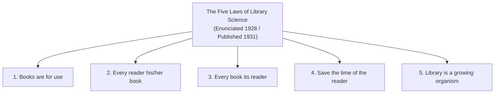

# Unit 1 — Foundations of Library Science

## Sub-Unit 1.2: Biography of Dr. S.R. Ranganathan, Contributions and Five Laws of Library Science

> **Comprehensive English Study Notes**  
> Target: Bihar School Librarian Eligibility Examination 2026

---

### Part 1: Dr. S.R. Ranganathan — Biography & Background

| Attribute | Details (English) |
| :--- | :--- |
| **Full Name** | Shiyali Ramamrita Ranganathan (S.R. Ranganathan) |
| **Date of Birth** | 9 August 1892 (Officially recorded: 12 August 1892) |
| **Birthplace** | Shiyali (Sirkazhi), Thanjavur District, Madras Presidency (Tamil Nadu) |
| **Parents** | Father: Ramamrita Ayyar, Mother: Seethalakshmi |
| **Date of Demise** | 27 September 1972 (Bangalore, Karnataka) |
| **Primary Education** | M.A. in Mathematics (1916), Madras Christian College |
| **Academic Mentor** | Prof. Edward B. Ross (Professor of Mathematics) |
| **Library Mentor** | W.C. Berwick Sayers (University College London / Croydon Public Library, UK) |
| **Honorary Titles & Honors** | Rao Sahib (1935), Padma Shri (1957), National Research Professor (1965) |

---

### Part 2: Professional Career Timeline

1. **Lecturer in Mathematics (1917–1923):**
   * Began his professional career teaching mathematics at Government College Mangalore, Government College Coimbatore, and Presidency College Madras.
2. **First Librarian of the University of Madras (1924–1944):**
   * Appointed as the first full-time University Librarian of Madras University in January 1924.
   * Traveled to the UK (September 1924 – July 1925) for professional training at the School of Librarianship, University College London, under the mentorship of **W.C. Berwick Sayers**.
3. **Madras Library Association (MALA, 1928):**
   * Founded MALA on January 31, 1928, along with K.V. Krishnaswamy Ayyar. MALA published Ranganathan's landmark treatises.
4. **Banaras Hindu University (BHU, 1945–1947):**
   * Invited by Pandit Madan Mohan Malaviya and Dr. S. Radhakrishnan to serve as University Librarian and Professor of Library Science at BHU.
5. **University of Delhi (1947–1955):**
   * Invited by Vice-Chancellor **Sir Maurice Gwyer** to establish the Department of Library Science at Delhi University.
   * **Landmark Milestones:** Instituted a Diploma course in 1948, the country's first Master's degree (**M.Lib.Sc.**) in 1949, and a **Ph.D. program** in 1951.
   * **First Ph.D. in India and the Commonwealth:** In **1957**, under Ranganathan's supervision, **Dr. D.B. Krishna Rao** was awarded the first Doctorate in Library Science in India and the Commonwealth (Research Thesis: *"Facet Analysis and Depth Classification of Agriculture"*).
6. **DRTC, Bangalore (Documentation Research and Training Centre, 1962):**
   * Founded **DRTC** in Bangalore in January **1962** under the auspices of the Indian Statistical Institute (ISI) with the support of eminent statistician Prof. P.C. Mahalanobis. Served as its Honorary Director for life.
7. **National Research Professor (1965):**
   * Appointed by the Government of India in 1965 as the first (and only) National Research Professor in Library Science.
8. **National Librarian's Day:**
   * Celebrated nationwide across India every year on his official birth date, **12 August**, as National Librarian's Day.

---

### Part 3: Major Published Treatises of Dr. S.R. Ranganathan

| Year | Book Title | Key Significance |
| :---: | :--- | :--- |
| **1931** | **The Five Laws of Library Science** | First published book expounding the fundamental five laws (Foreword: Sir P.S. Sivaswami Ayyar; Introduction: W.C. Berwick Sayers). |
| **1933** | **Colon Classification (CC)** | First Edition of the pioneering Analytico-Synthetic classification scheme; introduced PMEST facet formula. |
| **1934** | **Classified Catalogue Code (CCC)** | India's first complete classified cataloguing code (5th ed. in 1964 with A. Neelameghan). |
| **1937** | **Prolegomena to Library Classification** | Masterpiece detailing the normative principles, postulates, and canons of classification (2nd ed. 1957, 3rd ed. 1967). |
| **1938** | **Theory of Library Catalogue** | Formulated the fundamental Canons of Cataloguing. |
| **1940** | **Reference Service and Bibliography** | Foundational treatise on reference services, co-authored with K.M. Sivaraman. |
| **1951** | **Library Development Plan** | A comprehensive 30-year national blueprint for library infrastructure in India. |
| **1953** | **Dictionary Catalogue Code** | Standardized rules and canons for dictionary cataloguing. |
| **1961** | **Reference Service** | Independent theory and practical distinction between Ready Reference and Long-Range Reference Service. |
| **1973** | **Documentation: Genesis and Development** | Published posthumously; advanced research on documentation and information science. |
| **1992** | **A Librarian Looks Back** | Ranganathan's autobiography (edited and published by P.N. Kaula). |

---

### Part 4: The Five Laws of Library Science — In-Depth Analysis

Dr. S.R. Ranganathan enunciated the Five Laws in **1928** at Meenakshi College, Annamalainagar. They were published in book form in 1931 by the Madras Library Association.

---

#### 1. First Law: Books Are For Use
* **Philosophical Transformation:**  
  Overturned the medieval concept of chaining books for mere preservation. Proclaimed that books are not meant to be locked away in vaults, but exist for **maximum utilization**.
* **Key Implications & Applications:**
  1. **Library Location:** Located centrally within a city, town, or academic campus for easy accessibility.
  2. **Library Hours:** Kept open during evening hours, weekends, and holidays to suit working patrons.
  3. **Building & Furniture:** Ergonomic seating, proper lighting, ventilation, and shelf height restricted to human height (approx. 2.2 meters / 7 feet) so books can be reached without ladders.
  4. **Book Selection:** Acquired based on real user needs rather than rarity alone.
  5. **Staff Attitude:** Staff should act as friendly guides rather than rigid custodians.
  6. **Open Access System:** Direct physical access to bookshelves.

---

#### 2. Second Law: Every Reader His/Her Book
* **Philosophical Foundation:**  
  Embodies the principle of **"Books for All"** and universal democratization of knowledge. Focuses on the user perspective, asserting that every citizen—regardless of socioeconomic status, age, literacy level, or physical capability—is entitled to access appropriate reading material.
* **Obligations of Four Key Stakeholders:**
  1. **Obligations of the State:** Enact public library legislation, establish sustainable funding through library cess or budgetary grants, and create a coordinated library network.
  2. **Obligations of Library Authority:** Formulate user-centric book selection policies and recruit qualified, service-oriented staff.
  3. **Obligations of Library Staff:** Understand patron needs and deliver personalized reference service.
  4. **Obligations of Readers:** Handle materials carefully, return books promptly, and abide by library rules.
* **Service to Marginalized Groups:** Directs the provision of Braille literature for the visually impaired, prison libraries for inmates, hospital libraries for patients, and pictorial literacy resources for neo-literates.

---

#### 3. Third Law: Every Book Its Reader
* **Philosophical Foundation:**  
  Champions the perspective of **The Book**. Dictates that every acquired book must find its intended reader and not sit neglected on library shelves.
* **Practical Measures:**
  1. **Open Access System:** The most powerful tool for this law. Allows serendipitous discovery when browsing shelves.
  2. **Classified Shelf Arrangement:** Arranging books by subject classification so related materials stand together.
  3. **Analytical & Cross-Reference Entries:** Preparing cross-reference index entries in the catalogue for hidden chapters and specialized essays.
  4. **Display of New Arrivals:** Prominent display of recent acquisitions at entrances and display racks.
  5. **Library Extension Activities:** Organizing book exhibitions, author talks, reading circles, and public lectures to draw attention to dormant titles.

---

#### 4. Fourth Law: Save the Time of the Reader
* **Philosophical Foundation:**  
  Emphasizes operational efficiency and patron satisfaction. A library's technical and administrative workflows must minimize the time a user spends locating and retrieving information.
* **Techniques & Innovations:**
  1. **Efficient Circulation Systems:** Replacing sluggish ledgers with rapid two-card systems like the **Browne System (1895)** and the **Newark System (1900)**.
  2. **Open Access:** Saves hours spent submitting request slips in closed access libraries.
  3. **Centralized & Pre-natal Cataloguing:** Processing books at the point of publication to eliminate processing bottlenecks.
  4. **Reference Service:** Competent reference librarians transform multi-hour searches into minutes.
  5. **Signboards & Stack Guides:** Clear floor plans, bay guides, and shelf tags.
  6. **Library Automation & OPAC:** Barcode/RFID scanners and computer cataloguing for instantaneous search.
* **Corollary:** *"Save the time of the staff"* — Ranganathan invented the Three-Card System for periodicals management to optimize staff time.

---

#### 5. Fifth Law: The Library Is a Growing Organism
* **Philosophical Foundation:**  
  Establishes the biological analogy of the library as a living organism that must either grow or perish.
* **Two Modes of Growth:**
  1. **Child Growth:** Rapid physical expansion in collection volume, reader numbers, staff, and physical building during early development.
  2. **Adult Growth:** Mature phase where physical expansion is finite; growth occurs through qualitative enrichment and the replacement of older parts with new material.
* **Critical Implications:**
  1. **Weeding Out Obsolete Books:** Just as a living body sheds dead cells, a library must systematically weed out worn-out, obsolete, and misleading items to preserve health.
  2. **Flexible Classification & Cataloguing Schemes:** Requires expansive, open-ended notation systems (such as DDC and Colon Classification). Utilizes flexible standard 5"x3" catalogue cards and digital OPACs rather than rigid bound book catalogues.
  3. **Modular Building Design:** Constructing modular library architecture capable of accommodating structural expansion over 20 to 30 years.

---

### Part 5: Modern Adaptations of the Five Laws

#### 1. Michael Gorman's Five New Laws of Librarianship (1998):
1. Libraries serve humanity.
2. Respect all forms by which knowledge is communicated.
3. Use technology intelligently to enhance service.
4. Protect free access to knowledge.
5. Honor the past and create the future.

#### 2. Alireza Noruzi's Five Laws of the Web (2004):
1. Web resources are for use.
2. Every user his/her web resource.
3. Every web resource its user.
4. Save the time of the user.
5. The Web is a growing organism.

---

### Part 6: Master Comparative Matrix for Examinations

| Law | Core Motto | Strategic Focus | Prominent Practical Applications |
| :--- | :--- | :--- | :--- |
| **First Law** | Utility | The Book in Use | Central location, convenient hours, ergonomic furniture, courteous staff |
| **Second Law** | Democratization | The Reader's Rights | Library legislation, library cess, mobile/Braille/prison libraries |
| **Third Law** | Visibility | The Book finding its Reader | Open access, classified shelf arrangement, book displays, extension talks |
| **Fourth Law** | Efficiency | The Reader's Time | Browne/Newark charging, OPAC, stack guides, reference service |
| **Fifth Law** | Evolution | The Living Organism | Weeding out obsolete materials, card/OPAC catalogue, modular architecture |

---

### Part 7: High-Yield Exam Points & One-Liners

1. **Where and when were the Five Laws first enunciated?**  
   In **1928** at Meenakshi College, Annamalainagar.
2. **When was 'The Five Laws of Library Science' published?**  
   In **1931** by the Madras Library Association (MALA).
3. **Who contributed the Foreword and Introduction to the book?**  
   Foreword: **Sir P.S. Sivaswami Ayyar**; Introduction: **W.C. Berwick Sayers**.
4. **When is National Librarian's Day celebrated in India?**  
   Every year on **12 August** (Ranganathan's official birthday).
5. **Who earned the first Ph.D. in Library Science in India?**  
   **Dr. D.B. Krishna Rao** in **1957** (Delhi University, guided by Dr. S.R. Ranganathan).
6. **When was DRTC Bangalore established?**  
   In January **1962** (in collaboration with Prof. P.C. Mahalanobis).
7. **When was Dr. Ranganathan awarded the Padma Shri?**  
   In **1957** by the Government of India.
8. **When was Dr. Ranganathan appointed National Research Professor?**  
   In **1965**.
9. **Which law directly mandates library legislation and library cess?**  
   The **Second Law (Every reader his/her book)**.
10. **Which law is most strongly championed by Open Access?**  
    The **Third Law** (primarily), as well as the First and Fourth Laws.
11. **Which law justifies rapid circulation methods like Browne and Newark?**  
    The **Fourth Law (Save the time of the reader)**.
12. **Which law biologically necessitates the weeding out of obsolete books?**  
    The **Fifth Law (The library is a growing organism)**.
13. **Which law introduces the concept of Child Growth versus Adult Growth?**  
    The **Fifth Law**.
14. **Which law shifted the library paradigm from preservation to utilization?**  
    The **First Law**.
15. **In which work did Michael Gorman enunciate the Five New Laws of Librarianship?**  
    In *Our Singular Strengths* (**1998**).
