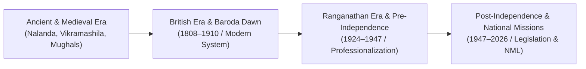
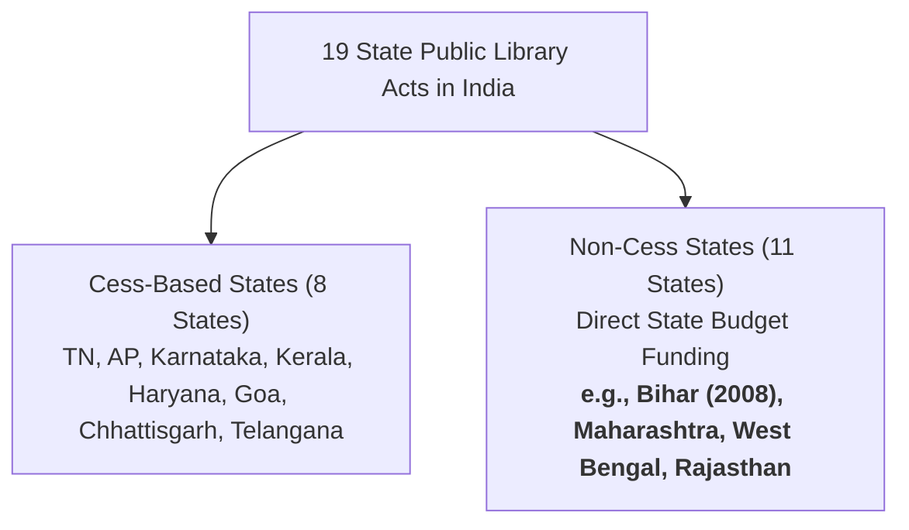

# Unit 1 — Foundations of Library Science

## Sub-Unit 1.3: Library Movement, Education and Legislation in India & Bihar

> **Comprehensive English Study Notes**  
> Target: Bihar School Librarian Eligibility Examination 2026

---

### Part 1: Historical Evolution of Library Movement in India

India possesses an illustrious and ancient tradition of libraries, spanning from ancient antiquity to the modern digital era across four major epochs:

#### 1. Ancient & Medieval Heritage:
* **Nalanda University Library (Bihar):** Renowned Buddhist monastic university library known collectively as **'Dharmaganja' (Piety of Religion)**. It comprised three massive multi-storeyed buildings:
  1. **Ratnasagara:** The towering 9-storeyed central repository.
  2. **Ratnodadhi**
  3. **Ratnaranjaka**  
  *(Note: Sacked and destroyed in 1193 AD during Bakhtiyar Khilji's invasion.)*
* **Other Ancient Centers in Bihar:** Vikramashila (Bhagalpur, Bihar), Odantapuri (Bihar Sharif, Bihar), and Taxila (ancient Gandhara, present-day Pakistan).
* **Medieval Period:** Royal Mughal Imperial libraries (**Imperial Kitabkhana**) maintained by Babur, Humayun, and Akbar. Emperor Humayun tragically died from a fall down the stairs of his personal library at Sher Mandal. Emperor Akbar established official administrative titles: **'Nazim'** (Head Librarian / Imperial Director) and **'Muhtamim'** (Assistant / Cataloguing In-charge).

#### 2. Dawn of Modern Library Movement:
* **1808 (Bombay Government Resolution):** The Bombay Presidency government registered a proposal to provide books and financial grants to encourage public library development—marking the first instance of state patronage for libraries in India.
* **1836 (Calcutta Public Library):** Established as a proprietary public library, eventually merged into the Imperial Library in 1903 and designated the National Library of India in 1948.
* **1910 — Baroda State Library Movement (The Baroda Epoch):**
  * Modern public library development in India was pioneered by **Maharaja Sayajirao Gaekwad III** of Baroda State.
  * In 1910, alongside compulsory primary education, he instituted a statewide, tax-supported **Free Public Library System**.
  * He recruited renowned American library specialist **William Alanson Borden (W.A. Borden)** as the Director of State Libraries.
  * **Historic Innovations:** Establishment of the Baroda Central Library, branch libraries, village reading rooms, separate children's and ladies' departments, and India's first **Travelling / Mobile Libraries**.
* **1914:** Founding of India's first state library association, the **'Andhra Desa Library Association' (Andhra Desa Grantha Nilaya Sangham)**, spearheaded by Iyyanki Venkata Ramanayya.
* **1928:** Dr. S.R. Ranganathan founded the **Madras Library Association (MALA)**.
* **1930 (Model Public Library Act):** Dr. Ranganathan drafted and presented India's first Model Public Library Act at the First All Asia Educational Conference held in Banaras.

#### 3. Post-Independence Committees & Missions:
* **K.P. Sinha Committee (Advisory Committee for Libraries, 1957):**
  * Appointed by the Government of India under the chairmanship of **K.P. Sinha**; submitted its seminal report in 1959.
  * **Recommendations:** Establishing a 4-tier coordinated public library network (National, State, District, and Block levels) over a 25-year period, along with a library cess of 6 paise per rupee on property tax in all states.
* **Raja Rammohun Roy Library Foundation (RRRLF, 1972):**
  * Established in May 1972 at Kolkata by the Ministry of Culture, Government of India.
  * **Mandate:** Apex autonomous national body providing matching (50:50 for general states; 90:10 for northeastern states) and non-matching (100%) financial assistance to public libraries across India.
* **National Policy on Library and Information Systems (NAPLIS, 1986):**
  * Drafted under the chairmanship of Prof. D.P. Chattopadhyaya.
* **National Knowledge Commission (NKC, 2005):**
  * Chaired by Sam Pitroda; its Working Group on Libraries recommended broad technological modernization, automated networking, and a national mission.
* **National Mission on Libraries (NML, 2014):**
  * Launched in 2014 by President Pranab Mukherjee; dedicated to upgrading district libraries, fostering digital connectivity, and developing national bibliographical repositories.

---

### Part 2: Development of LIS Education in India

| Year | Institution / Organization | Pioneer | Historical Significance |
| :---: | :--- | :--- | :--- |
| **1911** | Central Library, Baroda | **W.A. Borden** | Inaugurated the **first formal library training class** in India. |
| **1915** | University of the Punjab, Lahore | **Asa Don Dickinson** | First **university-level certificate course** in India; Dickinson authored *"Punjab Library Primer"* (1916). |
| **1929** | Madras Library Association (MALA) | Dr. S.R. Ranganathan | Certificate training program (elevated to a PG Diploma at Madras University in 1931). |
| **1937** | Andhra University, Visakhapatnam | - | Instituted a full-time PG Diploma in Library Science. |
| **1942** | Banaras Hindu University (BHU) | - | Instituted Diploma in Library Science (Dip.Lib.Sc.). |
| **1947** | University of Delhi (DU) | Sir Maurice Gwyer & Dr. Ranganathan | Established India's first independent **Department of Library Science**. |
| **1949** | University of Delhi | Dr. S.R. Ranganathan | Instituted the first **Master's Degree (M.Lib.Sc.)** in India and the Commonwealth. |
| **1951** | University of Delhi | Dr. S.R. Ranganathan | Launched India's first **Ph.D. program** in Library Science. |
| **1957** | University of Delhi | Dr. D.B. Krishna Rao (Scholar) | Awarded India's **first Ph.D. in Library Science** (Supervisor: Dr. Ranganathan). |
| **1962** | DRTC, Bangalore | Dr. S.R. Ranganathan | Advanced specialized training program in Documentation and Information Science. |
| **1963** | INSDOC, New Delhi | - | Launched Associateship in Information Science (AIS). |
| **1968** | Aligarh Muslim University (AMU) | - | Introduced India's first Bachelor of Library Science (**B.Lib.Sc.**) degree. |

---

### Part 3: Library Legislation in India

Library legislation provides statutory backing, stable financial support, and administrative structure for public library systems. To date, **19 states** in India have enacted Public Library Acts:

#### Chronological Master Table of All 19 State Library Acts:

| No. | State | Year of Act | Library Cess Status | Basis / Nature of Financing |
| :---: | :--- | :---: | :---: | :--- |
| **1** | **Tamil Nadu (Madras)** | **1948** | **Yes** | Surcharge on property tax / house tax (initially 3 paise, raised to 31 paise per rupee) |
| **2** | **Andhra Pradesh** | **1960** | **Yes** | 8 paise per rupee on house and property tax |
| **3** | **Karnataka (Mysore)** | **1965** | **Yes** | Most comprehensive cess: levied on property, land revenue, vehicles, and entry tax |
| **4** | **Maharashtra** | **1967** | **No** | Direct annual grant from the State Consolidated Fund (minimum Rs. 25 lakh) |
| **5** | **West Bengal** | **1979** | **No** | Direct state government budgetary grants |
| **6** | **Manipur** | **1988** | **No** | State budgetary allocation |
| **7** | **Haryana** | **1989** | **Yes** | Surcharge on property and local taxes |
| **8** | **Kerala** | **1989** | **Yes** | Surcharge on building tax / property tax |
| **9** | **Goa** | **1993** | **Yes** | Surcharge on Indian-Made Foreign Liquor (IMFL) |
| **10** | **Mizoram** | **1993** | **No** | State budgetary allocation |
| **11** | **Gujarat** | **2001** | **No** | State Consolidated Fund |
| **12** | **Odisha** | **2001** | **No** | State budgetary appropriation |
| **13** | **Uttarakhand** | **2005** | **No** | Annual state budgetary grant |
| **14** | **Rajasthan** | **2006** | **No** | State Education Department budget |
| **15** | **Uttar Pradesh** | **2006** | **No** | Direct state government funding |
| **16** | **Bihar** | **2008** | **No** | **Funded entirely by the State Department of Education (No Cess)** |
| **17** | **Chhattisgarh** | **2008** | **Yes** | Surcharge on entry tax and toll tax |
| **18** | **Arunachal Pradesh** | **2009** | **No** | State Consolidated Fund |
| **19** | **Telangana** | **2015** | **Yes** | Adopted the Andhra Pradesh Act 1960; surcharge on property tax |

> [!TIP]
> **Summary & Key Patterns:**
> * **8 Cess-Levying States:** Tamil Nadu, Andhra Pradesh, Karnataka, Haryana, Kerala, Goa, Chhattisgarh, Telangana.
> * **11 Non-Cess States:** Maharashtra, West Bengal, Manipur, Mizoram, Gujarat, Odisha, Uttarakhand, Rajasthan, Uttar Pradesh, **Bihar**, Arunachal Pradesh.
> * **First State to Enact:** Tamil Nadu (Madras, 1948) — spearheaded by Dr. S.R. Ranganathan.
> * **Most Recent State:** Telangana (2015).

---

### Part 4: Bihar Public Libraries and Information Centres Act, 2008

To grant statutory authority to the public library system in Bihar, the state legislature passed a dedicated act in 2008:

#### 1. Official Nomenclature & Enactment:
* **Official Title:** **The Bihar State Public Libraries and Information Centres Act, 2008**.
* **Year of Enactment:** **2008** (Bihar became the **16th state** in India to enact library legislation).

#### 2. The No-Cess Model:
* A hallmark feature of the Bihar Act is that **no library cess** is levied on the public.
* The entire financial commitment is borne directly through annual budgetary grants allocated by the **Department of Education, Government of Bihar**.

#### 3. Administrative Architecture:
1. **State Library Authority:**
   * President / Chairman: The Minister for Human Resource Development / Education, Government of Bihar.
   * Functions as the supreme statutory policy-making and budget-reviewing authority for libraries statewide.
2. **Directorate of Public Libraries:**
   * Executive agency operating within the Department of Education responsible for administrative management, staff allocations, and maintenance.
3. **District Library Authority:**
   * Chaired by the District Magistrate (DM) or a designated officer, coordinating district, sub-divisional, and block-level library operations.

#### 4. Landmark Historical Libraries in Bihar:
* **State Central Library of Bihar:** Sachchidananda Sinha Library (Radhika Sinha Institute), Patna (Est. 1924 by Dr. Sachchidananda Sinha).
* **Heritage Treasure:** Khuda Bakhsh Oriental Public Library, Patna (Est. 1891 by Maulvi Khuda Bakhsh; designated an Institute of National Importance by an Act of Parliament in 1969).

---

### Part 5: Master Comparative Matrix for Examinations

| Dimension / Topic | Historical Landmark (India) | Key Authority / Year |
| :--- | :--- | :--- |
| **Pioneer Public Library Movement** | Baroda State System | Maharaja Sayajirao Gaekwad III (1910) |
| **First American LIS Specialist** | Baroda State Library Director | W.A. Borden (1910) |
| **First University Course in LIS** | University of the Punjab, Lahore | Asa Don Dickinson (1915) |
| **First Independent LIS Department** | University of Delhi | Dr. S.R. Ranganathan & Sir Maurice Gwyer (1947) |
| **First Master's Degree (M.Lib.Sc.)** | University of Delhi | 1949 (First in Commonwealth) |
| **First Ph.D. Recipient in LIS** | Dr. D.B. Krishna Rao | University of Delhi (1957, Guide: Dr. Ranganathan) |
| **First State Library Act** | Madras / Tamil Nadu Public Libraries Act | 1948 (Cess-based) |
| **Bihar Public Library Act** | Bihar Public Libraries and Info Centres Act | 2008 (16th State, Non-Cess Model) |
| **State Levying Cess on Alcohol** | Goa Public Libraries Act | 1993 (Surcharge on IMFL) |
| **Most Comprehensive Cess Base** | Karnataka Public Libraries Act | 1965 (Property, Vehicles, Land Revenue, Entry) |

---

### Part 6: High-Yield Exam Points & One-Liners

1. **Who is recognized as the pioneer of the public library movement in India?**  
   **Maharaja Sayajirao Gaekwad III** of Baroda (1910).
2. **Where was India's first mobile/travelling library introduced?**  
   In **Baroda State** under the direction of W.A. Borden.
3. **Who authored the historic 'Punjab Library Primer' (1916)?**  
   American librarian **Asa Don Dickinson**.
4. **When and where was India's first university-level LIS training course launched?**  
   In **1915 at the University of the Punjab, Lahore**.
5. **Who introduced the Model Public Library Act at Banaras in 1930?**  
   **Dr. S.R. Ranganathan** (First All Asia Educational Conference).
6. **What was the primary mandate of the K.P. Sinha Committee (1957)?**  
   Advisory Committee for Public Libraries in India (Submitted report in 1959).
7. **When and where was RRRLF established?**  
   In **May 1972 at Kolkata** by the Ministry of Culture.
8. **Which was the first state in independent India to pass a Public Library Act?**  
   **Madras (Tamil Nadu) in 1948**.
9. **In which year was the Bihar State Public Libraries and Information Centres Act passed?**  
   In **2008**.
10. **What is Bihar's ranking among Indian states with library legislation?**  
    Bihar is the **16th state**.
11. **Does Bihar levy a library cess on taxes?**  
    **No**, it operates on a direct state budgetary funding model (Department of Education).
12. **Which state levies a library cess on Indian-Made Foreign Liquor (IMFL)?**  
    **Goa (1993)**.
13. **Which state is the 19th (and most recent) state to enact library legislation?**  
    **Telangana (2015)**.
14. **What was the name of the central 9-storeyed library building at Nalanda University?**  
    **Ratnasagara** (part of Dharmaganja).
15. **When was the National Mission on Libraries (NML) launched?**  
    In **2014** by President Pranab Mukherjee.
