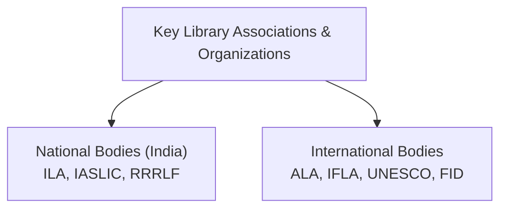

# Unit 1 — Foundations of Library Science

## Sub-Unit 1.4: National and International Library Associations & Organizations

> **Comprehensive English Study Notes**  
> Target: Bihar School Librarian Eligibility Examination 2026

---

### Introduction

Professional library associations serve as the backbone for protecting the interests of library professionals, formulating library standards, upholding professional codes of ethics, and fostering research and Continuing Professional Development (CPD).

---

### Part 1: National Library Associations & Organizations in India

---

#### 1. Indian Library Association (ILA)

* **Date of Establishment:** **13 September 1933**.
* **Founding Venue:** First All India Library Conference, held at the Asiatic Society Hall, Calcutta.
* **Legal Registration:** Registered in 1935 under the Societies Registration Act XXI of 1860.
* **First Office Bearers:**
  * **First President:** **Dr. M.O. Thomas**.
  * **First Secretary:** **Khan Bahadur K.M. Asadullah** (Librarian of the Imperial Library).
* **Headquarters:** **New Delhi** (A-40-41, Flat No. 201, Ansal Building, Dr. Mukherjee Nagar, Delhi - 110009).  
  *(Historical note: Founded in Calcutta in 1933, shifted to Delhi in 1946, back to Calcutta in 1953, and finally established permanently in Delhi in 1964.)*
* **Dr. S.R. Ranganathan's Presidency (Golden Era 1944–1953):**  
  Dr. Ranganathan served as President from 1944 to 1953, elevating the ILA onto the international stage and founding the renowned research quarterly *ABGILA*.
* **Key Publications:**
  1. **ABGILA** (*Annals, Bulletin, and Granthalaya of the Indian Library Association*): 1949–1953 (Edited by Dr. S.R. Ranganathan).
  2. **JILA** (*Journal of Indian Library Association*): Formerly *ILA Bulletin* (Published quarterly since 1965).
  3. **ILA Newsletter**: Official monthly publication.
* **National Library Week:**  
  Celebrated annually across India from **14 to 20 November** since **1968** (commencing on the birth anniversary of Jawaharlal Nehru).
* **Major Professional Honors:** P.N. Kaula Best Librarian Award, Dr. P.S.G. Kumar Lifetime Achievement Award, S.M. Ganguly Award.

---

#### 2. Indian Association of Special Libraries & Information Centres (IASLIC)

* **Date of Establishment:** **3 September 1955**.
* **Sobriquet:** Widely celebrated as the **"ASLIB of India"**.
* **First Office Bearers:**
  * **First President:** **Dr. S.L. Hora** (Eminent zoologist and scientist).
  * **First Honorary General Secretary:** **J. Saha**.
* **Headquarters:** **Kolkata** (P-291, CIT Scheme No. 6M, Kankurgachi, Kolkata - 700054).
* **Mandate & Activities:** Promoting coordination among special libraries, scientific research institutes, and documentation centers across India; providing technical translation and reprographic/microfilm services.
* **Key Publications:**
  1. **IASLIC Bulletin:** Published quarterly since 1956.
  2. **IASLIC Newsletter:** Monthly newsletter.
  3. **ILSA (Indian Library Science Abstracts):** Launched in **1967**; India's premier national abstracting periodical dedicated to library and information science literature.
* **Annual Honors:** IASLIC Best Librarian of the Year Award.

---

#### 3. Raja Rammohun Roy Library Foundation (RRRLF)

* **Date of Establishment:** **May 1972** (Founded by the Ministry of Culture, Government of India, commemorating the bicentenary of Raja Rammohun Roy).
* **Headquarters:** Block-DD-34, Sector-1, Salt Lake City, **Kolkata** - 700064.
* **Institutional Status:** The apex autonomous national body dedicated to promoting, supporting, and modernizing public library systems across India.
* **Financial Assistance Schemes:**
  1. **Matching Schemes:** Based on shared center-state funding ratios (50:50 for general states; 90:10 for northeastern states). Covers purchase of books, furniture, computerization, and building construction/renovation.
  2. **Non-Matching Schemes:** 100% central financial grants (for library conferences, national book fairs, establishment of children's and senior citizen sections, and mobile library vans).
* **CIP (Cataloguing in Publication):** The formal initiation of Cataloguing in Publication in India was supported by RRRLF.
* **Key Publications:** *Granthana: Indian Journal of Library Studies* (Biannual), *RRRLF Newsletter*, *Directory of Indian Public Libraries*.

---

### Part 2: International Library Associations & Organizations

---

#### 1. American Library Association (ALA)

* **Date of Establishment:** **6 October 1876** (Philadelphia, USA).
* **Historical Significance:** The **oldest and largest** library association in the world.
* **Founding Luminaries:** **Melvil Dewey**, Justin Winsor, and Charles Ammi Cutter (C.A. Cutter).
* **First Office Bearers:**
  * **First President:** **Justin Winsor** (1876–1885).
  * **First Secretary:** **Melvil Dewey** (1876–1890).
* **Headquarters:** **Chicago, Illinois, USA**.
* **Guiding Motto:**  
  *"The best reading, for the largest number, at the least cost"* — Melvil Dewey.
* **Key Operating Divisions:**
  * **ACRL** (Association of College and Research Libraries): Largest division for higher education and academic libraries.
  * **PLA** (Public Library Association): Division dedicated to advancing public libraries.
* **Prestigious Awards:**
  * **Newbery Medal (1922):** World-renowned prize for distinguished contribution to children's literature.
  * **Caldecott Medal (1938):** Premier honor for distinguished American picture books for children.
  * **Melvil Dewey Medal:** Awarded for creative professional achievement in classification and management.
* **National Library Week (USA):** Celebrated annually every **April** since 1958.

---

#### 2. International Federation of Library Associations and Institutions (IFLA)

* **Date of Establishment:** **30 September 1927** (Edinburgh, Scotland, during the 50th anniversary celebration of the Library Association, UK).
* **First President:** **Isak Collijn** (Sweden).
* **Headquarters:** **The Hague, Netherlands** (Housed in the Royal Library / National Library of the Netherlands).
* **Global Role:** The recognized **"Global Voice of Libraries and Information Professionals"**.
* **IFLA's Landmark Core Programs:**
  1. **UBC / UBCIM (Universal Bibliographic Control):** Launched in 1974; dedicated to ensuring the universal availability of standardized bibliographic data for all publications.
  2. **UAP (Universal Availability of Publications):** Launched in 1979; ensuring that published materials are readily accessible to any reader anywhere in the world.
  3. **PAC (Preservation and Conservation):** Launched in 1984; dedicated to preserving library materials worldwide.
* **Standardization Milestones:**  
  * Formulated **ISBD** (International Standard Bibliographic Description).  
  * Developed **FRBR** (Functional Requirements for Bibliographic Records) and the **LRM** (Library Reference Model).
* **Manifesto Collaborations:** Co-authored the UNESCO Public Library Manifesto (1994, 2022) and the School Library Manifesto (1999).
* **Global Congress:** **WLIC** (World Library and Information Congress).
* **Key Publications:** *IFLA Journal* (Quarterly), *IFLA Publications Series*.

---

#### 3. UNESCO (United Nations Educational, Scientific and Cultural Organization)

* **Date of Establishment:** **16 November 1945** (London); Constitution came into force on 4 November 1946.
* **Headquarters:** **Paris, France**.
* **Landmark Contributions to Library & Information Science:**
  1. **UNESCO Public Library Manifesto:** Published in 1949 (Original), revised in 1972, 1994 (with IFLA), and 2022.
  2. **Delhi Public Library (DPL, 1951):** Joint pilot project between UNESCO and the Government of India, established as South Asia's first model public library.
  3. **UNISIST (1971):** World Science Information System programme.
  4. **PGI (1976):** General Information Programme (*Programme General d'Information*), unifying UNISIST and NATIS under an integrated framework.
  5. **CDS/ISIS Software (1985):** Renowned non-numerical bibliographic database management software developed by UNESCO for mainframe and microcomputers.
  6. **Memory of the World Programme (1992):** Global initiative to preserve and digitize rare manuscripts and endangered documentary heritage.
  7. **UNESCO Book Coupons:** System designed to assist developing countries in purchasing foreign publications without currency restrictions.

---

#### 4. FID (International Federation for Information and Documentation)

* **Date of Establishment:** **12 September 1895** (Brussels, Belgium).
* **Founders:** **Paul Otlet** and **Henri La Fontaine** (Nobel Peace Prize Laureate, 1913).
* **Evolution of Nomenclature:**
  * 1895: **IIB** (*Institut International de Bibliographie*)
  * 1931: **IID** (*Institut International de Documentation*)
  * 1938: **FID** (*Federation Internationale de Documentation*)
  * 1988: **FID** (*International Federation for Information and Documentation*)
  * **Dissolution:** Officially dissolved in **2002** due to financial constraints.
* **Greatest Contribution:** Creation and development of the **Universal Decimal Classification (UDC)** in 1905.  
  *(Note: Paul Otlet is recognized as the 'Father of Documentation'.)*

---

### Part 3: Master Comparative Matrix of Library Associations

| Organization | Year Founded | Founding City | Current Headquarters | Founder / First Head | Major Landmark / Publication |
| :---: | :---: | :--- | :--- | :--- | :--- |
| **ALA** | **1876** | Philadelphia, USA | **Chicago, Illinois, USA** | Melvil Dewey, Justin Winsor | Oldest & largest association; Newbery & Caldecott Medals |
| **FID** | **1895** | Brussels, Belgium | The Hague (Dissolved 2002) | Paul Otlet, Henri La Fontaine | Developed UDC (1905); Pioneer of Documentation |
| **IFLA** | **1927** | Edinburgh, Scotland | **The Hague, Netherlands** | Isak Collijn | Global Voice; ISBD, UBC, UAP; IFLA Journal |
| **ILA** | **1933** | Calcutta (Asiatic Society) | **New Delhi, India** | Dr. M.O. Thomas, K.M. Asadullah | ABGILA, JILA; National Library Week (14–20 Nov) |
| **UNESCO** | **1945** | London, UK | **Paris, France** | UN Specialized Agency | DPL (1951), Public Library Manifesto, CDS/ISIS |
| **IASLIC** | **1955** | Kolkata, India | **Kolkata, India** | Dr. S.L. Hora, J. Saha | ILSA (Indian Library Science Abstracts); Special libraries |
| **RRRLF** | **1972** | Kolkata, India | **Kolkata, India** | Govt of India (Ministry of Culture) | Public library financing; Matching & Non-Matching grants |

---

### Part 4: High-Yield Exam Points & One-Liners

1. **Which is the oldest and largest library association in the world?**  
   **ALA (American Library Association, established 1876)**.
2. **What is the official motto of the American Library Association?**  
   *"The best reading, for the largest number, at the least cost"* (Melvil Dewey).
3. **Where is the headquarters of IFLA situated?**  
   In **The Hague, Netherlands** (Royal Library premises).
4. **Who launched the UBC (Universal Bibliographic Control) and UAP programs?**  
   **IFLA**.
5. **When was the Indian Library Association (ILA) established?**  
   On **13 September 1933** at Calcutta.
6. **Who were the first President and first Secretary of the ILA?**  
   First President: **Dr. M.O. Thomas**; First Secretary: **Khan Bahadur K.M. Asadullah**.
7. **Who was the founding editor of ILA's quarterly journal 'ABGILA' (1949–53)?**  
   **Dr. S.R. Ranganathan**.
8. **When and by whom is National Library Week celebrated across India?**  
   Every year from **14 to 20 November** by the **ILA** (instituted in 1968).
9. **Which Indian association is known as the "ASLIB of India"?**  
   **IASLIC (established 3 September 1955, Kolkata)**.
10. **Who publishes 'Indian Library Science Abstracts' (ILSA)?**  
    **IASLIC** (published since 1967).
11. **When was the Raja Rammohun Roy Library Foundation (RRRLF) established?**  
    In **May 1972** at Kolkata.
12. **Who provides matching and non-matching financial grants to public libraries in India?**  
    **RRRLF** (Ministry of Culture, Government of India).
13. **Delhi Public Library (DPL, 1951) was founded as a joint pilot project between the Government of India and which international body?**  
    **UNESCO**.
14. **Who founded FID in 1895 and what was its original name?**  
    **Paul Otlet and Henri La Fontaine**; originally named **IIB (Institut International de Bibliographie)**.
15. **Which organization developed the famous bibliographic database software CDS/ISIS?**  
    **UNESCO** (in 1985).
