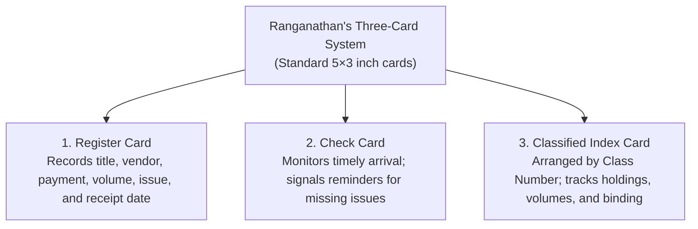

# Unit 2 — Library Management

## Sub-Unit 2.1: Collection Development and Acquisition Process

> **Comprehensive English Study Notes**  
> Target: Bihar School Librarian Eligibility Examination 2026

---

### Part 1: Collection Development — Concepts & Theories

**Collection Development:**  
Collection Development is a dynamic, systematic, and continuous process of building and maintaining a library's collection. It encompasses community information needs assessment, selection policy formulation, acquisition, collection evaluation, preservation, and the systematic weeding out of obsolete materials.

---

### Part 2: Classic Theories of Book Selection

Eminent library thinkers have formulated classic guiding principles governing book selection:

#### 1. Melvil Dewey's Principle (1876):
* **Guiding Motto:**  
  *"The best reading for the largest number at the least cost."*
* **Core Dimensions:** This principle synthesizes three essential pillars:
  1. **The Best Reading:** Content quality, authority, and literary/informational merit.
  2. **The Largest Number:** Meeting the democratic requirements of the widest user community.
  3. **The Least Cost:** Economical, prudent, and optimized utilization of available financial resources.

#### 2. Francis Drury's Principle (1930):
* Formulated in his classic treatise *"Book Selection"* (1930):  
  *"To provide the right book to the right reader at the right time."*
* **Analysis:** Emphasizes pinpointed matching between the intellectual needs of the patron (Right Reader) and the specific title (Right Book) at the exact moment of requirement (Right Time).

#### 3. L.R. McColvin's Demand and Supply Theory (1925):
* Treatise: *"The Theory of Book Selection for Public Libraries"* (1925).
* **Core Philosophy:** McColvin applied the economic law of demand and supply to library book selection:
  * Books are not ends in themselves; they serve as instruments to satisfy intellectual demand.
  * Libraries should select books based on **Expressed Demand** from current patrons or anticipated **Potential Demand** that can be nurtured.
  * Evaluated demand across two critical vectors: **Volume of Demand** (quantitative breadth) and **Value of Demand** (qualitative and educational worth).

#### 4. Dr. S.R. Ranganathan's Selection Theory (1952):
* In his work *"Library Book Selection"* (1952), Ranganathan grounded book selection upon the **Five Laws of Library Science**:
  * **First Law (Books are for use):** Acquire only materials that possess demonstrable utility; avoid building a dormant or unusable collection.
  * **Second Law (Every reader his/her book):** Ensure balanced representation catering to all user tiers (students, teachers, researchers, general citizens, and special groups).
  * **Third Law (Every book its reader):** Procure books for which potential readers exist within the parent community.

#### 5. Helen E. Haines' Theory (1935):
* Treatise: *"Living with Books: The Art of Book Selection"* (1935).
* Haines characterized book selection not as a mechanical clerical routine, but as an intellectual **'Art'** requiring deep appreciation of literary, educational, and humanistic values.

---

### Part 3: The Acquisition Process: Step-by-Step

The Acquisition Section manages the procurement of library materials through purchase, gifts/donations, and institutional exchanges:

1. **Selection & Recommendation:**  
   Collating requisitions from faculty, students, and subject specialists; consulting standard bibliographical sources (INB, BNB), publisher catalogues, and book review periodicals (*Times Literary Supplement*, *Book Review Digest*).
2. **Pre-Order Searching (Checking Duplication):**  
   Verifying that the requested item is not already held in the collection or on order (cross-checking the library catalogue and the outstanding on-order file) to prevent wasteful duplication.
3. **Ordering:**  
   Transmitting official Purchase Orders to approved vendors and publishers, specifying agreed discount rates, currency conversion norms, and delivery deadlines.
4. **Receipt, Verification & Accessioning:**  
   Unpacking parcels, verifying consignments against invoices and purchase orders, inspecting physical copies for printing and binding defects, and entering approved items into the Accession Register.

---

### Part 4: The Accession Register

The Accession Register represents the **permanent legal and financial record** of a library's holdings. Every book added to the collection receives an indelible, sequential serial number known as the **Accession Number**.

* **Standard 14 Columns of the Accession Register (BIS / ISI Standards):**  
  According to standard Indian library practice and Bureau of Indian Standards guidelines, the Accession Register consists of 14 standard columns:
  1. **Date:** Date of accessioning.
  2. **Accession Number:** Unique sequential serial number.
  3. **Author:** Full name of author(s) or editor.
  4. **Title:** Title and subtitle of the book.
  5. **Edition:** Edition statement.
  6. **Place & Publisher:** Place of publication and publisher's name.
  7. **Year:** Year of publication.
  8. **Pages / Collation:** Pagination and physical description.
  9. **Size:** Height and dimensions in centimeters.
  10. **Binding:** Type of binding (Paperback, Hardbound, Leather).
  11. **Source / Vendor:** Vendor name or donor details.
  12. **Cost & Bill Details:** Price, bill/invoice number, and voucher date.
  13. **Call Number:** Class Number + Book Number (+ Collection/Location mark).
  14. **Remarks / Withdrawal:** Status changes (lost, discarded, or weeded out).

---

### Part 5: Periodicals Acquisition — Ranganathan's Three-Card System

Due to the complex, recurring nature of journals and serials, Dr. S.R. Ranganathan designed the **Three-Card System**, employing standardized 5" × 3" (12.5 cm × 7.5 cm) cards:

1. **Register Card:**  
   Maintains title, publisher, vendor, annual subscription payment, volume number, issue number, and recording date of receipt.
2. **Check Card:**  
   Fitted with weekly/monthly grids to verify regular arrival. Pinpoints delayed or non-received issues, triggering prompt **reminders** to subscription agents.
3. **Classified Index Card:**  
   Arranged strictly by the Class Number of the periodical. Informs readers and staff regarding exact holdings, missing numbers, and volumes sent to the bindery.

---

### Part 6: Master Comparative Matrix of Selection Theories

| Thinker / Pioneer | Core Theoretical Principle | Classic Work & Year |
| :--- | :--- | :--- |
| **Melvil Dewey** | Best reading for the largest number at the least cost | ALA Conference, 1876 |
| **Francis Drury** | Right book to the right reader at the right time | *Book Selection*, 1930 |
| **L.R. McColvin** | Demand and Supply Theory (Volume & Value of demand) | *Theory of Book Selection*, 1925 |
| **Dr. S.R. Ranganathan** | Selection grounded in the Five Laws of Library Science | *Library Book Selection*, 1952 |
| **Helen E. Haines** | Book selection as an intellectual humanistic art | *Living with Books*, 1935 |

---

### Part 7: High-Yield Exam Points & One-Liners

1. **Who stated "The best reading for the largest number at the least cost"?**  
   **Melvil Dewey (1876)**.
2. **Who coined "To provide the right book to the right reader at the right time"?**  
   **Francis Drury (1930)**.
3. **Who formulated the 'Demand and Supply Theory' of book selection?**  
   **L.R. McColvin (1925)**.
4. **Who authored the classic work 'Library Book Selection' (1952)?**  
   **Dr. S.R. Ranganathan**.
5. **Who wrote 'Living with Books: The Art of Book Selection' (1935)?**  
   **Helen E. Haines**.
6. **Which document is the permanent legal and financial record of a library?**  
   The **Accession Register**.
7. **How many standard columns are prescribed in an Accession Register?**  
   **14 columns**.
8. **What is an Accession Number?**  
   A **unique, indelible serial number** assigned sequentially to each physical item in the library.
9. **Who invented the 'Three-Card System' for periodicals management?**  
   **Dr. S.R. Ranganathan**.
10. **What is the standard card dimension in the Three-Card System?**  
    **5" × 3" inches (12.5 cm × 7.5 cm)**.
11. **Name the three cards used in Ranganathan's Three-Card System.**  
    **Register Card, Check Card, and Classified Index Card**.
12. **Which card is used to detect overdue issues and send claims/reminders to vendors?**  
    The **Check Card**.
13. **Why is 'duplication checking' performed prior to placing orders?**  
    To avoid redundant purchases and conserve budgetary funds.
14. **What constitutes a Call Number?**  
    **Call Number = Class Number + Book Number** (plus Collection Number where applicable).
15. **What is the first and foundational step in the collection development cycle?**  
    **User Needs Assessment**.
