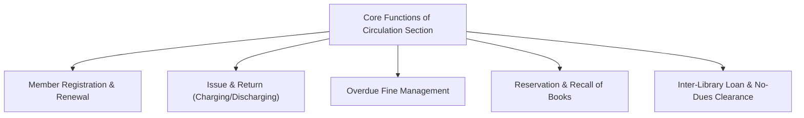
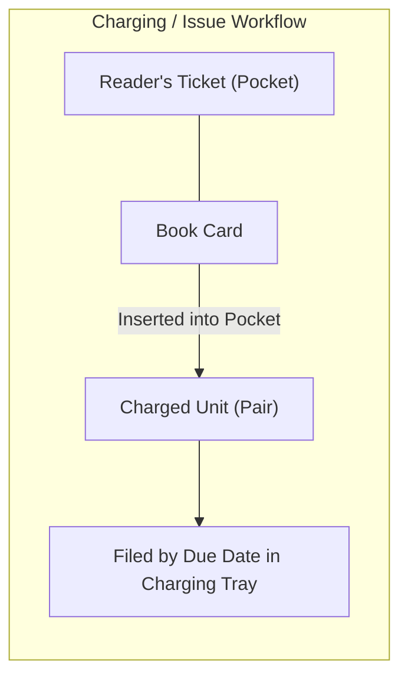

# Unit 2 — Library Management

## Sub-Unit 2.2: Circulation Systems (Browne, Newark & Modern Methods)

> **Comprehensive English Study Notes**  
> Target: Bihar School Librarian Eligibility Examination 2026

---

### Part 1: Functions & Importance of Circulation Section

The Circulation Section serves as the primary operational hub and frontline public interface of a library, facilitating direct and continuous contact between library users and professional staff.

---

### Part 2: Traditional Circulation Methods

1. **Day-Book / Ledger System:**  
   In early libraries, heavy registers were maintained with dedicated pages assigned to each borrower. Every loan and return transaction required detailed handwritten entries. The process was painfully slow, causing long user queues and frequent transcription errors.
2. **Dummy System:**  
   Whenever a book was issued, a wooden or cardboard block (a dummy) bearing the borrower's name was placed in the exact empty slot on the shelf. This proved cumbersome and visually cluttered the stacks.

---

### Part 3: The Browne Charging System (1895)

* **Inventor:** **Nina E. Browne**, Librarian at the Boston Athenaeum, Massachusetts, USA.
* **Year of Invention:** **1895**.
* **Guiding Mechanism:** **"Pocket-in-Pocket" Principle**. It requires **zero clerical writing** during the transaction, operating as a rapid card-exchange system.

#### Four Essential Physical Components:
1. **Reader's Ticket / Pocket:**  
   A heavy paper or cardboard envelope/pocket sized 3" × 2" inches, inscribed with the reader's name, address, and membership number. Each member is issued as many pockets as the number of books they are entitled to borrow.
2. **Book Card:**  
   A 4" × 2" card kept inside the book pocket on the inside back cover, bearing the Call No., Accession No., Author, and Brief Title.
3. **Book Pocket:**  
   A cardboard pocket pasted securely onto the inside back cover of each book.
4. **Date Slip:**  
   A slip pasted on the flyleaf opposite the book pocket, stamped with the loan due date.

#### Step-by-Step Charging & Discharging Workflow:
* **Charging (Issue):**  
  The reader presents the book along with one Reader's Ticket. The desk assistant removes the **Book Card** from the book pocket and slips it directly into the **Reader's Ticket (Pocket)**. The **Date Slip** is stamped with the due date, and the book is handed to the borrower. The assembled charged unit is placed into a **Charging Tray** behind the respective date guide card in classified (Call Number) order.
* **Discharging (Return):**  
  When the book is returned, the desk assistant checks the due date from the Date Slip, locates the charged pair in the tray, removes the Book Card and replaces it into the book pocket, and hands the Reader's Ticket back to the patron as a receipt of return.

#### Merits & Demerits:
* **Merits:** Lightning-fast speed; no writing required; eliminates queues; instant calculation of overdue books per date.
* **Demerits:** Lacks a permanent borrower reading history; misfiling a card in the tray creates immense tracing difficulties; cannot easily prove who borrowed a lost book once returned.

---

### Part 4: The Newark Charging System (1900)

* **Inventor:** **John Cotton Dana**, Librarian at the Newark Public Library, New Jersey, USA.
* **Year of Invention:** **1900**.
* **Guiding Mechanism:** **Permanent Record and Date-Stamp Principle**.

#### Essential Components:
1. **Borrower's Card:**  
   A standard 5" × 3" card retained by the borrower, featuring three columns: Due Date, Return Date, and Staff Initials.
2. **Book Card:**  
   A 5" × 3" card housed in the book pocket, bearing Call No., Acc No., Author, Title, followed by three columns: Due Date, Borrower Membership Number, and Return Date.
3. **Book Pocket and Date Slip** pasted inside the book.
4. **Date Stamp Pad and Dater Stamp**.

#### Charging & Discharging Workflow:
* **Charging (Issue):**  
  The assistant stamps the due date onto the Date Slip, the Borrower's Card, and the Book Card. The borrower's membership number is inscribed on the Book Card. The Borrower's Card is returned to the user, while the Book Card is filed in the circulation tray.
* **Discharging (Return):**  
  Upon return, the assistant stamps the return date on the Borrower's Card and hands it back. The Book Card is later retrieved from the tray and restored to the book pocket.

#### Merits & Demerits:
* **Merits:** Maintains a **complete permanent circulation record**. The library preserves an exact audit trail of all titles borrowed by a user and all users who read a particular book.
* **Demerits:** Slower than the Browne System due to multiple stamping steps and manual transcription of membership numbers.

---

### Part 5: Other Notable Circulation Systems

| System Name | Inventor / Pioneer | Year | Core Operational Mechanism |
| :--- | :--- | :---: | :--- |
| **Dickman Charging System** | Dickman Company | **1927** | **First mechanical charging machine**; embossed metal tag imprinted the borrower's number onto the book card. |
| **Detroit Self-Charging System** | Ralph Ulveling | **1929** | Self-service system where the patron wrote their own membership number on the book card to save staff time. |
| **Gaylord Charging System** | Gaylord Brothers | **1932** | **First electrically operated charging machine**. |
| **Photo-charging (Recordak System)** | Ralph Shaw | **1947** | Microfilm photographic camera capturing the reader's badge, book card, and date transaction slip simultaneously. |
| **RFID Circulation System** | Modern Digital Standard | 21st Century | Radio Frequency Identification tags; enables automated self-checkout kiosks, intelligent book return chutes, and rapid stock audit. |

---

### Part 6: Master Comparison: Browne vs. Newark Systems

| Feature / Dimension | Browne System (1895) | Newark System (1900) |
| :--- | :--- | :--- |
| **Inventor** | **Nina E. Browne** | **John Cotton Dana** |
| **Originating Institution** | Boston Athenaeum, USA | Newark Public Library, New Jersey, USA |
| **Borrower's Token** | Pocket / Envelope (3" × 2") | Borrower's Card (5" × 3") |
| **Handwriting Work** | **Zero (No writing required)** | Borrower number written on Book Card |
| **Transaction Speed** | Extremely fast and fluid | Relatively slower due to stamping/writing |
| **Permanent Reading History** | **Not available** | **Fully recorded and permanent** |
| **Overdue Calculation** | Simple, via tray date divisions | Simple and verified against cards |

---

### Part 7: High-Yield Exam Points & One-Liners

1. **Who invented the Browne Charging System?**  
   **Nina E. Browne in 1895** (Boston Athenaeum, USA).
2. **Who invented the Newark Charging System?**  
   **John Cotton Dana in 1900** (Newark Public Library, USA).
3. **What is the physical format of a Reader's Ticket in the Browne System?**  
   In the shape of an **envelope / pocket (3" × 2")**.
4. **In which circulation system is the book card slipped into the reader's pocket?**  
   The **Browne Charging System**.
5. **In the Newark System, who retains the Borrower's Card between loans?**  
   The **Reader / Borrower**.
6. **Which traditional system maintains a permanent record of who borrowed which book?**  
   The **Newark Charging System**.
7. **Which was the first mechanical book-charging machine in library history?**  
   The **Dickman Charging System (1927)**.
8. **What was the first electrically operated charging machine?**  
   The **Gaylord Charging System (1932)**.
9. **Who invented the photo-charging system in 1947?**  
   **Ralph Shaw**.
10. **What was the main purpose of the Detroit Self-Charging System (1929)?**  
    To save staff time by having the borrower write their own membership number.
11. **Which library section handles the reservation and recall of checked-out books?**  
    The **Circulation Section**.
12. **Which counter issues a 'No Dues Certificate' or clearance to departing students/faculty?**  
    The **Circulation Counter**.
13. **What is a self-service machine for issuing books using RFID called?**  
    A **Self-Checkout Kiosk**.
14. **What is the external receptacle that accepts returned books after library hours called?**  
    A **Smart Book Drop Box (Book Chute)**.
15. **Which Law of Library Science is most directly fulfilled by rapid circulation systems?**  
    The **Fourth Law: Save the time of the reader**.
