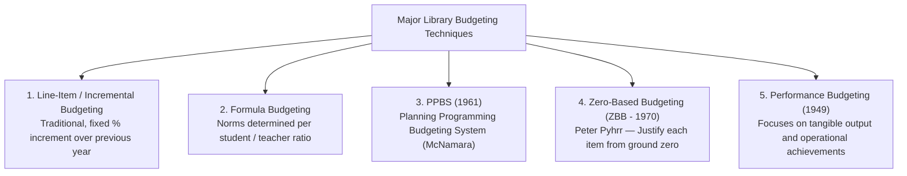
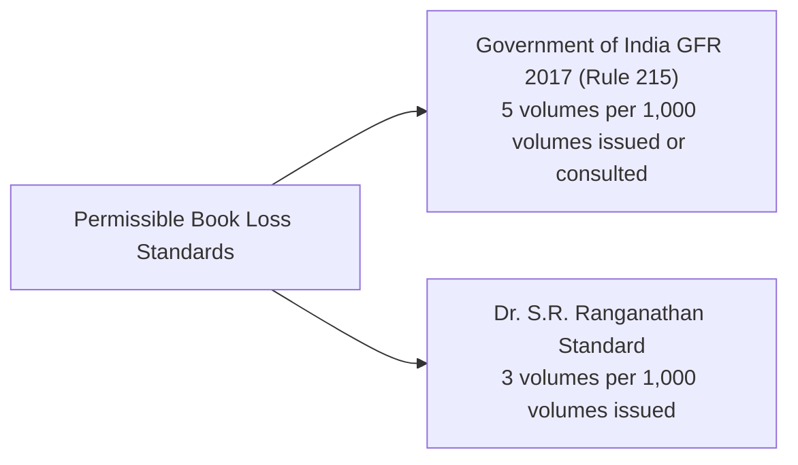

# Unit 2 — Library Management

## Sub-Unit 2.3: Library Budgeting, Financial Management, Stock Verification & Weeding

> **Comprehensive English Study Notes**  
> Target: Bihar School Librarian Eligibility Examination 2026

---

### Part 1: Financial Management & Budgeting

**Library Budget:**  
A library budget is a formalized financial plan that projects estimated revenues and allocates proposed expenditures for a defined future period (typically one fiscal year). It reflects the library's operational priorities, instructional goals, and development programs in quantitative financial terms.

#### Primary Sources of Library Finance:
1. **Government Grants:**
   * **Recurring / Maintenance Grants:** Continuous annual funding allocated for staff salaries, journal subscriptions, utility bills, and routine maintenance.
   * **Non-Recurring / Capital Grants:** One-time capital funding allocated for building construction, physical infrastructure expansion, major IT digitization, and specialized equipment.
2. **Library Cess:** Statutory surcharge levied on municipal property tax, house tax, vehicle tax, or local revenue in states with library legislation.
3. **Parent Institutional Allocations:** Direct budgetary appropriations from universities, colleges, or parent research institutes.
4. **Endowments & Grants from Autonomous Bodies:** Matching and non-matching grants from bodies like RRRLF (Raja Rammohun Roy Library Foundation) and philanthropic trusts.
5. **Internal Library Revenue:** Nominal collections from overdue fines, reprographic/digital scanning fees, institutional membership charges, and auction proceeds from discarded non-archival waste.

---

### Part 2: Major Budgeting Techniques

#### 1. Line-Item / Incremental Budgeting:
* **Characteristics:** The oldest, most widely practiced traditional budgeting technique.
* **Mechanism:** Takes the previous fiscal year's actual expenditures as the baseline and adds an incremental percentage increase (typically 5% to 10%) across itemized expenditure lines (salaries, books, serials, binding, contingencies) to adjust for inflation and institutional expansion.
* **Limitations:** Does not measure operational performance or program efficacy; obsolete activities continue receiving funding indefinitely.

#### 2. Zero-Based Budgeting (ZBB):
* **Pioneer:** Developed by **Peter A. Pyhrr** in **1970** at Texas Instruments, USA.
* **Adoption:** Formally introduced into the US federal budgetary process by President **Jimmy Carter** in 1977.
* **Core Philosophy:**  
  * Begins every fiscal cycle from a **clean slate ("Ground Zero")**.
  * Previous baseline budgets are not taken for granted; every department must re-justify its entire operational expenditure from scratch.
* **Decision Packages:** Activities are grouped into modular "Decision Packages" evaluated via Cost-Benefit Analysis and ranked strictly by institutional priority.
* **Advantages:** Eliminates redundant or obsolete programs, ensuring optimal allocation of financial capital.

#### 3. Planning Programming Budgeting System (PPBS):
* **Pioneer:** Introduced in **1961** by US Secretary of Defense **Robert McNamara** with analytical backing from the Rand Corporation.
* **Characteristics:** Seamlessly integrates long-term strategic Planning, Program formulation, and financial Budgeting into a unified scientific management model.

#### 4. Performance Budgeting:
* Introduced through the recommendations of the First Hoover Commission (1949) in the USA. Focuses on what the library achieves (outcomes, service outputs, transactions) rather than merely what it purchases (inputs).

---

### Part 3: Financial Norms & Commission Standards in India

1. **Kothari Commission (National Education Commission, 1964–66):**  
   Recommended that universities allocate **6.5% to 10%** of their total educational budget to library development.
2. **Radhakrishnan Commission (University Education Commission, 1948–49):**  
   Recommended a per-capita library grant of **Rs. 40 per student**.
3. **Ranganathan UGC Library Committee (1957):**  
   Formulated the celebrated per-capita standard of **Rs. 15 per student** and **Rs. 200 per teacher/research scholar** annually.

---

### Part 4: Stock Verification (Physical Inventory)

**Definition:**  
Stock Verification is the systematic, periodic physical audit and checking of a library's total book stock to determine exact losses, detect damaged materials, locate misplaced volumes, and update official records.

#### Primary Methods of Stock Verification:
1. **By Accession Register:**  
   Verifying physical volumes directly against the pages of the Accession Register. Highly cumbersome, sluggish, and leads to physical tearing of permanent legal records.
2. **By Shelf List Cards:**  
   The **most scientific, standard, and convenient method** in librarianship. Because Shelf List Cards are arranged in the exact classified order of books on the shelves, the audit proceeds smoothly shelf by shelf.
3. **By Numerical Counting:**  
   Merely counts the total number of physical volumes present. Fails to identify specific lost or misplaced titles.
4. **By Separate Number Slips:**  
   Writing down accession numbers on slips from stack shelves and matching them subsequently against records.
5. **By Barcode & RFID Scanners:**  
   The **most modern, rapid, and accurate technique**. Handheld portable RFID scanners sweep across shelves, reading hundreds of tags per minute and generating automated missing reports instantly.

---

### Part 5: Permissible Book Loss Norms: GFR & LIS Standards

In modern libraries operating on an Open Access basis, a certain margin of book loss is recognized as inevitable and acceptable.

> [!IMPORTANT]
> **Government of India General Financial Rules (GFR 2017, Rule 215):**  
> * A loss of **up to 5 volumes per 1,000 volumes issued and/or consulted** in a year may be taken as reasonable and written off, provided such losses are not attributed to dishonesty or gross negligence by library staff.  
> * *Crucial Proviso: Loss of any rare, unique, historical, or manuscript volume shall not be written off routinely and mandates a formal high-level inquiry.*

---

### Part 6: Weeding Out of Library Materials

**Definition:**  
Weeding out is the systematic, permanent withdrawal of obsolete, unserviceable, worn-out, factually misleading, and superseded reading materials from the active library collection.

#### Philosophical Foundation:
* **The Fifth Law of Library Science (The Library is a Growing Organism):**  
  Just as a living biological organism must shed dead tissues and waste cells to sustain healthy growth, a library must regularly purge unusable materials to maintain vitality and conserve physical stack space.

#### The CREW Method & MUSTIE Criteria:
Developed by the Texas State Library, the **CREW method** (*Continuous Re-evaluation, Evaluation and Weeding*) outlines the classic **MUSTIE** criteria for discarding materials:

* **M = Misleading:** Factually inaccurate, obsolete, or outdated information.
* **U = Ugly:** Physically worn, damaged, soiled, or dilapidated beyond binding repair.
* **S = Superseded:** Replaced by newer, updated, or revised editions.
* **T = Trivial:** Ephemeral literature of superficial merit and no lasting reference value.
* **I = Irrelevant:** Outside the curriculum, research interests, or demographic scope of the institution.
* **E = Elsewhere Available:** Readily obtainable through Inter-Library Loan (ILL) or accessible via digital open repositories.

---

### Part 7: Master Comparative Matrix for Examinations

| Concept / Methodology | Pioneer / Authority | Landmark Year / Rule | Key Distinguishing Feature |
| :--- | :--- | :---: | :--- |
| **Zero-Based Budgeting (ZBB)** | Peter A. Pyhrr | **1970** | Starts from ground zero every year; Decision Packages |
| **PPBS** | Robert McNamara (US DoD) | **1961** | Integrates Planning, Programming, and Budgeting |
| **Permissible Loss Norm (GFR)** | Ministry of Finance, India | **GFR 2017 (Rule 215)** | **5 volumes per 1,000 issued/consulted** |
| **Ranganathan Loss Norm** | Dr. S.R. Ranganathan | Classic LIS Standard | **3 volumes per 1,000 issued** |
| **MUSTIE Criteria** | CREW Method | Texas State Library | Scientific framework for collection weeding |
| **Best Inventory Audit Method** | Standard LIS Methodology | - | **Shelf List Cards (Classified Order)** |

---

### Part 8: High-Yield Exam Points & One-Liners

1. **Who is recognized as the father of Zero-Based Budgeting (ZBB)?**  
   **Peter A. Pyhrr (1970)**.
2. **On what baseline does Zero-Based Budgeting begin each year?**  
   On **Ground Zero (Clean Slate)**; no previous expenditure is automatically accepted.
3. **Who developed PPBS in 1961?**  
   **Robert McNamara** (US Department of Defense).
4. **What percentage of total university budget did the Kothari Commission recommend for libraries?**  
   **6.5% to 10%**.
5. **Under Rule 215 of GFR 2017, how many books lost per 1,000 issued/consulted are write-off eligible?**  
   **5 volumes per 1,000 volumes**.
6. **How many lost books per 1,000 issued did Dr. S.R. Ranganathan recommend as permissible?**  
   **3 volumes per 1,000 volumes**.
7. **Which is the most scientific and standard method for stock verification?**  
   **By Shelf List Cards**.
8. **In what sequence are cards arranged in a Shelf List?**  
   In the exact classified order of books on the shelves (**Call Number order**).
9. **Which Law of Library Science directly mandates collection weeding?**  
   The **Fifth Law: The library is a growing organism**.
10. **In the MUSTIE weeding acronym, what do 'M' and 'S' stand for?**  
    **M = Misleading** and **S = Superseded**.
11. **Which US President introduced Zero-Based Budgeting into the federal government?**  
    **Jimmy Carter (1977)**.
12. **Which budgeting method emphasizes concrete outputs and services over inputs?**  
    **Performance Budgeting**.
13. **What type of grant is awarded for building construction and physical infrastructure?**  
    **Non-Recurring / Capital Grant**.
14. **What is the formal term for auditing physical book holdings against inventory records?**  
    **Stock Verification (Physical Inventory)**.
15. **What is mandated under GFR if a rare manuscript or invaluable historical book is lost?**  
    A **special high-level investigation** is compulsory; it cannot be treated as a routine loss.
