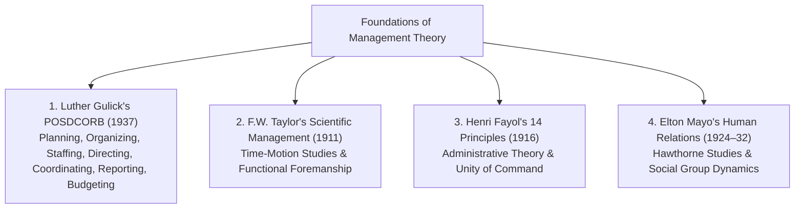
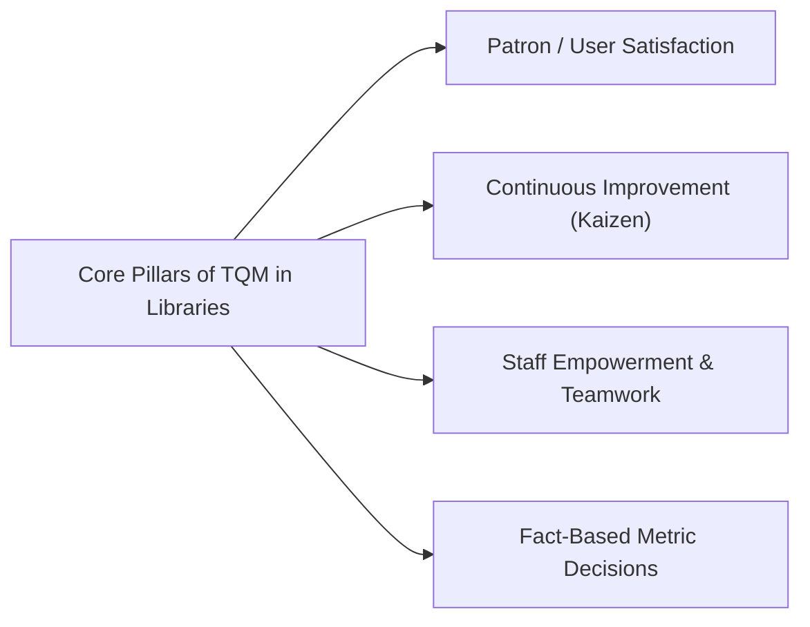

# Unit 2 — Library Management

## Sub-Unit 2.4: Human Resource Management, Staff Formula and Total Quality Management (TQM)

> **Comprehensive English Study Notes**  
> Target: Bihar School Librarian Eligibility Examination 2026

---

### Part 1: Classical Management Theories

Management is the art and science of achieving organizational objectives efficiently and effectively through the coordinated efforts of people and resources.

#### 1. Luther Gulick's 'POSDCORB' Framework (1937):
Published by **Luther Gulick** and **Lyndall Urwick** in *"Papers on the Science of Administration"* (1937), POSDCORB synthesizes seven core executive functions:

* **P = Planning:** Deciding in advance what is to be done, how, and by whom.
* **O = Organizing:** Establishing formal administrative structures and allocating responsibilities.
* **S = Staffing:** Recruiting, training, developing, and maintaining favorable conditions for personnel.
* **D = Directing:** Making decisions, issuing orders, providing continuous leadership, and guiding staff.
* **CO = Coordinating:** Harmonizing diverse departmental workflows and inter-relating various sections.
* **R = Reporting:** Keeping superiors and stakeholders informed through inspection, records, and reports.
* **B = Budgeting:** Financial planning, accounting, fiscal audit, and control.

#### 2. F.W. Taylor's Scientific Management (1911):
* **Frederick Winslow Taylor (F.W. Taylor)** is celebrated as the **'Father of Scientific Management'**.
* Landmark Treatise: *"The Principles of Scientific Management"* (1911).
* **Core Tenets:** Replaced traditional 'rule of thumb' methods with rigorous scientific investigation; pioneered **Time and Motion Studies** to eliminate wasted motion; introduced Functional Foremanship, standardized work equipment, and differential piece-rate wage systems.

#### 3. Henri Fayol's Administrative Management (1916):
* **Henri Fayol** is revered as the **'Father of Modern Operational Management'**.
* Treatise: *"General and Industrial Management"* (1916).
* **Key Principles:**
  1. **Division of Work:** Specialization increases efficiency and technical competence.
  2. **Authority and Responsibility:** Authority must be commensurate with accountability.
  3. **Unity of Command:** An employee should receive instructions and orders from **only one superior officer**.
  4. **Unity of Direction:** One head and one unified operational plan for a group of activities with the same objective.
  5. **Scalar Chain & Gang Plank:** The unbroken chain of authority extending from top to bottom; provided the **'Gang Plank'** bridge for direct lateral communication between peers during emergencies to circumvent bureaucratic delays.
  6. **Esprit de Corps:** Fostering mutual trust, team spirit, and organizational harmony.

#### 4. Elton Mayo's Human Relations Approach (1924–1932):
* Conducted the historic **Hawthorne Studies** at Western Electric Company (Chicago). Demonstrated that social, psychological, and informal group dynamics exert far greater influence on productivity than physical workplace conditions alone.

---

### Part 2: Theories of Motivation in LIS Management

#### 1. Maslow's Hierarchy of Human Needs (1943):
Abraham Maslow structured human needs into a 5-tier ascending hierarchical pyramid:
1. **Physiological Needs:** Basic biological survival needs (food, water, shelter, rest).
2. **Safety & Security Needs:** Job security, fair tenure, protection against physical/economic harm.
3. **Social / Belongingness Needs:** Workplace friendships, collegiality, social acceptance.
4. **Esteem Needs:** Status, self-respect, professional recognition, and prestige.
5. **Self-Actualization Needs:** The highest pinnacle; realizing one's full intellectual potential and creative growth.

#### 2. Herzberg's Two-Factor / Motivation-Hygiene Theory (1959):
Frederick Herzberg bifurcated workplace conditions into two independent categories:
* **Hygiene Factors (Extrinsic):** Salary, institutional policies, working environment, supervision quality, and administrative stability.  
  *(Absence causes acute dissatisfaction; presence merely removes dissatisfaction but fails to provide genuine intrinsic motivation.)*
* **Motivators (Intrinsic):** Sense of achievement, recognition, meaningful nature of the work itself, autonomy, and career advancement.  
  *(Directly stimulate superior performance, deep commitment, and job satisfaction.)*

#### 3. Douglas McGregor's Theory X and Theory Y (1960):
* **Theory X (Authoritarian / Pessimistic):** Assumes employees inherently dislike work, avoid responsibility, lack ambition, and must be coerced, controlled, and threatened with sanctions.
* **Theory Y (Participative / Optimistic):** Assumes work is as natural and enjoyable as play; employees exercise self-direction, seek responsibility, and exhibit high creativity when committed to objectives.

---

### Part 3: Dr. S.R. Ranganathan's Staff Formula

As Chairman of the University Grants Commission (UGC) Library Committee in **1957**, Dr. S.R. Ranganathan formulated a scientific, workload-based **Staff Formula** for academic and research libraries:

| Library Section | Workload Standard | Prescribed Staff Norm |
| :--- | :--- | :---: |
| **1. Book Section (Acquisition)** | For every **6,000 volumes** added annually | **1 Person** |
| **2. Periodical Section** | For every **500 current periodical titles** subscribed annually | **1 Person** |
| **3. Technical Section (Classification & Cataloguing)** | For every **2,000 volumes** classified and catalogued annually | **1 Person** |
| **4. Maintenance Section (Shelving & Shelf Care)** | For every **1,500 volumes** added annually | **1 Person** |
| **5. Circulation Section** | For every **50 hours of opening** during the year per **100 transactions** (issues/returns) daily | **1 Person** |
| **6. Reference Section** | For every **50 readers** consulting reference desk services daily | **1 Person** |
| **7. Administrative Section** | For coordinating every **24 professional library staff members** | **1 Accountant / Clerical Assistant** |

---

### Part 4: Total Quality Management (TQM) in Libraries

**TQM (Total Quality Management):**  
A comprehensive, user-focused management philosophy dedicated to continuous improvement (Kaizen) across all institutional processes, services, and workflows to exceed patron expectations.

#### Key Quality Pioneers:
1. **W. Edwards Deming:**
   * **PDCA Quality Cycle:** **Plan** $\rightarrow$ **Do** $\rightarrow$ **Check** $\rightarrow$ **Act**.
   * Outlined the 14 Management Principles for institutional quality transformation.
2. **Joseph M. Juran:**
   * **Juran's Quality Trilogy:** 1. Quality Planning, 2. Quality Control, 3. Quality Improvement.
3. **Benchmarking:**  
   The systematic process of measuring library services, workflows, and performance metrics against the world's highest performing peer institutions to adopt best practices.
4. **LibQUAL+:**  
   A globally standardized Web-based survey instrument developed by the Association of Research Libraries (ARL) to measure user perceptions of library service quality across three dimensions: Affect of Service, Information Control, and Library as Place.

---

### Part 5: Library Building, Furniture & BIS Standards

The Bureau of Indian Standards (**BIS**, formerly ISI) has codified benchmark architectural and spatial standards for libraries:

1. **IS:1553-1989:** Code of Practice for Architecture and Building of Libraries (Formulates spatial planning, room layouts, and modular expansion principles).
2. **IS:1829 (Part I - 1978):** Specifications for Library Wooden Furniture and Fittings.
3. **IS:1829 (Part II - 1993):** Specifications for Library Steel Furniture and Shelving Racks.
4. **Ergonomic and Lighting Standards:**
   * **Reading Room Illumination:** 150 to 300 Lux.
   * **Main Center Aisle:** 1.5 meters (5 feet) in width.
   * **Gangway between Book Racks:** 0.75 meters to 1.0 meter.
   * **Standard Shelf Height:** 2.2 meters (approx. 7 feet), ensuring the top shelf is comfortably reachable by hand without requiring ladders (embodying the First Law).

---

### Part 6: Master Comparative Matrix of Management Theories

| Theory / Paradigm | Pioneer / Authority | Landmark Year | Core Conceptual Principle |
| :--- | :--- | :---: | :--- |
| **POSDCORB** | Luther Gulick & Lyndall Urwick | **1937** | 7 essential executive administrative functions |
| **Scientific Management** | F.W. Taylor | **1911** | Time-motion studies; standardization; functional foremanship |
| **Unity of Command** | Henri Fayol | **1916** | Employee receives directives from one superior only |
| **Scalar Chain & Gang Plank** | Henri Fayol | **1916** | Formal line of authority with emergency lateral bypass |
| **Hierarchy of Needs** | Abraham Maslow | **1943** | 5-tier pyramid from physiological to self-actualization |
| **Two-Factor Theory** | Frederick Herzberg | **1959** | Hygiene (extrinsic) vs. Motivators (intrinsic) |
| **Theory X and Theory Y** | Douglas McGregor | **1960** | Authoritarian vs. Participative managerial assumptions |
| **Staff Formula** | Dr. S.R. Ranganathan (UGC) | **1957** | Acquisition: 6,000 vols/person; Technical: 2,000 vols/person |
| **PDCA Cycle** | W. Edwards Deming | Quality Circle | Plan-Do-Check-Act continuous improvement cycle |
| **Library Building Standard** | Bureau of Indian Standards | **IS:1553-1989** | Code of practice for library architecture & design |

---

### Part 7: High-Yield Exam Points & One-Liners

1. **Who coined the acronym 'POSDCORB'?**  
   **Luther Gulick and Lyndall Urwick (1937)**.
2. **Who is recognized as the 'Father of Scientific Management'?**  
   **F.W. Taylor (Frederick Winslow Taylor)**.
3. **Who is recognized as the 'Father of Modern Operational Management'?**  
   **Henri Fayol**.
4. **What does Henri Fayol's 'Unity of Command' dictate?**  
   An employee should receive directives from **one superior officer only**.
5. **What is Fayol's 'Gang Plank'?**  
   A mechanism for direct **lateral communication between peers** across departments during emergencies to bypass the scalar chain.
6. **What is the highest need in Abraham Maslow's hierarchy?**  
   **Self-Actualization Need**.
7. **Under Herzberg's theory, how are salary and physical work conditions categorized?**  
   As **Hygiene Factors (Extrinsic Factors)**.
8. **Who formulated Theory X and Theory Y?**  
   **Douglas McGregor (1960)**.
9. **According to Ranganathan's Staff Formula, how many books processed in the Acquisition Section warrant 1 staff member?**  
   **6,000 volumes annually**.
10. **According to Ranganathan's Staff Formula, how many books processed in the Technical Section warrant 1 staff member?**  
    **2,000 volumes annually**.
11. **According to Ranganathan's Staff Formula, how many current journal titles warrant 1 staff member in the Periodicals Section?**  
    **500 current periodical titles annually**.
12. **Who popularized the PDCA (Plan-Do-Check-Act) quality cycle?**  
    **W. Edwards Deming**.
13. **Which globally recognized survey tool measures library service quality?**  
    **LibQUAL+** (developed by ARL).
14. **Which Bureau of Indian Standards code governs library architecture and building layout?**  
    **IS:1553-1989**.
15. **Who led the historic Hawthorne Studies that gave rise to the Human Relations movement?**  
    **Elton Mayo**.
