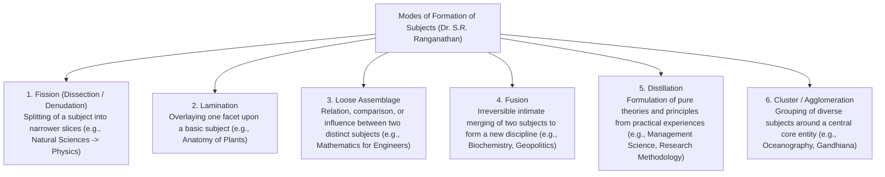
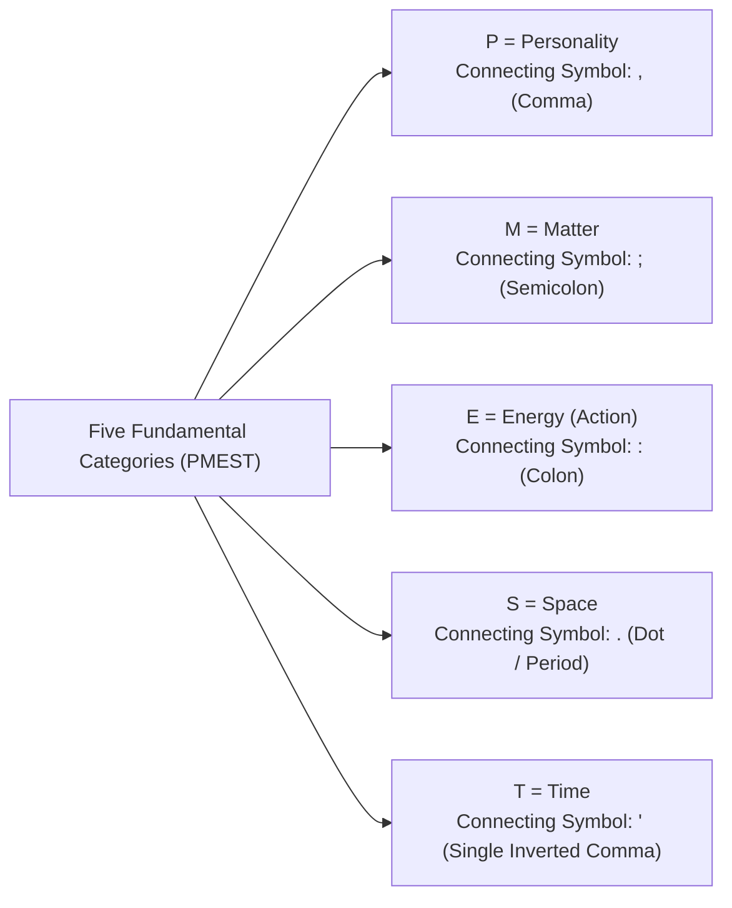

# Unit 3 — Knowledge Organization: Classification and Cataloguing

## Sub-Unit 3.1: Universe of Knowledge & Major Classification Schemes (DDC, UDC, CC)
*(Target: Bihar School Librarian Eligibility Test 2026)*

> **Comprehensive In-Depth Study Notes (English Edition)**  
> Target: Bihar School Librarian Eligibility Test 2026

---

### Part 1: Universe of Knowledge & Modes of Formation of Subjects

**Library Classification:**  
The art and science of arranging books and documents in a logical sequence based on their degrees of mutual likeness and unlikeness.  
*In the words of Dr. S.R. Ranganathan: "Library classification is the translation of the name of the subject of a book into a preferred artificial language of ordinal numbers (Class Numbers) to arrange books in a helpful sequence and automate mechanical rediscovery."*

#### Major Types of Classification Schemes:
1. **Purely Enumerative:** Contains a comprehensive, ready-made list of all past, present, and anticipated subjects (e.g., **LCC - Library of Congress Classification**, Rider's International Classification).
2. **Almost Enumerative:** Primarily enumerative with a few auxiliary tables for common subdivisions (e.g., **DDC - Dewey Decimal Classification**).
3. **Almost Faceted:** Moving progressively toward facet analysis with auxiliary schedules and relation symbols (e.g., **UDC - Universal Decimal Classification**).
4. **Rigidly Faceted:** Based on facets, but the sequence and presence of facets are fixed and rigid (e.g., **CC 1st to 3rd editions**).
5. **Analytico-Synthetic / Freely Faceted:** Analyzes compound subjects into their basic concepts/facets and synthesizes class numbers using connecting symbols without rigid predetermination (e.g., **CC 4th to 6th edition; CC 7th edition is Freely Faceted**).

---

### Part 2: Dewey Decimal Classification (DDC)

* **Inventor:** **Melvil Dewey** (1851–1931), Amherst College, Massachusetts, USA.
* **First Edition:** Published anonymously in **1876** under the title *"A Classification and Subject Index for Cataloguing and Arranging the Books and Pamphlets of a Library"*, comprising **44 pages**.
* **Latest Edition:** **23rd Edition (2011)**, published in **4 volumes** (Editor: Joan S. Mitchell).
* **Digital Version:** **WebDewey** (continuously updated online database).
* **Ownership and Rights:** Owned and maintained by **OCLC (Online Computer Library Center)** since 1988.

#### Three Summaries of DDC Structure:
DDC employs **Pure Notation** consisting exclusively of Indo-Arabic numerals (0 to 9). A decimal point (.) is introduced after the first three digits (e.g., 510.78).

| Main Class (1st Summary - 10 Main Classes) | Subject Field |
| :---: | :--- |
| **000** | **Computer Science, Information & General Works** |
| **100** | **Philosophy and Psychology** |
| **200** | **Religion** |
| **300** | **Social Sciences** |
| **400** | **Language / Linguistics** |
| **500** | **Pure Science / Natural Sciences & Mathematics** |
| **600** | **Technology / Applied Sciences & Medicine** |
| **700** | **The Arts / Fine and Decorative Arts** |
| **800** | **Literature and Rhetoric** |
| **900** | **History, Geography, and Biography** |

#### Auxiliary Tables in DDC (Tables 1 to 6):
* **Table 1:** Standard Subdivisions (e.g., -01 Philosophy and theory, -03 Dictionaries and encyclopedias, -05 Serial publications).
* **Table 2:** Geographic Areas, Historical Periods, Persons.
* **Table 3:** Subdivisions for Individual Literatures and Specific Literary Forms (Sub-tables 3A, 3B, 3C).
* **Table 4:** Subdivisions for Individual Languages and Language Families.
* **Table 5:** Ethnic and National Groups.
* **Table 6:** Languages.
*(Note: Table 7 'Groups of Persons' was discontinued from the 22nd edition; the 23rd edition contains exactly 6 auxiliary tables.)*

#### Phoenix Schedules in DDC:
* Introduced in the **16th edition (1958)** of DDC.
* A Phoenix schedule represents a completely restructured schedule for an existing class or discipline where the previous schedule is entirely discarded and rebuilt from scratch (analogous to the mythical Phoenix rising reborn from its ashes).

---

### Part 3: Universal Decimal Classification (UDC)

* **Pioneers:** **Paul Otlet** and **Henri La Fontaine** (Nobel Peace Prize laureate, 1913), Brussels, Belgium.
* **Development:** Initiated in **1895** under the International Institute of Bibliography (IIB); **First Edition published in 1905** in French (*Manuel du Repertoire Bibliographique Universel*).
* **Foundation:** Expanded adaptation of DDC's 5th edition (1894).
* **Scheme Nature:** Almost Faceted / Analytico-Synthetic.
* **Management & Maintenance:** Maintained by **FID** (Federation Internationale de Documentation) until 1992; managed by the **UDC Consortium (UDCC)**, The Hague, Netherlands, since January 1, 1992.
* **Notation:** **Mixed Notation** — utilizes Indo-Arabic numerals alongside mathematical symbols and punctuation marks as relational signs and auxiliary auxiliaries:
  * **+ (Plus):** Addition / Coordination (e.g., 54+66)
  * **/** (Slash / Oblique): Consecutive extension (e.g., 592/599)
  * **:** (Colon): Simple relation (e.g., 17:7)
  * **::** (Double Colon): Irreversible / fixed relation
  * **=** (Equals): Common auxiliary of language (e.g., =20 English)
  * **(0...)** : Common auxiliary of form of document (e.g., (03) Dictionaries)
  * **(...)** : Common auxiliary of place (e.g., (540) India)
  * **"..."** : Common auxiliary of time (e.g., "2026")
  * **-0...** : Common auxiliary of properties / materials
  * **-1/-9** : Special analytical auxiliaries

---

### Part 4: Colon Classification (CC)

* **Inventor:** **Dr. S.R. Ranganathan** (Father of Library Science in India).
* **First Edition:** Published in **1933** by the Madras Library Association (MALA).
* **Chronological Development of Editions:**
  1. **1st Edition (1933):** Rigidly Faceted; the only connecting symbol used was the Colon (:).
  2. **2nd Edition (1939):** Introduced Phase Relations and octaves.
  3. **3rd Edition (1950):** Refined facet analysis.
  4. **4th Edition (1952):** Introduced distinctive connecting symbols for the five fundamental categories (**PMEST**).
  5. **5th Edition (1957):** Introduced canonical divisions and revised schedules.
  6. **6th Edition (1960) & 6th Revised Edition (1963):** Standard benchmark edition used across Indian universities, BLIS/MLIS curricula, and competitive examinations.
  7. **7th Edition (1987):** Published posthumously (edited by Dr. M.A. Gopinath); categorized as Freely Faceted.

#### Fundamental Categories: PMEST and Connecting Symbols:
Dr. Ranganathan postulated that every isolate in any subject can be manifested into one of five fundamental categories:

> [!IMPORTANT]
> **Connecting Symbol Evolution for Time [T]:**  
> * Up to the 6th Edition (1960), both Space [S] and Time [T] shared the same connecting symbol: the **dot (.)**.  
> * In the **6th Revised Edition (1963)**, Dr. Ranganathan designated the **single inverted comma (')** exclusively for Time [T] to resolve ambiguity between Space and Time isolates.

#### Rounds and Levels:
* **Rounds:** The Energy category [E] may manifest multiple times in a complex subject (2E, 3E, etc.). Subsequent to an Energy facet, Personality and Matter can reappear in second or subsequent rounds (e.g., [2P], [2M]). Space and Time manifest only in the final round.
* **Levels:** Within a single round, Personality and Matter may manifest at multiple hierarchical levels (e.g., $P_1, P_2, P_3$).

#### Common Isolates (CI):
* **Anteriorising Common Isolates (ACI):** Attached directly to the host class number without requiring any connecting symbol (e.g., $k$ for dictionary, $m$ for periodical, $v$ for history).
* **Posteriorising Common Isolates (PCI):** Attached using appropriate connecting symbols for Energy and Space (e.g., administrative common isolates).

#### Three Planes of Work (Ranganathan):
1. **Idea Plane:** Analysis of concepts, facets, and relationships in the universe of ideas (the paramount and decisive plane).
2. **Verbal Plane:** Expressing ideas in standardized, unambiguous, and precise terminology.
3. **Notational Plane:** Translating terminology into ordinal numbers, digits, and connecting symbols.  
*(Note: In 'Prolegomena to Library Classification', Dr. Ranganathan formulated 43 Canons, 5 Basic Laws, 13 Postulates, and 22 Principles.)*

---

### Part 5: Master Comparative Matrix (DDC, UDC, CC)

| Feature | Dewey Decimal Classification (DDC) | Universal Decimal Classification (UDC) | Colon Classification (CC) |
| :--- | :--- | :--- | :--- |
| **Creator / Pioneer** | **Melvil Dewey (1876)** | **Paul Otlet & Henri La Fontaine (1905)** | **Dr. S.R. Ranganathan (1933)** |
| **Country of Origin** | USA (Amherst College) | Belgium (Brussels) | India (Madras / Chennai) |
| **Scheme Typology** | Almost Enumerative | Almost Faceted | Analytico-Synthetic / Freely Faceted |
| **Notation Type** | **Pure Notation (Indo-Arabic numerals 0-9)** | **Mixed Notation (Digits + Relational Signs)** | **Highly Mixed Notation (A-Z, a-z, 0-9, Greek, Symbols)** |
| **Structural Base** | Decimal Base 10 | Decimal Base 10 | PMEST (Five Fundamental Categories) |
| **Governing Body / Status** | 23rd Ed. (2011), Owned by **OCLC** | Maintained by **UDC Consortium (The Hague)** | 6th Rev. Ed. (1963) widely practiced |

---

### Part 6: Exam POV High-Yield Fact Sheet (15 High-Priority Facts)

1. **In what year and with how many pages was the first edition of DDC published?** — **1876, comprising 44 pages**.
2. **Who served as the Editor-in-Chief for the 23rd Edition of DDC (2011)?** — **Joan S. Mitchell**.
3. **Which organization holds the copyright and editorial stewardship of DDC since 1988?** — **OCLC (Online Computer Library Center)**.
4. **What do the main classes '500' and '600' represent in DDC?** — **500 = Pure Sciences; 600 = Technology / Applied Sciences**.
5. **In which edition of DDC were Phoenix Schedules introduced for the first time?** — **16th Edition (1958)**.
6. **In what year and language was the first edition of UDC published?** — **1905, in French** (*Manuel du Repertoire Bibliographique Universel*).
7. **Which body currently manages and updates the Universal Decimal Classification?** — **UDC Consortium (UDCC), The Hague, Netherlands**.
8. **What symbols are used in UDC for 'Place' and 'Time'?** — Place uses **parentheses (...)**, Time uses **quotation marks "..."**.
9. **In which year was the first edition of Dr. S.R. Ranganathan's Colon Classification published?** — **1933**.
10. **What are the five connecting symbols for PMEST in Colon Classification?** — **Personality = , (Comma); Matter = ; (Semicolon); Energy = : (Colon); Space = . (Dot); Time = ' (Single Inverted Comma)**.
11. **In the 6th Revised Edition (1963) of CC, what did the connecting symbol for Time [T] change to?** — **Single Inverted Comma (')**, replaced from dot (.).
12. **What are the three planes of work identified by Dr. Ranganathan in classification?** — **Idea Plane, Verbal Plane, Notational Plane**.
13. **How many Canons of Classification did Dr. Ranganathan formulate in the Prolegomena?** — **43 Canons**.
14. **Biochemistry and Geopolitics represent which mode of formation of subjects?** — **Fusion**.
15. **How many auxiliary tables are present in the 23rd Edition of DDC?** — **6 Tables (Tables 1 to 6)**.
