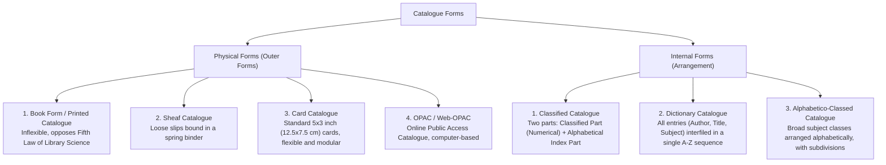
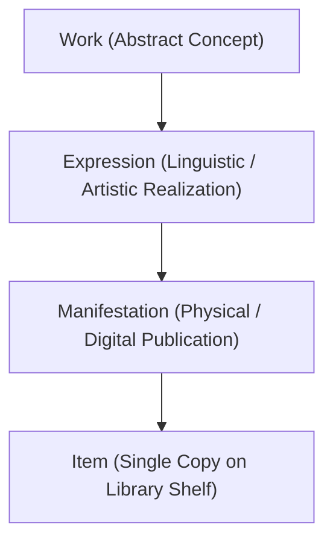
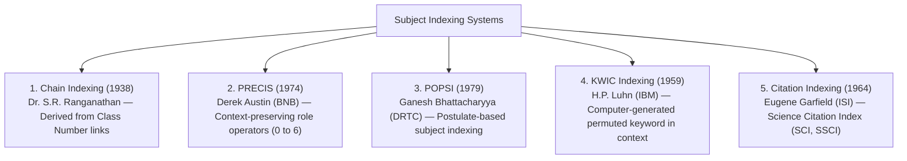

# Unit 3 — Knowledge Organization: Classification and Cataloguing

## Sub-Unit 3.2: Cataloguing Codes, Standards, OPAC and Indexing Systems
*(AACR-2, RDA, MARC-21, ISBD, Chain Indexing, PRECIS, POPSI, KWIC, Citation Indexing)*

> **Comprehensive In-Depth Study Notes (English Edition)**  
> Target: Bihar School Librarian Eligibility Test 2026

---

### Part 1: Library Catalogue — Concept & Cutter's Objectives

**Library Catalogue:**  
An organized, systematic, and up-to-date bibliographic record of the complete holding of books, documents, and learning resources available within a library, designed to guide patrons in discovering, locating, and selecting materials.

#### Charles Ammi Cutter's Three Objectives of a Library Catalogue (1876):
In his seminal work *"Rules for a Dictionary Catalog"* (1876), C.A. Cutter formulated three foundational objectives:
1. **To Find:** To enable a person to find a book of which either:
   - The **Author** is known,
   - The **Title** is known, or
   - The **Subject** is known.
2. **To Show:** To show what the library has:
   - By a given author,
   - On a given subject, or
   - In a given kind of literature.
3. **To Assist in the Choice of a Book:**
   - As to its edition (bibliographically), or
   - As to its character (literary or topical).

---

### Part 2: Physical and Internal Forms of Library Catalogue

---

### Part 3: Historical Cataloguing Codes

| Year | Cataloguing Code | Author / Sponsoring Body | Key Milestone / Feature |
| :---: | :--- | :--- | :--- |
| **1841** | **Panizzi's 91 Rules** | Sir Anthony Panizzi (British Museum) | Regarded as the "Mother of all Cataloguing Codes". |
| **1876** | **Rules for a Dictionary Catalog (RDC)** | Charles Ammi Cutter (C.A. Cutter) | First complete code with formulated objectives for dictionary catalogues. |
| **1908** | **Anglo-American Code (AA Code)** | ALA (USA) & Library Association (UK) | First joint international collaborative cataloguing code. |
| **1934** | **Classified Catalogue Code (CCC)** | **Dr. S.R. Ranganathan** | **India's first scientific classified code**; 5th edition published in 1964 with A. Neelameghan. |
| **1961** | **Paris Principles (ICCP)** | UNESCO / IFLA (Paris Conference) | Global consensus on international cataloguing principles and choice of headings. |
| **1967** | **AACR-1** | Joint Steering Committee (JSC) | First code built upon the foundation of the Paris Principles (North American & British texts). |
| **1978** | **AACR-2** | Editors: Michael Gorman & Paul W. Winkler | Structured around ISBD format; split into Description and Headings. |
| **1988 / 2002** | **AACR-2R (Revised)** | JSC | Incorporated electronic resources and seriality. |
| **2010** | **RDA (Resource Description & Access)** | JSC / International Committee | Modern digital successor to AACR-2 based on the conceptual FRBR model. |

---

### Part 4: Comparative Structure of Main Entry: CCC vs. AACR-2

#### 1. Dr. S.R. Ranganathan's Classified Catalogue Code (CCC):
The Main Entry card in CCC consists of **6 distinct sections**:
1. **Leading Section:** Contains the **Call Number** of the document, written strictly in pencil on the first line (starting from the First Indention).
2. **Heading Section:** Records the author's name or corporate body responsible for intellectual content.
3. **Title Section:** Records the title, subtitle, edition statement, and collaborators (translators, editors, illustrators).
4. **Note Section:** Contains series notes and bibliographical relationships.
5. **Accession Number:** Recorded at the bottom-most line, leftmost corner of the card.
6. **Tracing:** Written on the **reverse side (back)** of the Main Entry card, recording all Added Entries (Class Index Entries, Book Index Entries, Cross Reference Index Entries, Cross Reference Entries) prepared for that document.

#### 2. Anglo-American Cataloguing Rules (AACR-2):
* **Structure:**
  * **Part 1 (Description - Chapters 1 to 13):** Follows the 8 areas of ISBD (General rules, Books, Cartographic materials, Manuscripts, Music, Sound recordings, Motion pictures, Graphic materials, Electronic resources, Microforms, Continuing resources).
  * **Part 2 (Headings, Uniform Titles, and References - Chapters 21 to 26):** Governs choice of access points, personal/corporate headings, geographic names, uniform titles, and references.
* **The Rule of Three in AACR-2:**
  * If a work is created by **up to three authors**, the Main Entry is entered under the name of the **first named author**, with Added Entries provided for the second and third co-authors.
  * If a work has **more than three authors** (e.g., four or more), the Main Entry is made under the **Title**, and an added entry is made under the first author followed by the mark of omission and abbreviation **[...et al.]** (or *and others* in modern guidelines).

---

### Part 5: RDA and the FRBR Conceptual Model

* **RDA (Resource Description and Access, 2010):**  
  A flexible metadata standard designed for the digital environment, facilitating the description of both traditional printed materials and dynamic online resources (e.g., e-books, institutional repositories, streaming media).
* **FRBR Model (Functional Requirements for Bibliographic Records, 1998 - IFLA):**  
  RDA is grounded in the entity-relationship architecture of FRBR, featuring the **WEMI hierarchy**:
  1. **Work:** An abstract intellectual or artistic creation (e.g., William Shakespeare's *Macbeth*).
  2. **Expression:** The specific intellectual or linguistic realization of a work (e.g., English text, Hindi translation, theatrical audio performance).
  3. **Manifestation:** The physical or digital embodiment of an expression (e.g., Penguin Classics 2015 paperback edition, Oxford hardbound edition).
  4. **Item:** A single exemplar or physical copy of a manifestation held by a specific library (e.g., copy with barcode `31245` in a school library).

---

### Part 6: Essential MARC-21 Bibliographic Tags

MARC-21 (Machine-Readable Cataloging) uses standardized 3-digit numerical tags, indicators, and subfield codes to store bibliographic data in a computer-readable format:

| MARC-21 Tag | Field Name / Description | Indicators / Subfields |
| :---: | :--- | :--- |
| **020** | **ISBN (International Standard Book Number)** | `$a` ISBN, `$c` Price |
| **022** | **ISSN (International Standard Serial Number)** | `$a` ISSN |
| **082** | **DDC Call Number** | `$a` Classification number, `$2` Edition number |
| **100** | **Main Entry — Personal Name (Author)** | `$a` Personal name, `$d` Dates associated with name |
| **110** | **Main Entry — Corporate Name** | `$a` Corporate body or jurisdiction name |
| **245** | **Title and Statement of Responsibility** | `$a` Title, `$b` Subtitle / remainder of title, `$c` Statement of responsibility |
| **250** | **Edition Statement** | `$a` Edition statement (e.g., 2nd rev. ed.) |
| **260 / 264** | **Publication, Distribution, etc. (Imprint)** | `$a` Place of publication, `$b` Name of publisher, `$c` Date of publication |
| **300** | **Physical Description** | `$a` Extent (pages/volumes), `$b` Illustrative details, `$c` Dimensions (height in cm) |
| **490 / 440** | **Series Statement** | `$a` Series title, `$v` Volume number |
| **500** | **General Note** | `$a` General note text |
| **504** | **Bibliography, etc. Note** | `$a` Includes bibliographical references and index |
| **650** | **Subject Added Entry — Topical Term** | `$a` Topical term or geographic subdivision |
| **700** | **Added Entry — Personal Name** | `$a` Joint author, editor, translator, illustrator |

---

### Part 7: Major Subject Indexing Systems

#### 1. Chain Indexing (Chain Procedure):
* **Pioneer:** **Dr. S.R. Ranganathan (1938)** in his book *"Theory of Library Catalogue"*.
* **Mechanism:** Derives alphabetical subject headings mechanically from the successive steps in the hierarchy of a document's Class Number.
* **Four Types of Links in the Chain:**
  1. **False Link:** A link ending with a connecting symbol or non-significant digit representing no real isolate/subject.
  2. **Unsought Link:** A link representing a broad or intermediate subject heading not likely to be sought by patrons.
  3. **Sought Link:** A link representing a real, specific subject that patrons are expected to search (becomes an alphabetical Subject Index Entry).
  4. **Missing Link:** A link in the conceptual hierarchy that is skipped or omitted in the classification schedule.

#### 2. PRECIS (Preserved Context Indexing System):
* **Pioneer:** **Derek Austin (1974)**, developed for the British National Bibliography (BNB) to replace Chain Procedure.
* **Entry Format:** Two-line, three-part entry structure that preserves the context of the subject at every access point:
  * **Lead** | **Qualifier**
  * **Display**
* **Role Operators:** Employs primary role operators (0 to 6) to govern syntax, syntactic relationships, and prepositional linkages.

#### 3. POPSI (Postulate-based Permuted Subject Indexing):
* **Pioneer:** **Ganesh Bhattacharyya (1979)**, Documentation Research and Training Centre (DRTC), Bangalore.
* **Mechanism:** Built directly upon Dr. Ranganathan's general theory of classification, postulates, and the elementary categories (Discipline, Entity, Action, Property).

#### 4. KWIC (Keyword In Context):
* **Pioneer:** **Hans Peter Luhn (1959)**, computer scientist at IBM.
* **Mechanism:** Fully computerized, title-based permuted indexing where keywords extracted from document titles are aligned down the center of the page in alphabetical sequence with surrounding context visible.

#### 5. Citation Indexing:
* **Pioneer:** **Eugene Garfield (1964)**, founder of the Institute for Scientific Information (ISI), Philadelphia.
* **Milestone Publications:** Developed *Science Citation Index* (SCI, 1964), *Social Sciences Citation Index* (SSCI, 1973), and *Arts & Humanities Citation Index* (A&HCI). Measures scientific impact via citations.

---

### Part 8: Exam POV High-Yield Fact Sheet (15 High-Priority Facts)

1. **Which code is universally celebrated as the "Mother of all Cataloguing Codes"?** — **Sir Anthony Panizzi's 91 Rules (1841)**.
2. **Who authored the seminal work 'Rules for a Dictionary Catalog' (1876)?** — **Charles Ammi Cutter (C.A. Cutter)**.
3. **In which year was the first edition of Dr. S.R. Ranganathan's Classified Catalogue Code (CCC) published?** — **1934**.
4. **In which section of CCC's Main Entry is the Call Number recorded?** — **Leading Section (written in pencil)**.
5. **Who served as the principal editors of AACR-2 (1978)?** — **Michael Gorman and Paul W. Winkler**.
6. **According to AACR-2, under what heading is the Main Entry made when a work has more than three authors?** — Under the **Title** of the work.
7. **Which standard is the modern digital successor to AACR-2?** — **RDA (Resource Description & Access, 2010)**.
8. **What does the acronym 'WEMI' stand for in the FRBR conceptual model?** — **Work, Expression, Manifestation, Item**.
9. **In MARC-21, what do tags 245 and 100 represent?** — **Tag 245 = Title and Statement of Responsibility; Tag 100 = Main Entry Personal Name (Author)**.
10. **Which MARC-21 tag is dedicated to the International Standard Book Number (ISBN)?** — **Tag 020** (ISSN is Tag 022).
11. **Who invented Chain Indexing and in which year?** — **Dr. S.R. Ranganathan in 1938** (in *Theory of Library Catalogue*).
12. **Who designed the PRECIS indexing system and for which bibliography?** — **Derek Austin (1974)** for the **British National Bibliography (BNB)**.
13. **Who developed the POPSI indexing system and where?** — **Ganesh Bhattacharyya (1979)** at **DRTC, Bangalore**.
14. **Who was the inventor of KWIC (Keyword In Context) indexing?** — **Hans Peter Luhn (H.P. Luhn, 1959)** at IBM.
15. **Who is recognized as the father of Citation Indexing and the Science Citation Index (SCI)?** — **Eugene Garfield (1964)**.
