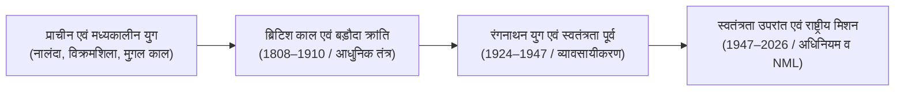
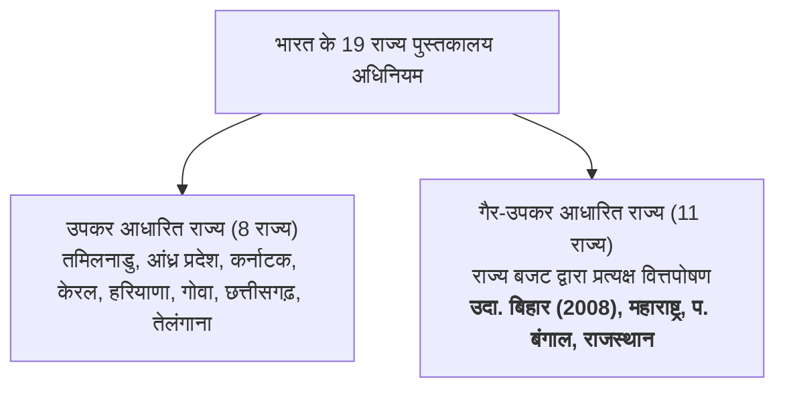

# इकाई 1 — पुस्तकालय की नींव एवं समाज

## उप-इकाई 1.3: भारत में पुस्तकालय आंदोलन, पुस्तकालय शिक्षा एवं पुस्तकालय अधिनियम

> **विस्तृत हिंदी अध्ययन सामग्री**  
> लक्ष्य: बिहार विद्यालय पुस्तकालयाध्यक्ष पात्रता परीक्षा 2026

---

### भाग 1: भारत में पुस्तकालय आंदोलन का ऐतिहासिक विकास

भारत में पुस्तकालयों की एक सुदीर्घ और गौरवशाली परंपरा रही है, जिसे प्राचीन काल से आधुनिक काल तक चार प्रमुख चरणों में विभाजित किया जा सकता है:

#### 1. प्राचीन एवं मध्यकालीन विरासत:
* **नालंदा विश्वविद्यालय पुस्तकालय (बिहार):** विश्वप्रसिद्ध बौद्ध विहार पुस्तकालय, जिसे सामूहिक रूप से **'धर्मगंज'** कहा जाता था। इसके अंतर्गत तीन विशाल बहुमंजिला भवन थे:
  1. **रत्नसागर:** 9 मंजिला मुख्य केंद्रीय भवन।
  2. **रत्नोदधि**
  3. **रत्नारंजक**  
  *(नोट: 1193 ई. में बख्तियार खिलजी के आक्रमण द्वारा इसे नष्ट कर दिया गया था।)*
* **अन्य प्राचीन केंद्र:** विक्रमशिला (भागलपुर, बिहार), ओदंतपुरी (बिहारशरीफ, बिहार) तथा तक्षशिला (वर्तमान पाकिस्तान)।
* **मध्यकाल:** मुग़ल सम्राटों (बाबर, हुमायूं, अकबर) का शाही पुस्तकालय (**शाही किताबखाना**)। हुमायूं की मृत्यु अपने ही शेर मंडल पुस्तकालय की सीढ़ियों से गिरकर हुई थी। अकबर ने पुस्तकालयों के प्रबंधन हेतु **'नाजिम'** (मुख्य लाइब्रेरियन) और **'मुहतमिम'** (सहायक / सूचीकरण प्रभारी) के पद सृजित किए थे।

#### 2. आधुनिक पुस्तकालय आंदोलन का उदय:
* **1808 (बॉम्बे सरकार का प्रस्ताव):** बॉम्बे प्रेसीडेंसी सरकार ने नए पंजीकृत पुस्तकालयों को पुस्तकें और वित्तीय अनुदान देने का प्रस्ताव पारित किया। यह भारत में पुस्तकालयों को राज्य सहायता का प्रथम प्रमाण है।
* **1836 (कलकत्ता पब्लिक लाइब्रेरी):** जनता द्वारा संचालित आधुनिक पुस्तकालय की स्थापना, जो 1903 में इम्पीरियल लाइब्रेरी और 1948 में भारतीय राष्ट्रीय पुस्तकालय बना।
* **1910 — बड़ौदा राज्य की पुस्तकालय क्रांति (The Baroda Epoch):**
  * भारत में आधुनिक सार्वजनिक पुस्तकालय आंदोलन का वास्तविक जनक **महाराजा सयाजीराव गायकवाड़ तृतीय** को माना जाता है।
  * उन्होंने 1910 में बड़ौदा रियासत में अनिवार्य प्राथमिक शिक्षा के साथ-साथ एक सुदृढ़ **मुक्त सार्वजनिक पुस्तकालय तंत्र** लागू किया।
  * उन्होंने अमेरिकी पुस्तकालय विशेषज्ञ **विलियम एलनसन बोर्डन (W.A. Borden)** को बड़ौदा का पुस्तकालय निदेशक नियुक्त किया।
  * **विशेष उपलब्धियां:** बड़ौदा केंद्रीय पुस्तकालय की स्थापना, शाखा पुस्तकालय, ग्राम पुस्तकालय, महिलाओं व बच्चों के लिए स्वतंत्र प्रभाग तथा भारत में पहली बार **चल पुस्तकालय (Travelling / Mobile Libraries)** की शुरुआत।
* **1914:** भारत के प्रथम राज्य पुस्तकालय संघ **'आंध्र देश ग्रंथालय संघ'** की स्थापना (अय्यांकी वेंकट रमणय्या द्वारा)।
* **1928:** डॉ. एस.आर. रंगनाथन द्वारा **मद्रास लाइब्रेरी एसोसिएशन (MALA)** की स्थापना।
* **1930 (मॉडल लाइब्रेरी एक्ट):** डॉ. रंगनाथन ने प्रथम अखिल एशियाई शैक्षणिक सम्मेलन (बनारस) में भारत के लिए प्रथम 'मॉडल सार्वजनिक पुस्तकालय विधेयक' प्रस्तुत किया।

#### 3. स्वतंत्रता उपरांत समितियां एवं राष्ट्रीय मिशन:
* **के.पी. सिन्हा समिति (परामर्शदात्री समिति, 1957):**
  * भारत सरकार द्वारा **के.पी. सिन्हा** की अध्यक्षता में गठित। इसने 1959 में अपनी ऐतिहासिक रिपोर्ट दी।
  * **सिफारिशें:** 25 वर्षों में देश में 4-स्तरीय सार्वजनिक पुस्तकालय संरचना (राष्ट्रीय, राज्य, जिला व ब्लॉक) का निर्माण, तथा प्रत्येक राज्य में संपत्ति कर पर 6 पैसे प्रति रुपया पुस्तकालय उपकर (Library Cess) लगाने का सुझाव।
* **राजा राममोहन राय लाइब्रेरी फाउंडेशन (RRRLF, 1972):**
  * संस्कृति मंत्रालय, भारत सरकार द्वारा मई 1972 में कोलकाता में स्थापित।
  * **उद्देश्य:** देश भर में सार्वजनिक पुस्तकालय आंदोलन को वित्तीय अनुदान (मैचिंग ग्रांट्स 50:50 तथा पूर्वोत्तर हेतु 90:10; नॉन-मैचिंग ग्रांट्स 100%) और तकनीकी सहायता प्रदान करना।
* **राष्ट्रीय पुस्तकालय एवं सूचना प्रणाली नीति (NAPLIS, 1986):**
  * प्रो. डी.पी. चट्टोपाध्याय की अध्यक्षता में भारत सरकार द्वारा राष्ट्रीय नीति का मसौदा तैयार किया गया।
* **राष्ट्रीय ज्ञान आयोग (NKC, 2005):**
  * सैम पित्रोदा की अध्यक्षता में गठित; पुस्तकालयों पर कार्यदल ने देश भर में पुस्तकालयों के आधुनिकीकरण और राष्ट्रीय मिशन की सिफारिश की।
* **राष्ट्रीय पुस्तकालय मिशन (NML, 2014):**
  * प्रणब मुखर्जी द्वारा 2014 में राष्ट्रपति भवन से शुरू; उच्च-स्तरीय पुस्तकालय नेटवर्किंग, जिला पुस्तकालयों के उन्नयन और डिजिटल कैटलॉगिंग हेतु समर्पित।

---

### भाग 2: भारत में पुस्तकालय शिक्षा का विकास

| वर्ष | स्थान / संस्था | प्रवर्तक / व्यक्तित्व | ऐतिहासिक महत्व |
| :---: | :--- | :--- | :--- |
| **1911** | केंद्रीय पुस्तकालय, बड़ौदा | **डब्ल्यू.ए. बोर्डन (W.A. Borden)** | भारत में पुस्तकालय प्रशिक्षण की **सर्वप्रथम कक्षा**। |
| **1915** | पंजाब विश्वविद्यालय, लाहौर | **आसा डॉन डिकिंसन (Asa Don Dickinson)** | भारत में किसी **विश्वविद्यालय द्वारा शुरू किया गया प्रथम प्रशिक्षण पाठ्यक्रम**। डिकिंसन ने 1916 में भारत की पहली पाठ्यपुस्तक *"Punjab Library Primer"* लिखी। |
| **1929** | मद्रास लाइब्रेरी एसोसिएशन (MALA) | डॉ. एस.आर. रंगनाथन | पुस्तकालय विज्ञान में सर्टिफिकेट कोर्स शुरू किया (जिसे 1931 में मद्रास विश्वविद्यालय ने पीजी डिप्लोमा में बदला)। |
| **1937** | आंध्र विश्वविद्यालय, विशाखापट्टनम | - | पुस्तकालय विज्ञान में पूर्णकालिक पीजी डिप्लोमा कोर्स शुरू किया। |
| **1942** | बनारस हिंदू विश्वविद्यालय (BHU) | - | डिप्लोमा इन लाइब्रेरी साइंस (Dip.Lib.Sc.) शुरू किया। |
| **1947** | दिल्ली विश्वविद्यालय (DU) | सर मॉरिस ग्वायर एवं डॉ. रंगनाथन | देश में प्रथम स्वतंत्र **पुस्तकालय विज्ञान विभाग** की स्थापना। |
| **1949** | दिल्ली विश्वविद्यालय | डॉ. एस.आर. रंगनाथन | भारत एवं राष्ट्रमंडल में प्रथम **मास्टर डिग्री (M.Lib.Sc.)** पाठ्यक्रम शुरू किया। |
| **1951** | दिल्ली विश्वविद्यालय | डॉ. एस.आर. रंगनाथन | भारत में प्रथम **Ph.D. कार्यक्रम** की शुरुआत। |
| **1957** | दिल्ली विश्वविद्यालय | डॉ. डी.बी. कृष्ण राव (शोधार्थी) | भारत की **प्रथम Ph.D. उपाधि** प्रदान की गई (गाइड: डॉ. रंगनाथन)। |
| **1962** | DRTC, बेंगलुरु | डॉ. एस.आर. रंगनाथन | प्रलेखन एवं सूचना विज्ञान में उच्च-स्तरीय विशेषज्ञता कोर्स। |
| **1963** | INSDOC (नई दिल्ली) | - | सूचना विज्ञान में एसोसिएटशिप (AIS) शुरू। |
| **1968** | अलीगढ़ मुस्लिम विश्वविद्यालय (AMU) | - | भारत में प्रथम बार **B.Lib.Sc.** (बैचलर डिग्री) कोर्स शुरू किया। |

---

### भाग 3: भारत में पुस्तकालय अधिनियम

सार्वजनिक पुस्तकालयों को स्थायी वित्तीय आधार, कानूनी अधिकार और प्रशासनिक संरक्षण देने हेतु पुस्तकालय कानून अनिवार्य है। भारत में अब तक **19 राज्यों** ने सार्वजनिक पुस्तकालय अधिनियम पारित किया है।

#### भारत के सभी 19 राज्यों के पुस्तकालय अधिनियमों की कालानुक्रमिक तालिका:

| क्र.सं. | राज्य का नाम | अधिनियम का वर्ष | पुस्तकालय उपकर की स्थिति | उपकर का आधार / वित्तीय स्वरूप |
| :---: | :--- | :---: | :---: | :--- |
| **1** | **तमिलनाडु (मद्रास)** | **1948** | **हाँ** | संपत्ति कर / गृह कर पर 31 पैसे प्रति रुपया (शुरू में 3 पैसे) |
| **2** | **आंध्र प्रदेश** | **1960** | **हाँ** | संपत्ति कर एवं गृह कर पर 8 पैसे प्रति रुपया |
| **3** | **कर्नाटक (मैसूर)** | **1965** | **हाँ** | संपत्ति, भूमि राजस्व, वाहनों एवं प्रवेश कर पर सर्वाधिक व्यापक उपकर |
| **4** | **महाराष्ट्र** | **1967** | **नहीं** | राज्य संचित निधि से प्रत्यक्ष बजटीय अनुदान (न्यूनतम ₹25 लाख) |
| **5** | **पश्चिम बंगाल** | **1979** | **नहीं** | राज्य सरकार द्वारा प्रत्यक्ष वित्तीय अनुदान |
| **6** | **मणिपुर** | **1988** | **नहीं** | राज्य बजट द्वारा वित्तपोषित |
| **7** | **हरियाणा** | **1989** | **हाँ** | संपत्ति कर और स्थानीय करों पर उपकर |
| **8** | **केरल** | **1989** | **हाँ** | भवन कर / संपत्ति कर पर उपकर |
| **9** | **गोवा** | **1993** | **हाँ** | भारत निर्मित विदेशी शराब (IMFL) पर सरचार्ज/उपकर |
| **10** | **मिजोरम** | **1993** | **नहीं** | राज्य सरकार द्वारा बजटीय आवंटन |
| **11** | **गुजरात** | **2001** | **नहीं** | राज्य संचित निधि द्वारा वित्तपोषण |
| **12** | **ओडिशा** | **2001** | **नहीं** | राज्य बजट आवंटन |
| **13** | **उत्तराखंड** | **2005** | **नहीं** | राज्य सरकार का वार्षिक अनुदान |
| **14** | **राजस्थान** | **2006** | **नहीं** | राज्य शिक्षा विभाग बजट |
| **15** | **उत्तर प्रदेश** | **2006** | **नहीं** | राज्य सरकार द्वारा वित्तपोषित |
| **16** | **बिहार** | **2008** | **नहीं** | **राज्य शिक्षा विभाग बजट (नो सेस / उपकर रहित मॉडल)** |
| **17** | **छत्तीसगढ़** | **2008** | **हाँ** | प्रवेश कर (Entry Tax) एवं टोल पर उपकर |
| **18** | **अरुणाचल प्रदेश** | **2009** | **नहीं** | राज्य संचित निधि |
| **19** | **तेलंगाना** | **2015** | **हाँ** | आंध्र प्रदेश अधिनियम 1960 को अंगीकृत किया; संपत्ति कर पर उपकर |

> [!TIP]
> **स्मृति सूत्र एवं मुख्य बिंदु:**
> * **उपकर लगाने वाले 8 राज्य:** तमिलनाडु, आंध्र प्रदेश, कर्नाटक, हरियाणा, केरल, गोवा, छत्तीसगढ़, तेलंगाना।
> * **नो-सेस वाले 11 राज्य:** महाराष्ट्र, पश्चिम बंगाल, मणिपुर, मिजोरम, गुजरात, ओडिशा, उत्तराखंड, राजस्थान, उत्तर प्रदेश, **बिहार**, अरुणाचल प्रदेश।
> * **प्रथम राज्य:** तमिलनाडु (मद्रास, 1948) — डॉ. रंगनाथन के व्यक्तिगत प्रयासों से पारित।
> * **नवीनतम राज्य:** तेलंगाना (2015)।

---

### भाग 4: बिहार सार्वजनिक पुस्तकालय अधिनियम, 2008 — विशेष परीक्षा संदर्भ

बिहार में पुस्तकालय व्यवस्था को कानूनी आधार प्रदान करने के लिए वर्ष 2008 में बिहार विधानमंडल द्वारा कानून पारित किया गया।

#### 1. अधिनियम का पूर्ण नाम एवं अधिसूचना:
* **नाम:** **बिहार राज्य सार्वजनिक पुस्तकालय एवं सूचना केंद्र अधिनियम, 2008**।
* **पारित होने का वर्ष:** **2008** (बिहार पुस्तकालय अधिनियम लागू करने वाला भारत का **16वां राज्य** बना)।

#### 2. नो-सेस मॉडल:
* बिहार अधिनियम की सबसे विशिष्ट विशेषता यह है कि इसमें जनता पर कोई **पुस्तकालय उपकर नहीं** लगाया गया है।
* इसका संपूर्ण वित्तीय भार **बिहार सरकार के शिक्षा विभाग** के वार्षिक बजटीय प्रावधानों द्वारा वहन किया जाता है।

#### 3. प्रशासनिक ढांचा:
1. **राज्य पुस्तकालय प्राधिकरण:**
   * अध्यक्ष: माननीय **शिक्षा मंत्री, बिहार सरकार**।
   * यह राज्य में पुस्तकालय नीति निर्धारण, विकास योजनाओं के अनुमोदन और बजट अनुशंसा की शीर्ष संस्था है।
2. **सार्वजनिक पुस्तकालय निदेशालय:**
   * राज्य के शिक्षा विभाग के अंतर्गत पुस्तकालयों के प्रशासनिक संचालन हेतु उत्तरदायी।
3. **जिला पुस्तकालय प्राधिकरण:**
   * प्रत्येक जिले में जिला पदाधिकारी (DM) / नामित अधिकारी की अध्यक्षता में जिला, अनुमंडल और प्रखंड स्तर के पुस्तकालयों का समन्वय।

#### 4. बिहार के प्रमुख केंद्रीय पुस्तकालय:
* **राज्य केंद्रीय पुस्तकालय:** श्रीमती राधिका सिन्हा इंस्टीट्यूट एवं सच्चिदानंद सिन्हा लाइब्रेरी, पटना (स्थापना: 1924, संस्थापक: डॉ. सच्चिदानंद सिन्हा)।
* **विरासत संस्थान:** खुदा बख्श ओरिएंटल पब्लिक लाइब्रेरी, पटना (स्थापना: 1891, संस्थापक: मौलवी खुदा बख्श; संसद के 1969 के अधिनियम द्वारा राष्ट्रीय महत्व का संस्थान घोषित)।

---

### भाग 5: परीक्षा हेतु मास्टर तुलनात्मक सारणी

| श्रेणी | ऐतिहासिक विवरण (भारत) | प्रमुख प्राधिकार / वर्ष |
| :--- | :--- | :--- |
| **प्रथम सार्वजनिक पुस्तकालय आंदोलन** | बड़ौदा रियासत प्रणाली | महाराजा सयाजीराव गायकवाड़ तृतीय (1910) |
| **प्रथम अमेरिकी विशेषज्ञ** | बड़ौदा राज्य पुस्तकालय निदेशक | डब्ल्यू.ए. बोर्डन (1910) |
| **विश्वविद्यालय में प्रथम पाठ्यक्रम** | पंजाब विश्वविद्यालय, लाहौर | आसा डॉन डिकिंसन (1915) |
| **प्रथम स्वतंत्र LIS विभाग** | दिल्ली विश्वविद्यालय | डॉ. एस.आर. रंगनाथन एवं सर मॉरिस ग्वायर (1947) |
| **प्रथम M.Lib.Sc. डिग्री** | दिल्ली विश्वविद्यालय | 1949 (राष्ट्रमंडल में प्रथम) |
| **प्रथम Ph.D. शोधार्थी** | डॉ. डी.बी. कृष्ण राव | दिल्ली विश्वविद्यालय (1957, निर्देशक: डॉ. रंगनाथन) |
| **प्रथम राज्य पुस्तकालय अधिनियम** | मद्रास / तमिलनाडु पुस्तकालय अधिनियम | 1948 (उपकर आधारित) |
| **बिहार पुस्तकालय अधिनियम** | बिहार सार्वजनिक पुस्तकालय एवं सूचना केंद्र अधिनियम | 2008 (16वां राज्य, नो-सेस मॉडल) |
| **शराब पर उपकर लगाने वाला राज्य** | गोवा सार्वजनिक पुस्तकालय अधिनियम | 1993 (IMFL पर अधिभार) |
| **सर्वाधिक व्यापक उपकर** | कर्नाटक सार्वजनिक पुस्तकालय अधिनियम | 1965 (संपत्ति, वाहन, भूमि राजस्व, प्रवेश कर) |

---

### भाग 6: परीक्षा के लिए उच्च-प्राथमिकता वन-लाइनर्स

1. **भारत में सार्वजनिक पुस्तकालय आंदोलन का जनक किसे कहा जाता है?** — **महाराजा सयाजीराव गायकवाड़ तृतीय** (बड़ौदा, 1910)।
2. **भारत में प्रथम चल पुस्तकालय (Mobile Library) की शुरुआत कहाँ हुई?** — **बड़ौदा राज्य** में (डब्ल्यू.ए. बोर्डन के निर्देशन में)।
3. **'Punjab Library Primer' (1916) पुस्तक के लेखक कौन थे?** — **आसा डॉन डिकिंसन**।
4. **भारत में किसी विश्वविद्यालय द्वारा LIS शिक्षा का पहला कोर्स कब शुरू हुआ?** — **1915 में, पंजाब विश्वविद्यालय (लाहौर)** में।
5. **प्रथम अखिल एशियाई शैक्षणिक सम्मेलन (बनारस, 1930) में मॉडल एक्ट किसने पेश किया?** — **डॉ. एस.आर. रंगनाथन** ने।
6. **के.पी. सिन्हा समिति (1957) किस विषय से संबंधित थी?** — **सार्वजनिक पुस्तकालयों की स्थिति व विकास हेतु परामर्शदात्री समिति** (रिपोर्ट: 1959)।
7. **राजा राममोहन राय लाइब्रेरी फाउंडेशन (RRRLF) की स्थापना कब और कहाँ हुई?** — मई **1972**, **कोलकाता** में।
8. **स्वतंत्र भारत का प्रथम सार्वजनिक पुस्तकालय अधिनियम किस राज्य में पारित हुआ?** — **मद्रास (तमिलनाडु) में, 1948**।
9. **बिहार राज्य सार्वजनिक पुस्तकालय एवं सूचना केंद्र अधिनियम किस वर्ष पारित हुआ?** — वर्ष **2008** में।
10. **पुस्तकालय अधिनियम पारित करने वाला बिहार भारत का कौन-सा राज्य है?** — **16वां राज्य**।
11. **क्या बिहार में पुस्तकालय उपकर (Library Cess) लगाया जाता है?** — **नहीं**, यह सीधे शिक्षा विभाग के बजट से वित्तपोषित है।
12. **भारत में शराब (IMFL) की बिक्री पर पुस्तकालय उपकर कौन-सा राज्य लगाता है?** — **गोवा (1993)**।
13. **भारत का 19वां (सबसे नवीनतम) राज्य कौन-सा है जहाँ पुस्तकालय अधिनियम लागू है?** — **तेलंगाना (2015)**।
14. **नालंदा विश्वविद्यालय के मुख्य 9-मंजिला पुस्तकालय भवन का क्या नाम था?** — **रत्नसागर**।
15. **राष्ट्रीय पुस्तकालय मिशन (NML) किस वर्ष शुरू हुआ?** — वर्ष **2014** में राष्ट्रपति प्रणब मुखर्जी द्वारा।
