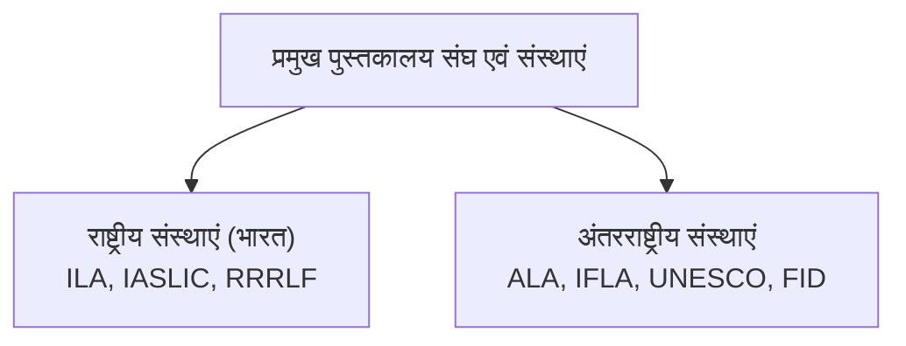

# इकाई 1 — पुस्तकालय की नींव एवं समाज

## उप-इकाई 1.4: राष्ट्रीय एवं अंतरराष्ट्रीय पुस्तकालय संघ

> **विस्तृत हिंदी अध्ययन सामग्री**  
> लक्ष्य: बिहार विद्यालय पुस्तकालयाध्यक्ष पात्रता परीक्षा 2026

---

### परिचय

पुस्तकालय संघ पुस्तकालय पेशेवरों के हितों की रक्षा, पुस्तकालय मानकों के निर्धारण, आचार संहिता के निर्माण, अनुसंधान एवं सतत व्यावसायिक विकास (Continuing Professional Development - CPD) के लिए रीढ़ की हड्डी के समान कार्य करते हैं।

---

### भाग 1: राष्ट्रीय पुस्तकालय संघ एवं संस्थाएं (भारत)

---

#### 1. भारतीय पुस्तकालय संघ (ILA - Indian Library Association)

* **स्थापना तिथि:** **13 सितंबर 1933**।
* **स्थापना स्थल:** प्रथम अखिल भारतीय पुस्तकालय सम्मेलन, एशियाटिक सोसाइटी हॉल, कलकत्ता।
* **पंजीकरण:** वर्ष 1935 में सोसाइटी पंजीकरण अधिनियम XXI (1860) के अंतर्गत पंजीकृत।
* **प्रथम पदाधिकारी:**
  * **प्रथम अध्यक्ष:** **डॉ. एम.ओ. थॉमस (Dr. M.O. Thomas)**।
  * **प्रथम सचिव:** **खान बहादुर के.एम. असदुल्लाह (K.M. Asadullah)** (इम्पीरियल लाइब्रेरी के तत्कालीन लाइब्रेरियन)।
* **मुख्यालय:** वर्तमान में **नई दिल्ली** (A-40-41, फ्लैट नं. 201, अंसल बिल्डिंग, डॉ. मुखर्जी नगर, दिल्ली - 110009)।  
  *(ऐतिहासिक विवरण: 1933 में कलकत्ता में स्थापित, 1946 में दिल्ली, 1953 में पुनः कलकत्ता और अंततः 1964 में स्थायी रूप से दिल्ली स्थानांतरित हुआ।)*
* **डॉ. एस.आर. रंगनाथन का योगदान (स्वर्ण युग 1944–1953):**  
  डॉ. रंगनाथन 1944 से 1953 तक ILA के अध्यक्ष रहे। इस दौरान उन्होंने ILA को अंतरराष्ट्रीय पहचान दिलाई और शोध पत्रिका *ABGILA* शुरू की।
* **प्रमुख प्रकाशन:**
  1. **ABGILA** (*Annals, Bulletin, and Granthalaya of the Indian Library Association*): 1949–1953 (संपादक: डॉ. एस.आर. रंगनाथन)।
  2. **JILA** (*Journal of Indian Library Association*): पूर्व नाम *ILA Bulletin* (1965 से त्रैमासिक प्रकाशित)।
  3. **ILA Newsletter**: मासिक समाचार पत्र।
* **राष्ट्रीय पुस्तकालय सप्ताह:**  
  ILA द्वारा वर्ष **1968** से प्रतिवर्ष **14 से 20 नवंबर** (पंडित जवाहरलाल नेहरू के जन्मदिवस 14 नवंबर से) संपूर्ण भारत में 'राष्ट्रीय पुस्तकालय सप्ताह' मनाया जाता है।
* **प्रमुख पुरस्कार:** पी.एन. कौला बेस्ट लाइब्रेरियन अवार्ड, डॉ. पी.एस.जी. कुमार लाइफटाइम अचीवमेंट अवार्ड, एस.एम. गांगुली अवार्ड।

---

#### 2. आईयास्लिक (IASLIC - Indian Association of Special Libraries & Information Centres)

* **स्थापना तिथि:** **3 सितंबर 1955**।
* **उपनाम:** इसे **"भारत का अस्लिब" (ASLIB of India)** कहा जाता है।
* **प्रथम पदाधिकारी:**
  * **प्रथम अध्यक्ष:** **डॉ. एस.एल. होरा (Dr. S.L. Hora)** (प्रख्यात जीवविज्ञानी)।
  * **प्रथम मानद महासचिव:** **जे. साहा (J. Saha)**।
* **मुख्यालय:** **कोलकाता** (P-291, CIT स्कीम नं. 6M, कांकुरगाछी, कोलकाता - 700054)।
* **उद्देश्य एवं कार्य:** भारत में विशेष पुस्तकालयों, वैज्ञानिक अनुसंधान प्रयोगशालाओं और प्रलेखन केंद्रों के मध्य समन्वय स्थापित करना, प्रलेख अनुवाद सेवा (Translation Service) और माइक्रोफिल्म/रिप्रोग्राफी सेवा प्रदान करना।
* **प्रमुख प्रकाशन:**
  1. **IASLIC Bulletin:** 1956 से त्रैमासिक प्रकाशित।
  2. **IASLIC Newsletter:** मासिक।
  3. **ILSA (Indian Library Science Abstracts):** **1967** से शुरू; यह भारत में पुस्तकालय एवं सूचना विज्ञान का एकमात्र राष्ट्रीय सारकरण (Abstracting) सामयिक पत्र है।
* **वार्षिक पुरस्कार:** IASLIC बेस्ट लाइब्रेरियन ऑफ द ईयर अवार्ड।

---

#### 3. राजा राममोहन राय लाइब्रेरी फाउंडेशन (RRRLF)

* **स्थापना:** **मई 1972** (संस्कृति मंत्रालय, भारत सरकार द्वारा राजा राममोहन राय की 200वीं जयंती के अवसर पर)।
* **मुख्यालय:** ब्लॉक-DD-34, सेक्टर-1, साल्ट लेक सिटी, **कोलकाता** - 700064।
* **स्थिति:** भारत में सार्वजनिक पुस्तकालयों के संवर्धन, विकास और आधुनिकीकरण हेतु शीर्ष स्वायत्त राष्ट्रीय संस्था।
* **सहायता योजनाएं:**
  1. **मैचिंग स्कीम्स (Matching Schemes):** केंद्र और राज्य के साझा वित्तीय अनुपात पर आधारित (सामान्य राज्यों हेतु 50:50, पूर्वोत्तर राज्यों हेतु 90:10)। इसके तहत पुस्तक क्रय, उपस्कर, कंप्यूटर और भवन निर्माण/विस्तार हेतु अनुदान मिलता है।
  2. **नॉन-मैचिंग स्कीम्स (Non-Matching Schemes):** 100% केंद्रीय अनुदान (पुस्तकालय सम्मेलनों, पुस्तक मेलों, बाल प्रभागों और मोबाइल लाइब्रेरी वैन हेतु)।
* **CIP (Cataloguing in Publication):** भारत में पुस्तकों के प्रकाशन-पूर्व सूचीकरण (CIP) की शुरुआत RRRLF के सहयोग से की गई।
* **प्रमुख प्रकाशन:** *Granthana: Indian Journal of Library Studies* (द्वि-वार्षिक), *RRRLF Newsletter*, *Directory of Indian Public Libraries*।

---

### भाग 2: अंतरराष्ट्रीय पुस्तकालय संघ एवं संस्थाएं

---

#### 1. अमेरिकन लाइब्रेरी एसोसिएशन (ALA - American Library Association)

* **स्थापना:** **6 अक्टूबर 1876** (फिलाडेल्फिया, यूएसए)।
* **ऐतिहासिक महत्व:** यह विश्व का **सबसे पुराना और सबसे बड़ा** पुस्तकालय संघ है।
* **संस्थापक:** **मेल्विल डेवी (Melvil Dewey)**, जस्टिन विंसर (Justin Winsor), चार्ल्स एम्मी कटर (C.A. Cutter)।
* **प्रथम पदाधिकारी:**  
  * **प्रथम अध्यक्ष:** **जस्टिन विंसर** (1876–1885)।  
  * **प्रथम सचिव:** **मेल्विल डेवी** (1876–1890)।
* **मुख्यालय:** **शिकागो, इलिनोइस, संयुक्त राज्य अमेरिका (Chicago, USA)**।
* **आदर्श वाक्य (Motto):**  
  *"The best reading, for the largest number, at the least cost"* — मेल्विल डेवी।
* **प्रमुख विभाग:**
  * **ACRL** (Association of College and Research Libraries): शैक्षणिक पुस्तकालयों का सबसे बड़ा प्रभाग।
  * **PLA** (Public Library Association): सार्वजनिक पुस्तकालय प्रभाग।
* **प्रमुख पुरस्कार:**
  * **न्यूबेरी मेडल (Newbery Medal, 1922):** बाल साहित्य का विश्व प्रसिद्ध पुरस्कार।
  * **कैल्डेकॉट मेडल (Caldecott Medal, 1938):** सचित्र बाल पुस्तकों हेतु।
  * **मेल्विल डेवी मेडल (Melvil Dewey Medal):** वर्गीकरण व प्रबंधन में उत्कृष्ट योगदान हेतु।
* **राष्ट्रीय पुस्तकालय सप्ताह (USA):** अमेरिका में 1958 से प्रतिवर्ष **अप्रैल** माह में मनाया जाता है।

---

#### 2. इफ़्ला (IFLA - International Federation of Library Associations and Institutions)

* **स्थापना:** **30 सितंबर 1927** (एडिनबर्ग, स्कॉटलैंड में लाइब्रेरी एसोसिएशन यूके की 50वीं वर्षगांठ के अवसर पर)।
* **प्रथम अध्यक्ष:** **इसाक कोलिजन (Isak Collijn)**, स्वीडन।
* **मुख्यालय:** **द हेग (The Hague), नीदरलैंड्स** (रॉयल लाइब्रेरी / नेशनल लाइब्रेरी ऑफ द नीदरलैंड्स परिसर में)।
* **वैश्विक भूमिका:** संपूर्ण विश्व में पुस्तकालय एवं सूचना पेशे की वैश्विक प्रतिनिधि संस्था (**Global Voice of Libraries**)।
* **IFLA के ऐतिहासिक मूल कार्यक्रम:**
  1. **UBC / UBCIM (Universal Bibliographic Control):** 1974 में शुरू; विश्व भर के राष्ट्रीय प्रकाशनों का सार्वभौमिक ग्रंथपरक नियंत्रण।
  2. **UAP (Universal Availability of Publications):** 1979 में शुरू; किसी भी पाठक को संसार की कोई भी प्रकाशित सामग्री सुलभ कराना।
  3. **PAC (Preservation and Conservation):** 1984 में शुरू; पुस्तकालय सामग्री का भौतिक संरक्षण।
* **मानकीकरण उपलब्धियां:**  
  * **ISBD** (International Standard Bibliographic Description) का विकास।  
  * **FRBR** (Functional Requirements for Bibliographic Records) एवं **LRM** (Library Reference Model) का प्रतिपादन।
* **यूनेस्को घोषणापत्र सहयोग:**  
  UNESCO Public Library Manifesto (1994 एवं 2022) तथा School Library Manifesto (1999) का निर्माण IFLA के सक्रिय सहयोग से हुआ।
* **वार्षिक वैश्विक सम्मेलन:** **WLIC** (World Library and Information Congress)।
* **प्रमुख प्रकाशन:** *IFLA Journal* (त्रैमासिक), *IFLA Publications Series*।

---

#### 3. यूनेस्को (UNESCO - United Nations Educational, Scientific and Cultural Organization)

* **स्थापना तिथि:** **16 नवंबर 1945** (लंदन); संविधान 4 नवंबर 1946 को प्रभावी हुआ।
* **मुख्यालय:** **पेरिस, फ्रांस (Paris, France)**।
* **पुस्तकालय क्षेत्र में प्रमुख ऐतिहासिक योगदान:**
  1. **सार्वजनिक पुस्तकालय घोषणापत्र (Public Library Manifesto):** 1949 (प्रथम), 1972, 1994, और 2022।
  2. **दिल्ली पब्लिक लाइब्रेरी (DPL, 1951):** भारत सरकार और यूनेस्को के संयुक्त सहयोग से दक्षिण एशिया में प्रथम मॉडल पब्लिक लाइब्रेरी के रूप में स्थापित।
  3. **UNISIST (1971):** विश्व विज्ञान सूचना प्रणाली (World Science Information Programme)।
  4. **PGI (1976):** जनरल इंफॉर्मेशन प्रोग्राम (*Programme Général d'Information*), जिसने UNISIST और NATIS (National Information Systems) को एक एकीकृत मंच दिया।
  5. **CDS/ISIS सॉफ्टवेयर (1985):** ग्रंथपरक डेटाबेस प्रबंधन हेतु यूनेस्को द्वारा विकसित विश्वप्रसिद्ध मेनफ्रेम/माइक्रो-कंप्यूटर सॉफ्टवेयर।
  6. **मेमोरी ऑफ द वर्ल्ड प्रोग्राम (Memory of the World, 1992):** विश्व की दुर्लभ पांडुलिपियों व प्रलेखों के संरक्षण का वैश्विक अभियान।
  7. **यूनेस्को बुक कूपन योजना (UNESCO Book Coupons):** विकासशील देशों को विदेशी मुद्रा विनिमय बाधाओं के बिना विदेशी पुस्तकें खरीदने हेतु कूपन प्रणाली।

---

#### 4. फ़िड (FID - International Federation for Information and Documentation)

* **स्थापना:** **12 सितंबर 1895**, ब्रुसेल्स (बेल्जियम)।
* **संस्थापक:** **पॉल ऑटलेट (Paul Otlet)** एवं **हेनरी ला फोंटेन (Henri La Fontaine)** (नोबेल शांति पुरस्कार विजेता 1913)।
* **नामकरण का विकास क्रम:**
  * 1895: **IIB** (Institut International de Bibliographie)
  * 1931: **IID** (Institut International de Documentation)
  * 1938: **FID** (Fédération Internationale de Documentation)
  * 1988: **FID** (International Federation for Information and Documentation)
  * **समापन:** वित्तीय संकट के कारण वर्ष **2002** में इसे औपचारिक रूप से समाप्त कर दिया गया।
* **महानतम योगदान:** **यूनिवर्सल डेसिमल वर्गीकरण (UDC)** का निर्माण (1905 में प्रथम संस्करण)।  
  *(नोट: पॉल ऑटलेट को 'प्रलेखन का जनक' / Father of Documentation कहा जाता है।)*

---

### भाग 3: मास्टर तुलनात्मक सारणी

| संस्था | स्थापना वर्ष | स्थापना स्थल | वर्तमान मुख्यालय | संस्थापक / प्रथम प्रमुख | सर्वाधिक प्रसिद्ध योगदान / प्रकाशन |
| :---: | :---: | :--- | :--- | :--- | :--- |
| **ALA** | **1876** | फिलाडेल्फिया, USA | **शिकागो, इलिनोइस, USA** | मेल्विल डेवी, जस्टिन विंसर | विश्व का सबसे पुराना व बड़ा संघ; Newbery Medal |
| **FID** | **1895** | ब्रुसेल्स, बेल्जियम | द हेग (2002 में समाप्त) | पॉल ऑटलेट, हेनरी ला फोंटेन | UDC का विकास; प्रलेखन (Documentation) की नींव |
| **IFLA** | **1927** | एडिनबर्ग, स्कॉटलैंड | **द हेग, नीदरलैंड्स** | इसाक कोलिजन (Isak Collijn) | वैश्विक आवाज़; ISBD, UBC, UAP; IFLA Journal |
| **ILA** | **1933** | कलकत्ता (एशियाटिक सोसाइटी) | **नई दिल्ली, भारत** | डॉ. एम.ओ. थॉमस, के.एम. असदुल्लाह | ABGILA, JILA; राष्ट्रीय पुस्तकालय सप्ताह (14–20 Nov) |
| **UNESCO**| **1945** | लंदन, यूके | **पेरिस, फ्रांस** | यूएन की विशिष्ट एजेंसी | DPL (1951), Public Library Manifesto, CDS/ISIS |
| **IASLIC**| **1955** | कोलकाता, भारत | **कोलकाता, भारत** | डॉ. एस.एल. होरा, जे. साहा | ILSA (Indian Library Science Abstracts), विशेष पुस्तकालय |
| **RRRLF** | **1972** | कोलकाता, भारत | **कोलकाता, भारत** | भारत सरकार (संस्कृति मंत्रालय) | सार्वजनिक पुस्तकालय वित्तपोषण; मैचिंग/नॉन-मैचिंग ग्रांट्स |

---

### भाग 4: परीक्षा के लिए उच्च-प्राथमिकता वन-लाइनर्स

1. **विश्व का सबसे पुराना और सबसे बड़ा पुस्तकालय संघ कौन-सा है?** — **ALA (अमेरिकन लाइब्रेरी एसोसिएशन, 1876)**।
2. **ALA का आदर्श वाक्य (Motto) क्या है?** — *"The best reading, for the largest number, at the least cost"* (मेल्विल डेवी)।
3. **IFLA का मुख्यालय कहाँ स्थित है?** — **द हेग (The Hague), नीदरलैंड्स** में।
4. **'यूनिवर्सल बिब्लियोग्राफिक कंट्रोल' (UBC) और 'UAP' कार्यक्रम किसने शुरू किए?** — **IFLA** ने।
5. **भारतीय पुस्तकालय संघ (ILA) की स्थापना कब हुई थी?** — **13 सितंबर 1933** को (कलकत्ता में)।
6. **ILA के प्रथम अध्यक्ष और प्रथम सचिव कौन थे?** — प्रथम अध्यक्ष: **डॉ. एम.ओ. थॉमस**; प्रथम सचिव: **खान बहादुर के.एम. असदुल्लाह**।
7. **ILA द्वारा प्रकाशित त्रैमासिक शोध पत्रिका 'ABGILA' के संपादक कौन थे?** — **डॉ. एस.आर. रंगनाथन** (1949–1953)।
8. **भारत में 'राष्ट्रीय पुस्तकालय सप्ताह' (National Library Week) कब और किसके द्वारा मनाया जाता है?** — प्रतिवर्ष **14 से 20 नवंबर**, **ILA** द्वारा (1968 से)।
9. **"भारत का अस्लिब" (ASLIB of India) किस संघ को कहा जाता है?** — **IASLIC (स्थापना: 3 सितंबर 1955, कोलकाता)**।
10. **'Indian Library Science Abstracts' (ILSA) का प्रकाशन कौन करता है?** — **IASLIC** (1967 से)।
11. **राजा राममोहन राय लाइब्रेरी फाउंडेशन (RRRLF) की स्थापना किस वर्ष हुई?** — **मई 1972** (मुख्यालय: कोलकाता)।
12. **भारत में सार्वजनिक पुस्तकालयों को मैचिंग एवं नॉन-मैचिंग वित्तीय सहायता कौन प्रदान करता है?** — **RRRLF**।
13. **दिल्ली पब्लिक लाइब्रेरी (DPL, 1951) किस संस्था के संयुक्त पायलट प्रोजेक्ट के रूप में स्थापित हुई थी?** — **UNESCO** और भारत सरकार।
14. **FID की स्थापना किसने की थी और इसका मूल नाम क्या था?** — **पॉल ऑटलेट एवं हेनरी ला फोंटेन (1895)**; मूल नाम: **IIB (Institut International de Bibliographie)**।
15. **ग्रंथपरक सॉफ्टवेयर 'CDS/ISIS' किसके द्वारा विकसित किया गया था?** — **UNESCO** द्वारा (1985 में)।
