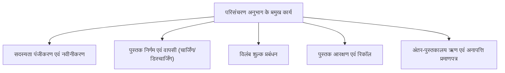
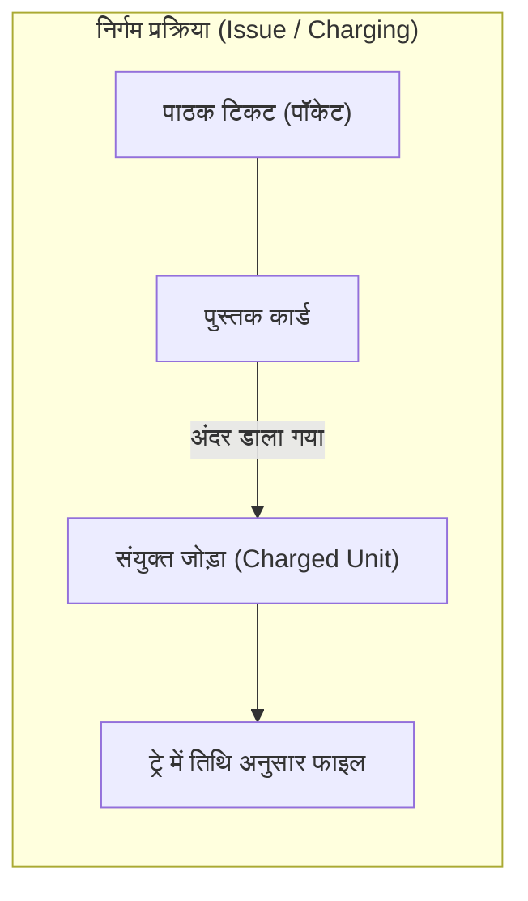

# इकाई 2 — पुस्तकालय प्रबंधन एवं संगठन

## उप-इकाई 2.2: परिसंचरण तंत्र — चार्जिंग एवं डिस्चार्जिंग की प्रमुख विधियां

> **विस्तृत हिंदी अध्ययन सामग्री**  
> लक्ष्य: बिहार विद्यालय पुस्तकालयाध्यक्ष पात्रता परीक्षा 2026

---

### भाग 1: परिसंचरण अनुभाग — कार्य एवं महत्व

परिसंचरण अनुभाग पुस्तकालय का वह मुख्य केंद्र बिंदु है जहाँ पाठक और पुस्तकालय कर्मचारियों का प्रत्यक्ष एवं निरंतर संपर्क होता है।

---

### भाग 2: पारंपरिक परिसंचरण पद्धतियां

1. **रजिस्टर / खाता बही प्रणाली (Day-Book / Ledger System):**  
   प्रारंभिक पुस्तकालयों में एक बड़े रजिस्टर में पृष्ठवार पाठकों का खाता होता था। पुस्तक जारी करने व लौटाने पर विस्तृत हस्तलिखित प्रविष्टि करनी पड़ती थी। यह अत्यंत धीमी थी और लंबी कतारों तथा त्रुटियों का कारण बनती थी।
2. **डमी प्रणाली (Dummy System):**  
   जब कोई पुस्तक जारी होती थी, तो शेल्फ में उस पुस्तक के स्थान पर लकड़ी या गत्ते का एक तख्ता (Dummy) रख दिया जाता था जिस पर पाठक का नाम लिखा होता था।

---

### भाग 3: ब्राउन परिसंचरण प्रणाली (1895)

* **आविष्कारक:** **नीना ई. ब्राउन (Nina E. Browne)**, बोस्टन एथेनियम (USA) की लाइब्रेरियन।
* **आविष्कार वर्ष:** **1895**।
* **मूल सिद्धांत:** **"पॉकेट के अंदर कार्ड" सिद्धांत**। इसमें लेनदेन के समय कोई प्रविष्टि हाथ से नहीं लिखनी पड़ती; यह विशुद्ध कार्ड-एक्सचेंज प्रणाली है।

#### प्रमुख चार घटक:
1. **पाठक टिकट / पॉकेट (Reader's Ticket):**  
   मजबूत कागज या कार्डबोर्ड की 3"×2" इंच की थैली (Envelope/Pocket), जिस पर पाठक का नाम, पता एवं सदस्य संख्या अंकित होती है। प्रत्येक सदस्य को जितनी पुस्तकें जारी करने की पात्रता होती है, उतनी पॉकेट मिलती हैं।
2. **पुस्तक कार्ड (Book Card):**  
   साइज 4"×2" इंच का कार्ड, जो पुस्तक के पिछले कवर पर लगी बुक पॉकेट में रखा रहता है। इस पर Call No., Accession No., Author, और Brief Title दर्ज होते हैं।
3. **पुस्तक जेब (Book Pocket):**  
   पुस्तक के पिछले कवर के भीतरी पृष्ठ पर चिपकाई गई कार्डबोर्ड की थैली।
4. **देय तिथि पर्ची (Date Slip):**  
   पुस्तक के अंतिम खाली पन्ने पर चिपकाई गई पर्ची, जिस पर वापसी की अंतिम तारीख (Due Date) की मुहर लगाई जाती है।

#### चार्जिंग एवं डिस्चार्जिंग प्रक्रिया:
* **चार्जिंग (Issue):**  
  पाठक पुस्तक और अपना टिकट देता है। पुस्तकालय कर्मी पुस्तक से **Book Card** निकालता है और उसे **Reader's Ticket (पॉकेट)** के अंदर डाल देता है। पुस्तक की Date Slip पर देय तिथि की मुहर लगाकर पुस्तक पाठक को दे दी जाती है। इस संयुक्त जोड़े को **चार्जिंग ट्रे** में देय तिथि के अंतर्गत कॉल नंबर क्रम में रख दिया जाता है।
* **डिस्चार्जिंग (Return):**  
  पुस्तक वापस आने पर Date Slip से तिथि देखकर चार्जिंग ट्रे से वह युग्म निकाला जाता है। Book Card को वापस पुस्तक की जेब में डाल दिया जाता है और Reader's Ticket पाठक को लौटा दिया जाता है।

#### गुण एवं दोष:
* **गुण:** अत्यंत तीव्र गति (No writing required); कतार नहीं लगती; नियत तिथि पर देय पुस्तकों की संख्या तुरंत पता चल जाती है।
* **दोष:** पाठक का कोई स्थायी पठन इतिहास नहीं रहता; यदि कार्ड ट्रे में गलत जगह फाइल हो जाए तो खोजना अत्यंत कठिन होता है।

---

### भाग 4: नेवार्क परिसंचरण प्रणाली (1900)

* **आविष्कारक:** **जॉन कॉटन डाना (John Cotton Dana)**, नेवार्क पब्लिक लाइब्रेरी (न्यू जर्सी, USA)।
* **आविष्कार वर्ष:** **1900**।
* **मूल सिद्धांत:** **स्थायी प्रविष्टि एवं तारीख मुहर सिद्धांत**।

#### प्रमुख घटक:
1. **उधारकर्ता कार्ड (Borrower's Card):**  
   पाठक के पास रहने वाला 5"×3" कार्ड, जिसमें तीन कॉलम होते हैं: देय तिथि, वापसी तिथि, और कर्मचारी के हस्ताक्षर।
2. **पुस्तक कार्ड (Book Card):**  
   पुस्तक में रहने वाला 5"×3" कार्ड, जिसमें Call No., Acc No., Author, Title के नीचे तीन कॉलम होते हैं: देय तिथि, पाठक संख्या (Borrower No.), और वापसी तिथि।
3. **पुस्तक जेब (Book Pocket) एवं तिथि पर्ची (Date Slip)**।
4. **दिनांक मुहर (Date Stamp Pad)**।

#### चार्जिंग एवं डिस्चार्जिंग प्रक्रिया:
* **चार्जिंग (Issue):**  
  कर्मचारी Date Slip, Borrower's Card और Book Card तीनों पर देय तिथि की मुहर लगाता है। साथ ही Book Card पर पाठक की सदस्य संख्या लिख दी जाती है। Borrower's Card पाठक को वापस दे दिया जाता है और Book Card ट्रे में रख लिया जाता है।
* **डिस्चार्जिंग (Return):**  
  वापसी पर Borrower's Card पर वापसी की मुहर लगाकर पाठक को दे दिया जाता है। बाद में ट्रे से Book Card निकालकर पुस्तक में लगा दिया जाता है।

#### गुण एवं दोष:
* **गुण:** **स्थायी पठन रिकॉर्ड** उपलब्ध रहता है। पुस्तक किस-किस ने पढ़ी और पाठक ने कौन-सी पुस्तकें पढ़ीं, दोनों का सांख्यिकीय रिकॉर्ड सुरक्षित रहता है।
* **दोष:** ब्राउन प्रणाली की तुलना में धीमी, क्योंकि इसमें मुहर लगाने और सदस्य संख्या लिखने में अतिरिक्त समय लगता है।

---

### भाग 5: अन्य प्रमुख परिसंचरण प्रणालियां

| प्रणाली का नाम | आविष्कारक / प्रवर्तक | वर्ष | कार्यप्रणाली का मुख्य आधार |
| :--- | :--- | :---: | :--- |
| **डिकमैन चार्जिंग (Dickman System)** | डिकमैन कंपनी | **1927** | **प्रथम यांत्रिक मशीन**; धातु की प्लेट से पाठक संख्या पुस्तक कार्ड पर मुद्रित होती थी। |
| **डेट्रायट सेल्फ-चार्जिंग (Detroit System)** | राल्फ उल्वेलिंग | **1929** | पाठक स्वयं बुक कार्ड पर अपनी संख्या लिखता है (कर्मचारी का समय बचाने हेतु)। |
| **गेलॉर्ड चार्जिंग (Gaylord System)** | गेलॉर्ड ब्रदर्स | **1932** | **प्रथम विद्युत-चालित चार्जिंग मशीन**। |
| **फोटो-चार्जिंग (Recordak)** | राल्फ शॉ | **1947** | माइक्रोफिल्म कैमरे द्वारा पाठक कार्ड, बुक कार्ड और तिथि पर्ची का एक साथ फोटो खींचना। |
| **आरएफआईडी (RFID Circulation System)** | आधुनिक डिजिटल मानक | 21वीं सदी | रेडियो तरंगों द्वारा स्वचालित स्कैनिंग; सेल्फ चेक-आउट कियोस्क एवं स्मार्ट बुक ड्रॉप। |

---

### भाग 6: ब्राउन बनाम नेवार्क — तुलनात्मक सारणी

| तुलना का आधार | ब्राउन प्रणाली (1895) | नेवार्क प्रणाली (1900) |
| :--- | :--- | :--- |
| **आविष्कारक** | **नीना ई. ब्राउन** | **जॉन कॉटन डाना** |
| **स्थान** | बोस्टन एथेनियम, USA | नेवार्क पब्लिक लाइब्रेरी, न्यू जर्सी, USA |
| **कार्ड का स्वरूप** | पाठक का टिकट पॉकेट रूप में (3"×2") | पाठक के पास कार्ड (5"×3") |
| **लेखन कार्य** | **शून्य (कोई लेखन नहीं)** | पुस्तक कार्ड पर पाठक संख्या लिखनी होती है |
| **गति** | अत्यंत तीव्र | अपेक्षाकृत धीमी |
| **स्थायी रिकॉर्ड** | स्थायी पठन इतिहास **नहीं मिलता** | स्थायी पठन इतिहास **उपलब्ध रहता है** |
| **दण्ड शुल्क गणना** | ट्रे में तिथि के अनुसार सुगम | सुगम एवं सटीक |

---

### भाग 7: परीक्षा के लिए उच्च-प्राथमिकता वन-लाइनर्स

1. **ब्राउन परिसंचरण प्रणाली का आविष्कार किसने किया?** — **नीना ई. ब्राउन ने 1895 में** (बोस्टन एथेनियम, USA)।
2. **नेवार्क परिसंचरण प्रणाली का आविष्कार किसने किया?** — **जॉन कॉटन डाना ने 1900 में** (नेवार्क पब्लिक लाइब्रेरी, USA)।
3. **ब्राउन प्रणाली में 'पाठक टिकट' का भौतिक स्वरूप कैसा होता है?** — **जेब / थैली (Pocket / Envelope) के रूप में (3"×2")**।
4. **किस प्रणाली में पुस्तक कार्ड को पाठक की टिकट (पॉकेट) के अंदर डालकर चार्ज किया जाता है?** — **ब्राउन प्रणाली** में।
5. **नेवार्क प्रणाली में उधारकर्ता कार्ड (Borrower's Card) किसके पास रहता है?** — **पाठक (Borrower) के पास**।
6. **किस चार्जिंग प्रणाली में स्थायी पठन रिकॉर्ड सुरक्षित रहता है?** — **नेवार्क प्रणाली** में।
7. **विश्व की पहली यांत्रिक पुस्तक निर्गम मशीन कौन-सी थी?** — **डिकमैन चार्जिंग सिस्टम (1927)**।
8. **प्रथम विद्युत-चालित चार्जिंग मशीन का क्या नाम था?** — **गेलॉर्ड चार्जिंग मशीन (1932)**।
9. **फोटो-चार्जिंग प्रणाली का आविष्कार 1947 में किसने किया था?** — **राल्फ शॉ (Ralph Shaw)** ने।
10. **डेट्रायट सेल्फ-चार्जिंग प्रणाली (1929) का मुख्य उद्देश्य क्या था?** — कर्मचारियों का समय बचाना (पाठक स्वयं विवरण भरता है)।
11. **पुस्तकालय में 'पुस्तक आरक्षण' (Reservation of Books / Recall) किस अनुभाग का दायित्व है?** — **परिसंचरण अनुभाग** का।
12. **पाठक द्वारा पुस्तक खो जाने पर देय 'अनापत्ति प्रमाणपत्र' कहाँ से जारी होता है?** — **परिसंचरण पटल (Circulation Counter)** से।
13. **RFID तकनीक में स्वयं पुस्तक जारी करने वाले उपकरण को क्या कहा जाता है?** — **सेल्फ चेक-आउट कियोस्क (Self Check-out Kiosk)**।
14. **पुस्तकालय बंद होने के बाद भी पुस्तकें वापस करने हेतु प्रयुक्त स्मार्ट बॉक्स क्या कहलाता है?** — **स्मार्ट बुक ड्रॉप बॉक्स (Book Drop Box / Smart Chute)**।
15. **ब्राउन और नेवार्क प्रणालियों का संबंध पुस्तकालय विज्ञान के किस सूत्र से सर्वाधिक है?** — **चतुर्थ सूत्र: पाठक का समय बचाएं (Save the time of the reader)**।
