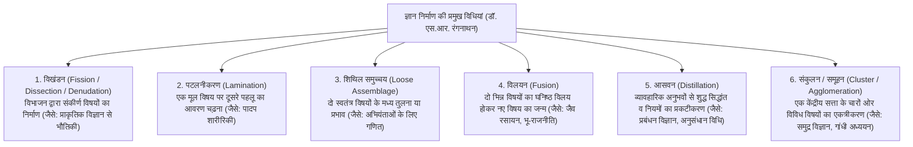
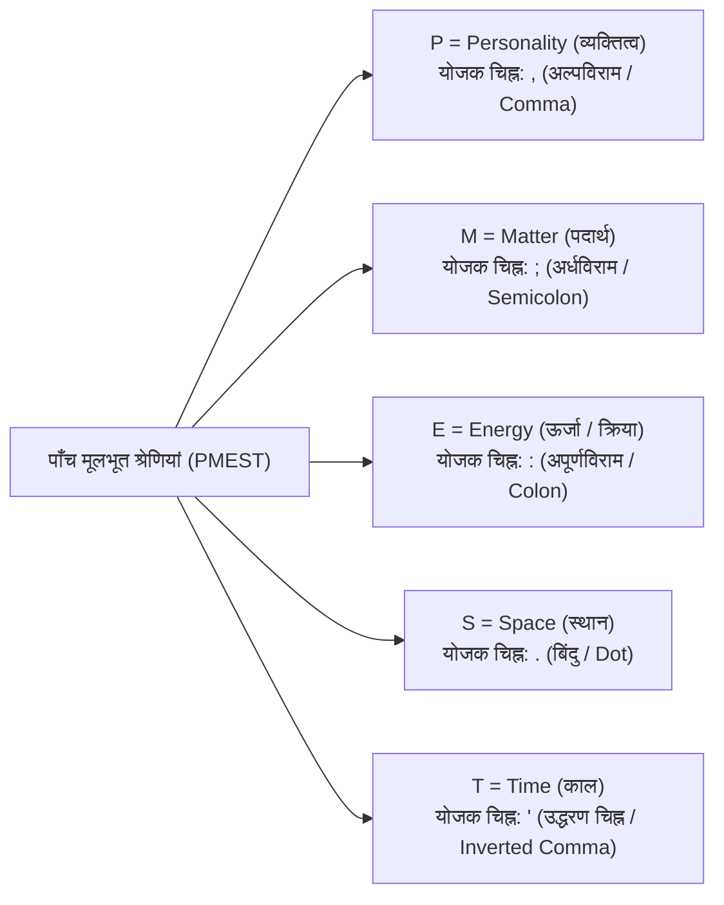

# इकाई 3 — ज्ञान संगठन: वर्गीकरण एवं सूचीकरण

## उप-इकाई 3.1: ज्ञान जगत एवं प्रमुख वर्गीकरण पद्धतियां (DDC, UDC, CC)
*(लक्ष्य: बिहार विद्यालय पुस्तकालयाध्यक्ष पात्रता परीक्षा 2026)*

> **विस्तृत हिंदी अध्ययन सामग्री (Hindi Edition)**  
> लक्ष्य: बिहार विद्यालय पुस्तकालयाध्यक्ष पात्रता परीक्षा 2026

---

### भाग 1: ज्ञान जगत एवं विषय निर्माण की विधियां

**पुस्तकालय वर्गीकरण की अवधारणा:**  
पुस्तकों एवं प्रलेखों को उनकी विषय-वस्तु की समानता और भिन्नता के आधार पर एक सहायक एवं तार्किक क्रम में व्यवस्थित करने की कला और विज्ञान को पुस्तकालय वर्गीकरण कहा जाता है।  
*डॉ. एस.आर. रंगनाथन के अनुसार: "पुस्तकालय वर्गीकरण किसी पुस्तक के विषय के नाम को क्रमसूचक अंकों (वर्गांक) की कृत्रिम भाषा में अनुवाद करने की प्रक्रिया है, ताकि पुस्तकों को सहायक अनुक्रम में व्यवस्थित किया जा सके तथा यांत्रिक पुनर्चक्रण संभव हो सके।"*

#### वर्गीकरण पद्धतियों के प्रमुख प्रकार:
1. **शुद्ध परिगणनात्मक पद्धति (Purely Enumerative Scheme):** जिसमें ज्ञान जगत के सभी पूर्व-निर्मित भूत, वर्तमान एवं संभावित विषयों की तैयार सूची दी होती है (जैसे: **LCC - लाइब्रेरी ऑफ कांग्रेस वर्गीकरण**, राइडर्स इंटरनेशनल वर्गीकरण)।
2. **लगभग परिगणनात्मक पद्धति (Almost Enumerative Scheme):** मुख्य रूप से परिगणनात्मक होती है, किंतु कुछ सहायक तालिकाओं (Tables) का समावेश होता है (जैसे: **DDC - डेवी दशमलव वर्गीकरण**)।
3. **लगभग पक्षात्मक पद्धति (Almost Faceted Scheme):** पक्षात्मकता की ओर अग्रसर, जिसमें सहायक अनुसूचियां एवं संबंधक चिह्न होते हैं (जैसे: **UDC - यूनिवर्सल डेसिमल वर्गीकरण**)।
4. **दृढ़ पक्षात्मक पद्धति (Rigidly Faceted Scheme):** पक्षों पर आधारित, किंतु पक्षों का क्रम एवं उपस्थिति पूर्व-निर्धारित व कठोर होती है (जैसे: **CC के प्रथम से तृतीय संस्करण**)।
5. **मुक्त पक्षात्मक / विश्लेषणात्मक-संश्लेषणात्मक पद्धति (Analytico-Synthetic / Freely Faceted Scheme):** जटिल विषयों को मूल तत्वों (पक्षों) में विश्लेषित कर योजक चिह्नों की सहायता से वर्गांक संश्लेषित किए जाते हैं (जैसे: **CC 4th से 6th संस्करण; 7वां संस्करण पूर्णतः मुक्त पक्षात्मक है**)।

---

### भाग 2: डेवी दशमलव वर्गीकरण (DDC)

* **आविष्कारक:** **मेल्विल डेवी (Melvil Dewey)** (1851–1931), एमहर्स्ट कॉलेज, मैसाचुसेट्स, संयुक्त राज्य अमेरिका।
* **प्रथम संस्करण:** वर्ष **1876** में अज्ञात (Anonymous) रूप से प्रकाशित (*"A Classification and Subject Index for Cataloguing and Arranging the Books and Pamphlets of a Library"*), जिसमें कुल **44 पृष्ठ** थे।
* **अद्यतन संस्करण:** **23वां संस्करण (2011)**, कुल **4 खंडों** में प्रकाशित (प्रधान संपादक: जोन एस. मिशेल - Joan S. Mitchell)।
* **डिजिटल स्वरूप:** **WebDewey** (इंटरनेट पर निरंतर अद्यतन होने वाला संस्करण)।
* **स्वामित्व एवं संपादन अधिकार:** वर्ष 1988 से **OCLC (Online Computer Library Center)** द्वारा स्वामित्व एवं निरंतर संपादन।

#### DDC की त्रि-स्तरीय संरचना (Three Summaries):
DDC केवल शुद्ध अंकन (Pure Notation - इंडो-अरेबिक अंक 0 से 9) का प्रयोग करती है। प्रथम तीन अंकों के पश्चात दशमलव (.) लगाया जाता है।

| मुख्य वर्ग (1st Summary - 10 मुख्य वर्ग) | विषय क्षेत्र |
| :---: | :--- |
| **000** | **कंप्यूटर विज्ञान, सूचना एवं सामान्य कार्य** |
| **100** | **दर्शनशास्त्र एवं मनोविज्ञान** |
| **200** | **धर्म** |
| **300** | **सामाजिक विज्ञान** |
| **400** | **भाषा विज्ञान** |
| **500** | **विशुद्ध विज्ञान (प्राकृतिक विज्ञान एवं गणित)** |
| **600** | **प्रौद्योगिकी एवं व्यावहारिक विज्ञान (चिकित्सा सहित)** |
| **700** | **कला एवं ललित कला** |
| **800** | **साहित्य एवं वाककला** |
| **900** | **इतिहास, भूगोल एवं जीवनी** |

#### DDC की सहायक तालिकाएं (Auxiliary Tables 1 to 6):
* **तालिका 1:** मानक उप-विभाजन (जैसे: -01 दर्शन व सिद्धांत, -03 शब्दकोश व विश्वकोश, -05 आवधिक पत्रिकाएं)।
* **तालिका 2:** भौगोलिक क्षेत्र, ऐतिहासिक काल, व्यक्ति।
* **तालिका 3:** विशिष्ट साहित्यों एवं साहित्यिक रूपों के उप-विभाजन (तालिका 3A, 3B, 3C)।
* **तालिका 4:** विशिष्ट भाषाओं एवं भाषा परिवारों के उप-विभाजन।
* **तालिका 5:** जातीय एवं राष्ट्रीय समूह।
* **तालिका 6:** भाषाएं।
*(विशेष तथ्य: 22वें संस्करण से तालिका 7 को समाप्त कर दिया गया है; 23वें संस्करण में कुल 6 तालिकाएं हैं।)*

#### फीनिक्स अनुसूची (Phoenix Schedules):
* DDC के **16वें संस्करण (1958)** से प्रारंभ।
* जब किसी पुराने विषय की संपूर्ण अनुसूची को पूरी तरह निरस्त करके नए सिरे से पुनर्गठित किया जाता है (जैसे पौराणिक अमर पक्षी फीनिक्स अपनी राख से पुनः जन्म लेता है)।

---

### भाग 3: यूनिवर्सल डेसिमल वर्गीकरण (UDC)

* **प्रवर्तक:** **पॉल ऑटलेट (Paul Otlet)** एवं **हेनरी ला फोंटेन (Henri La Fontaine - नोबेल शांति पुरस्कार विजेता 1913)**, ब्रुसेल्स, बेल्जियम।
* **विकास क्रम:** **1895** में इंटरनेशनल इंस्टीट्यूट ऑफ बिब्लियोग्राफी (IIB) के तहत प्रारंभ; **प्रथम संस्करण 1905** में फ्रेंच भाषा में प्रकाशित (*Manuel du Répertoire Bibliographique Universel*)।
* **आधार:** DDC के 5वें संस्करण (1894) का विस्तृत रूपांकन।
* **पद्धति का स्वरूप:** लगभग पक्षात्मक (Almost Faceted / Analytico-Synthetic)।
* **प्रबंधन:** वर्ष 1895 से 1992 तक **FID** द्वारा; 1 जनवरी 1992 से **UDC कंसोर्टियम (UDCC, द हेग, नीदरलैंड्स)** द्वारा संचालित।
* **अंकन:** **मिश्रित अंकन (Mixed Notation)** — अरेबिक अंकों के साथ गणितीय एवं विराम चिह्नों का सहायक प्रतीकों के रूप में प्रयोग:
  * **+ (धन):** संयोजन / समन्वय (जैसे: 54+66)
  * **/** (तिर्यक रेखा / ऑब्लिक): सतत विस्तार (जैसे: 592/599)
  * **:** (अपूर्णविराम / कोलन): साधारण संबंध (जैसे: 17:7)
  * **::** (दोहरा कोलन): अपरिवर्तनीय संबंध
  * **=** (बराबर): भाषा सहायक चिह्न (जैसे: =20 अंग्रेजी)
  * **(0...)** : प्रलेख प्रारूप सहायक (जैसे: (03) शब्दकोश)
  * **(...)** : स्थान सहायक चिह्न (जैसे: (540) भारत)
  * **"..."** : समय सहायक चिह्न (जैसे: "2026")
  * **-0...** : गुण एवं सामग्री सहायक

---

### भाग 4: कोलन वर्गीकरण (CC)

* **आविष्कारक:** **डॉ. एस.आर. रंगनाथन** (भारत में पुस्तकालय विज्ञान के जनक)।
* **प्रथम संस्करण:** वर्ष **1933** (मद्रास लाइब्रेरी एसोसिएशन द्वारा प्रकाशित)।
* **संस्करणों का ऐतिहासिक विकास:**
  1. **प्रथम संस्करण (1933):** कठोर पक्षात्मक; केवल कोलन (:) योजक चिह्न के रूप में प्रयुक्त।
  2. **द्वितीय संस्करण (1939):** दशा संबंध (Phase Relation) एवं अष्टक स्मृति सहायक का प्रादुर्भाव।
  3. **तृतीय संस्करण (1950):** पक्ष विश्लेषण का परिष्कृत रूप।
  4. **चतुर्थ संस्करण (1952):** पाँच मूलभूत श्रेणियों (**PMEST**) हेतु पृथक-पृथक योजक चिह्नों का प्रयोग।
  5. **पंचम संस्करण (1957):** विहित विभाजन एवं संशोधित अनुसूचियां।
  6. **षष्ठ संस्करण (1960) एवं षष्ठ संशोधित संस्करण (1963):** भारत के विश्वविद्यालयों एवं प्रतियोगी परीक्षाओं में प्रयुक्त मानक संस्करण।
  7. **सप्तम संस्करण (1987):** मरणोपरांत प्रकाशित (संपादक: डॉ. एम.ए. गोपीनाथ); मुक्त पक्षात्मक (Freely Faceted)।

#### मूलभूत श्रेणियां: PMEST एवं योजक चिह्न:
डॉ. रंगनाथन के अनुसार ज्ञान जगत के प्रत्येक विशिष्ट विषय को पाँच मूलभूत श्रेणियों में विश्लेषित किया जा सकता है:

> [!IMPORTANT]
> **Time [T] के योजक चिह्न का संशोधन:**  
> * छठे संस्करण (1960) तक Space [S] एवं Time [T] दोनों के लिए बिंदु (.) का प्रयोग होता था।  
> * **छठे संशोधित संस्करण (1963)** में डॉ. रंगनाथन ने Time [T] हेतु **एकल उद्धरण चिह्न (') Single Inverted Comma** का प्रयोग सुनिश्चित किया ताकि स्थान व समय में कोई भ्रम न रहे।

#### आवर्तन एवं स्तर (Rounds and Levels):
* **आवर्तन (Rounds):** Energy [E] श्रेणी किसी विषय में एक से अधिक बार आ सकती है ($2E, 3E$), और इसके उपरांत व्यक्तित्व व पदार्थ पुनः आ सकते हैं (जैसे: $[2P], [2M]$)। Space और Time केवल अंतिम आवर्तन में आते हैं।
* **स्तर (Levels):** एक ही आवर्तन के भीतर Personality और Matter कई स्तरों पर प्रकट हो सकते हैं (जैसे: $P_1, P_2, P_3$)।

#### सामान्य एकल (Common Isolates):
* **पूर्ववर्ती सामान्य एकल (ACI):** बिना किसी योजक चिह्न के सीधे मुख्य वर्ग से जुड़ते हैं (जैसे: $k$ शब्दकोश, $m$ पत्रिका, $v$ इतिहास)।
* **पश्चवर्ती सामान्य एकल (PCI):** योजक चिह्न के साथ जुड़ते हैं (ऊर्जा एवं स्थान सामान्य एकल)।

#### वर्गीकरण के तीन कार्य तल (Three Planes of Work):
1. **वैचारिक धरातल (Idea Plane):** अवधारणाओं एवं पक्षों का विश्लेषण (सर्वोच्च एवं निर्णायक तल)।
2. **शाब्दिक धरातल (Verbal Plane):** विचारों को स्पष्ट एवं मानकीकृत शब्दावली में व्यक्त करना।
3. **अंकन धरातल (Notational Plane):** शब्दों को क्रमसूचक अंकों व प्रतीकों में रूपांतरित करना।  
*(नोट: प्रोलेगोमेना में कुल 43 उपसूत्र - Canons, 5 मौलिक नियम, 13 पूर्वधारणाएं और 22 सिद्धांत प्रतिपादित हैं।)*

---

### भाग 5: मास्टर तुलनात्मक सारणी (DDC, UDC, CC)

| विशेषता | डेवी दशमलव वर्गीकरण (DDC) | यूनिवर्सल डेसिमल (UDC) | कोलन वर्गीकरण (CC) |
| :--- | :--- | :--- | :--- |
| **प्रणेता** | **मेल्विल डेवी (1876)** | **पॉल ऑटलेट व ला फोंटेन (1905)** | **डॉ. एस.आर. रंगनाथन (1933)** |
| **मूल देश** | संयुक्त राज्य अमेरिका | बेल्जियम (ब्रुसेल्स) | भारत (मद्रास) |
| **पद्धति का प्रकार** | लगभग परिगणनात्मक | लगभग पक्षात्मक | विश्लेषणात्मक-संश्लेषणात्मक |
| **अंकन स्वरूप** | **शुद्ध अंकन (इंडो-अरेबिक अंक)** | **मिश्रित अंकन (अंक + विशिष्ट चिह्न)** | **अत्यंत मिश्रित अंकन (A-Z, a-z, 0-9, चिह्न)** |
| **विभाजन का आधार** | दशमलव आधार 10 | दशमलव आधार 10 | PMEST (पाँच मूलभूत श्रेणियां) |
| **वर्तमान स्थिति** | 23वां सं. (2011), स्वामित्व: **OCLC** | संपादन: **UDC Consortium (द हेग)** | 6वां सं. (1963 rev.) सर्वाधिक प्रयुक्त |

---

### भाग 6: परीक्षा उपयोगी स्मरणीय तथ्य (15 उच्च-प्राथमिकता वन-लाइनर्स)

1. **DDC का प्रथम संस्करण किस वर्ष एवं कितने पृष्ठों में प्रकाशित हुआ था?** — **1876 में, कुल 44 पृष्ठों में**।
2. **DDC के 23वें संस्करण (2011) के प्रधान संपादक कौन थे?** — **जोन एस. मिशेल (Joan S. Mitchell)**।
3. **DDC पर वर्तमान में किसका स्वामित्व एवं संपादकीय अधिकार है?** — **OCLC (1988 से)**।
4. **DDC में मुख्य वर्ग '500' और '600' क्रमशः क्या दर्शाते हैं?** — **500 = विशुद्ध विज्ञान; 600 = प्रौद्योगिकी एवं व्यावहारिक विज्ञान**।
5. **DDC में 'फीनिक्स अनुसूची' (Phoenix Schedule) का प्रयोग किस संस्करण से शुरू हुआ?** — **16वें संस्करण (1958)** से।
6. **UDC का प्रथम संस्करण किस वर्ष और किस भाषा में प्रकाशित हुआ था?** — **1905 में, फ्रेंच भाषा में**।
7. **वर्तमान में UDC का प्रबंधन किसके द्वारा किया जाता है?** — **UDC कंसोर्टियम (UDCC, द हेग, नीदरलैंड्स)** द्वारा।
8. **UDC में 'स्थान' और 'समय' हेतु कौन-से सहायक चिह्न प्रयुक्त होते हैं?** — स्थान हेतु **कोष्ठक (...)**, समय हेतु **उद्धरण चिह्न "..."**।
9. **कोलन क्लासिफिकेशन (CC) का प्रथम संस्करण किस वर्ष प्रकाशित हुआ था?** — वर्ष **1933** में।
10. **CC में 'PMEST' के पाँचों योजक चिह्न क्या हैं?** — **P = , (अल्पविराम); M = ; (अर्धविराम); E = : (कोलन); S = . (डॉट); T = ' (उद्धरण चिह्न)**।
11. **CC के छठे संशोधित संस्करण (1963) में काल [T] का योजक चिह्न डॉट से बदलकर क्या किया गया?** — **Single Inverted Comma (')**।
12. **रंगनाथन के अनुसार वर्गीकरण कार्य के तीन धरातल कौन-से हैं?** — **वैचारिक धरातल, शाब्दिक धरातल, अंकन धरातल**।
13. **रंगनाथन ने प्रोलेगोमेना में वर्गीकरण के कुल कितने उपसूत्र प्रतिपादित किए हैं?** — **43 उपसूत्र (Canons)**।
14. **जैव रसायन (Biochemistry) और भू-राजनीति (Geopolitics) किस विषय निर्माण विधि के उदाहरण हैं?** — **विलयन (Fusion)** के।
15. **DDC के 23वें संस्करण में कुल कितनी सहायक तालिकाएं हैं?** — **6 तालिकाएं (Tables 1 to 6)**।
