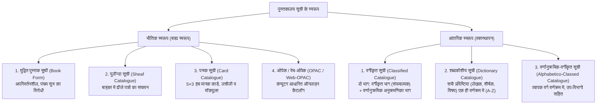
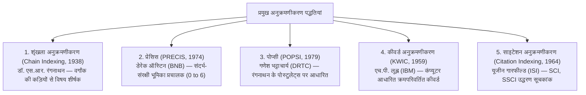

# इकाई 3 — ज्ञान संगठन: वर्गीकरण एवं सूचीकरण

## उप-इकाई 3.2: सूचीकरण, मानक संहिताएं एवं अनुक्रमणीकरण पद्धतियां
*(AACR-2, RDA, MARC-21, ISBD, Chain Indexing, PRECIS, POPSI, KWIC, साइटेशन अनुक्रमणीकरण)*

> **विस्तृत हिंदी अध्ययन सामग्री (Hindi Edition)**  
> लक्ष्य: बिहार विद्यालय पुस्तकालयाध्यक्ष पात्रता परीक्षा 2026

---

### भाग 1: पुस्तकालय सूची — अवधारणा एवं कटर के उद्देश्य

**पुस्तकालय सूची की परिभाषा:**  
पुस्तकालय में उपलब्ध संपूर्ण अध्ययन एवं पाठन सामग्री का एक सुव्यवस्थित, वैज्ञानिक एवं अद्यतन ग्रंथपरक रिकॉर्ड, जो पाठकों को सामग्री खोजने, पहचानने और उसका चयन करने में मार्गदर्शन प्रदान करता है।

#### सी.ए. कटर द्वारा प्रतिपादित सूची के तीन मौलिक उद्देश्य (1876):
चार्ल्स एम्मी कटर (Charles Ammi Cutter) ने अपनी ऐतिहासिक पुस्तक *"Rules for a Dictionary Catalog"* (1876) में पुस्तकालय सूची के निम्नलिखित तीन आधारभूत उद्देश्य निर्धारित किए:
1. **खोजना (To Find):** किसी पुस्तक को खोजना जब पाठक को उसका:
   - **लेखक (Author)** ज्ञात हो,
   - **आख्या / शीर्षक (Title)** ज्ञात हो, अथवा
   - **विषय (Subject)** ज्ञात हो।
2. **प्रदर्शित करना (To Show):** यह प्रदर्शित करना कि पुस्तकालय में:
   - किसी विशिष्ट लेखक की कौन-सी पुस्तकें हैं,
   - किसी विशिष्ट विषय पर कौन-सी पुस्तकें हैं, अथवा
   - किसी विशिष्ट साहित्य विधा की कौन-सी पुस्तकें उपलब्ध हैं।
3. **चयन में सहायता करना (To Assist in Choice):** पुस्तक के संस्करण (Edition) अथवा उसके स्वरूप/चरित्र के आधार पर पाठक को सही पुस्तक चुनने में सहायता करना।

---

### भाग 2: सूची के भौतिक एवं आंतरिक स्वरूप

---

### भाग 3: प्रमुख सूचीकरण संहिताएं (ऐतिहासिक विकास)

| वर्ष | सूचीकरण संहिता | प्रणेता / संस्था | मुख्य ऐतिहासिक उपलब्धि |
| :---: | :--- | :--- | :--- |
| **1841** | **पाणिज्जी के 91 नियम (Panizzi's 91 Rules)** | सर एंथोनी पाणिज्जी (ब्रिटिश म्यूजियम) | आधुनिक सूचीकरण संहिताओं की जननी (Mother of Codes)। |
| **1876** | **रूल्स फॉर ए डिक्शनरी कैटलॉग (RDC)** | चार्ल्स एम्मी कटर (C.A. Cutter) | शब्दकोशीय सूची के प्रथम पूर्ण नियम एवं स्पष्ट उद्देश्य। |
| **1908** | **एंग्लो-अमेरिकन कोड (AA Code)** | ALA (USA) एवं LA (UK) | प्रथम संयुक्त अंतरराष्ट्रीय द्विपक्षीय संहिता। |
| **1934** | **वर्गीकृत सूची संहिता (CCC - Classified Catalogue Code)** | **डॉ. एस.आर. रंगनाथन** | **भारत की प्रथम पूर्ण वैज्ञानिक वर्गीकृत संहिता** (5वां संस्करण 1964 में)। |
| **1961** | **पेरिस सिद्धांत (Paris Principles - ICCP)** | यूनेस्को / इफला (पेरिस सम्मेलन) | अंतरराष्ट्रीय सूचीकरण सिद्धांतों एवं शीर्षकों के चयन पर वैश्विक सहमति। |
| **1967** | **AACR-1** | संयुक्त संचालन समिति (JSC) | पेरिस सिद्धांतों पर आधारित प्रथम व्यापक संहिता। |
| **1978** | **AACR-2** | संपादक: माइकल गोरमैन व पॉल विंकलर | ISBD प्रारूप पर आधारित; 2 मुख्य भाग (विवरण व शीर्षक)। |
| **2010** | **RDA (Resource Description & Access)** | JSC / अंतरराष्ट्रीय कार्यदल | AACR-2 का आधुनिक डिजिटल उत्तराधिकारी (FRBR संकल्पना पर आधारित)। |

---

### भाग 4: मुख्य प्रविष्टि का तुलनात्मक ढांचा: CCC बनाम AACR-2

#### 1. रंगनाथन की वर्गीकृत सूची संहिता (CCC) की मुख्य प्रविष्टि के 6 अनुच्छेद:
1. **अग्र अनुच्छेद (Leading Section):** इसमें पुस्तक का **कॉल नंबर (Call Number)** प्रथम पंक्ति में केवल पेंसिल से लिखा जाता है।
2. **शीर्षक अनुच्छेद (Heading Section):** लेखक, संस्थागत निकाय अथवा ग्रंथ के मुख्य बौद्धिक दायित्व का नाम।
3. **आख्या अनुच्छेद (Title Section):** पुस्तक का शीर्षक, उप-शीर्षक, संस्करण विवरण और सहकर्मी (अनुवादक, संपादक, चित्रकार)।
4. **टिप्पणी अनुच्छेद (Note Section):** ग्रंथमाला (Series) विवरण व ग्रंथपरक संबंध।
5. **परिग्रहण संख्या (Accession Number):** मुख्य कार्ड के सबसे नीचे बाएं कोने में दर्ज।
6. **ट्रेसिंग (Tracing):** मुख्य कार्ड के **पृष्ठ भाग (Reverse Side)** पर बनाई जाती है, जो यह दर्शाती है कि इस मुख्य प्रविष्टि हेतु कौन-कौन सी सहायक प्रविष्टियां (Class Index, Book Index, Cross Reference Index Entries) तैयार की गई हैं।

#### 2. एंग्लो-अमेरिकन कैटलॉगिंग रूल्स (AACR-2):
* **संरचना:**
  * **भाग 1 (विवरण - अध्याय 1 से 13):** ISBD मानकों पर आधारित 8 क्षेत्र (सामान्य नियम, मुद्रित पुस्तकें, मानचित्र, पांडुलिपियां, इलेक्ट्रॉनिक संसाधन आदि)।
  * **भाग 2 (शीर्षक, एकरूप शीर्षक एवं संदर्भ - अध्याय 21 से 26):** अभिगम बिंदुओं के चयन और स्वरूप के नियम।
* **तीन का नियम (Rule of Three in AACR-2):**
  * यदि किसी पुस्तक के **3 तक लेखक** हैं, तो मुख्य प्रविष्टि प्रथम लेखक के नाम से बनेगी और शेष 2 लेखकों की सहायक प्रविष्टियां (Added Entries) बनेंगी।
  * यदि **3 से अधिक लेखक** (जैसे 4 या अधिक) हैं, तो मुख्य प्रविष्टि **आख्या / शीर्षक (Title)** के अंतर्गत बनेगी और केवल प्रथम लेखक का नाम लिखकर उसके आगे लोप चिह्न व संक्षिप्त रूप **[...et al.]** (या *and others*) लिख दिया जाता है।

---

### भाग 5: आरडीए एवं एफआरबीआर संकल्पनात्मक मॉडल

* **RDA (Resource Description and Access, 2010):**  
  डिजिटल युग में पारंपरिक मुद्रित सामग्री के साथ-साथ ई-संसाधनों (वेबसाइट, ई-बुक्स, डेटाबेस, मल्टीमीडिया) के विवरण हेतु विकसित अंतरराष्ट्रीय मानक।
* **FRBR मॉडल (Functional Requirements for Bibliographic Records, 1998 - IFLA):**  
  आरडीए पूरी तरह एफआरबीआर के **WEMI पदानुक्रम** पर आधारित है:
  1. **Work (कृति):** अमूर्त बौद्धिक या कलात्मक सृजन (जैसे: शेक्सपियर का नाटक *Macbeth*)।
  2. **Expression (अभिव्यक्ति):** कृति का विशिष्ट भाषाई या बौद्धिक प्रकटीकरण (जैसे: अंग्रेजी मूल पाठ, हिंदी अनुवाद, या ऑडियो रूपांतरण)।
  3. **Manifestation (प्रकाशन स्वरूप):** भौतिक या डिजिटल प्रकाशन रूप (जैसे: पेंगुइन बुक्स द्वारा 2020 में प्रकाशित पेपरबैक)।
  4. **Item (भौतिक प्रति):** किसी विशिष्ट पुस्तकालय की शेल्फ पर रखी बारकोड वाली एकल प्रति।

---

### भाग 6: मार्क-21 के अनिवार्य टैग (MARC-21 Bibliographic Tags)

मार्क-21 ग्रंथपरक आंकड़ों को कंप्यूटर द्वारा पढ़े जाने योग्य प्रारूप में संकलित करता है:

| MARC-21 टैग | क्षेत्र का नाम (Field Description) | संकेतक एवं उप-क्षेत्र (Subfields) |
| :---: | :--- | :--- |
| **020** | **अंतरराष्ट्रीय मानक पुस्तक संख्या (ISBN)** | `$a` ISBN संख्या, `$c` मूल्य |
| **022** | **अंतरराष्ट्रीय मानक सामयिकी संख्या (ISSN)** | `$a` ISSN संख्या |
| **082** | **डेवी दशमलव वर्गीकरण संख्या (DDC Call Number)** | `$a` वर्गांक संख्या, `$2` संस्करण संख्या |
| **100** | **मुख्य प्रविष्टि — व्यक्तिगत लेखक (Author)** | `$a` लेखक का नाम, `$d` जन्म-मृत्यु वर्ष |
| **110** | **मुख्य प्रविष्टि — संस्थागत निकाय (Corporate Name)** | `$a` संस्था का नाम |
| **245** | **शीर्षक एवं दायित्व कथन (Title & Statement of Responsibility)** | `$a` शीर्षक, `$b` उप-शीर्षक, `$c` लेखक/सहकर्मी कथन |
| **250** | **संस्करण विवरण (Edition Statement)** | `$a` संस्करण (जैसे: 2nd rev. ed.) |
| **260 / 264** | **प्रकाशन एवं वितरण विवरण (Imprint)** | `$a` स्थान, `$b` प्रकाशक का नाम, `$c` प्रकाशन वर्ष |
| **300** | **भौतिक विवरण (Physical Description)** | `$a` पृष्ठ संख्या, `$b` चित्र, `$c` आकार (सेमी) |
| **490 / 440** | **ग्रंथमाला विवरण (Series Statement)** | `$a` ग्रंथमाला का नाम, `$v` खंड संख्या |
| **500** | **सामान्य टिप्पणी (General Note)** | `$a` टिप्पणी विवरण |
| **650** | **विषय सहायक प्रविष्टि (Subject Added Entry — Topical Term)**| `$a` विषय शीर्षक / शब्दावली |
| **700** | **सहायक प्रविष्टि — व्यक्तिगत सह-लेखक (Joint Author / Editor)** | `$a` सह-लेखक, संपादक, अनुवादक का नाम |

---

### भाग 7: प्रमुख विषय अनुक्रमणीकरण पद्धतियां

#### 1. शृंखला अनुक्रमणीकरण (Chain Indexing / Chain Procedure):
* **प्रणेता:** **डॉ. एस.आर. रंगनाथन (1938)**, पुस्तक: *"Theory of Library Catalogue"*।
* **पद्धति:** किसी प्रलेख के वर्गांक (Class Number) की शृंखला का विश्लेषण कर वर्णानुक्रमिक विषय प्रविष्टियां (Subject Headings) यांत्रिक रूप से तैयार की जाती हैं।
* **चार प्रकार की कड़ियां (Four Links):**
  1. **मिथ्या कड़ी (False Link):** योजक चिह्न या अधूरी संख्या जो किसी स्वतंत्र विषय को नहीं दर्शाती।
  2. **अवांछित कड़ी (Unsought Link):** वह व्यापक श्रेणी जिसकी पाठक सामान्यतः मांग नहीं करते।
  3. **वांछित कड़ी (Sought Link):** वास्तविक विषय जिसका पाठक द्वारा खोजा जाना अपेक्षित है (यह वर्णानुक्रमिक विषय प्रविष्टि बनती है)।
  4. **लुप्त कड़ी (Missing Link):** वह श्रेणी जो वर्गीकरण अनुसूची में छूट गई हो।

#### 2. प्रेसिस (PRECIS - Preserved Context Indexing System):
* **प्रणेता:** **डेरेक ऑस्टिन (Derek Austin, 1974)** ब्रिटिश नेशनल बिब्लियोग्राफी (BNB) हेतु।
* **विशेषता:** संदर्भ को अक्षुण्ण रखते हुए दो-पंक्ति तीन-भाग प्रविष्टि संरचना:
  * **Lead (अग्र भाग)** | **Qualifier (विभाजक)**
  * **Display (प्रदर्शक)**
* इसमें व्याकरणिक संबंध स्थापित करने हेतु **भूमिका प्रचालकों (Role Operators 0 से 6)** का उपयोग होता है।

#### 3. पोप्सी (POPSI - Postulate-based Permuted Subject Indexing):
* **प्रणेता:** **गणेश भट्टाचार्य (Ganesh Bhattacharyya, 1979)**, DRTC बेंगलुरु।
* यह डॉ. रंगनाथन के आधारभूत सिद्धांतों (Postulates) और मूल श्रेणियों (Discipline, Entity, Action, Property) पर आधारित क्रमपरिवर्तित विषय अनुक्रमणीकरण है।

#### 4. कीवर्ड अनुक्रमणीकरण (KWIC - Keyword in Context):
* **प्रणेता:** **हंस पीटर लूह्न (H.P. Luhn, 1959)**, IBM वैज्ञानिक।
* यह शीर्षक के महत्वपूर्ण शब्दों (Keywords) को कंप्यूटर द्वारा स्वतः केंद्र में लाकर वर्णानुक्रम में सजाता है।

#### 5. साइटेशन अनुक्रमणीकरण (Citation Indexing):
* **प्रणेता:** **यूजीन गारफील्ड (Eugene Garfield, 1964)**, इंस्टीट्यूट फॉर साइंटिफिक इंफॉर्मेशन (ISI, फिलाडेल्फिया)।
* इसके तहत *Science Citation Index* (SCI, 1964), *Social Sciences Citation Index* (SSCI, 1973) का विकास हुआ, जो उद्धरणों के माध्यम से शोध प्रभाव का मापन करता है।

---

### भाग 8: परीक्षा उपयोगी स्मरणीय तथ्य (15 उच्च-प्राथमिकता वन-लाइनर्स)

1. **सूचीकरण संहिताओं की जननी (Mother of Cataloguing Codes) किसे कहा जाता है?** — **पाणिज्जी के 91 नियम (Panizzi's 91 Rules, 1841)**।
2. **'Rules for a Dictionary Catalog' (1876) पुस्तक के लेखक कौन हैं?** — **चार्ल्स एम्मी कटर (C.A. Cutter)**।
3. **डॉ. रंगनाथन द्वारा रचित 'Classified Catalogue Code' (CCC) का प्रथम संस्करण कब आया?** — वर्ष **1934** में।
4. **CCC की मुख्य प्रविष्टि में कॉल नंबर (Call Number) किस सेक्शन में लिखा जाता है?** — **अग्र अनुच्छेद (Leading Section) में, पेंसिल से**।
5. **AACR-2 (1978) के प्रधान संपादक कौन थे?** — **माइकल गोरमैन एवं पॉल विंकलर**।
6. **AACR-2 के अनुसार यदि 3 से अधिक लेखक हों तो मुख्य प्रविष्टि किसके तहत बनती है?** — **आख्या / शीर्षक (Title)** के तहत।
7. **RDA (Resource Description and Access, 2010) किसका आधुनिक उत्तराधिकारी है?** — **AACR-2 का**।
8. **FRBR मॉडल के 'WEMI' का पूर्ण रूप क्या है?** — **Work, Expression, Manifestation, Item**।
9. **MARC-21 में टैग '245' और '100' क्रमशः क्या दर्शाते हैं?** — **245 = शीर्षक एवं दायित्व कथन; 100 = मुख्य प्रविष्टि व्यक्तिगत लेखक**।
10. **MARC-21 में ISBN किस टैग में दर्ज होता है?** — **टैग 020 में** (ISSN टैग 022 में)।
11. **शृंखला अनुक्रमणीकरण (Chain Indexing) का आविष्कार किसने और कब किया था?** — **डॉ. एस.आर. रंगनाथन ने 1938 में** (*Theory of Library Catalogue* में)।
12. **प्रेसिस (PRECIS) अनुक्रमणीकरण पद्धति का विकास किसने किया था?** — **डेरेक ऑस्टिन (Derek Austin) ने 1974 में** (BNB हेतु)।
13. **पोप्सी (POPSI) अनुक्रमणीकरण पद्धति के जनक कौन हैं?** — **गणेश भट्टाचार्य (1979, DRTC बेंगलुरु)**।
14. **KWIC (Keyword in Context) अनुक्रमणीकरण के आविष्कारक कौन हैं?** — **एच.पी. लूह्न (H.P. Luhn, 1959, IBM)**।
15. **साइंस साइटेशन इंडेक्स (SCI) और साइटेशन अनुक्रमणीकरण के जनक कौन हैं?** — **यूजीन गारफील्ड (Eugene Garfield, 1964)**।
